# 开发记录：分层搭建与「批评—改进」

所有截图都是在无头 Chromium + SwiftShader（软件 WebGL2）中实际运行页面得到的。桌面视口多为 1280×720、1440×900（部分用 2× DPR），手机视口为 390×844（DPR 2–3）。图在 `docs/shots/`。

## 阶段 1：构图与光照基调

| 第一帧 | 阶段末 | 手机 |
|---|---|---|
| 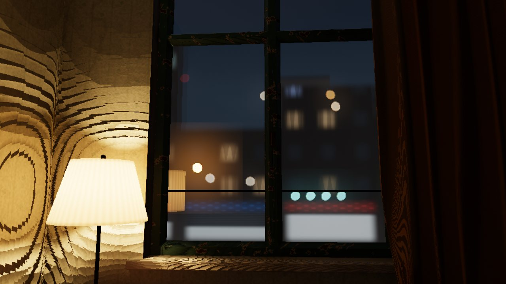 | 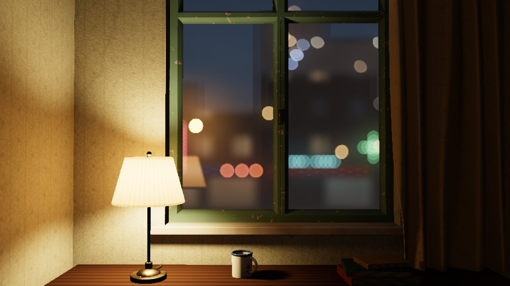 | 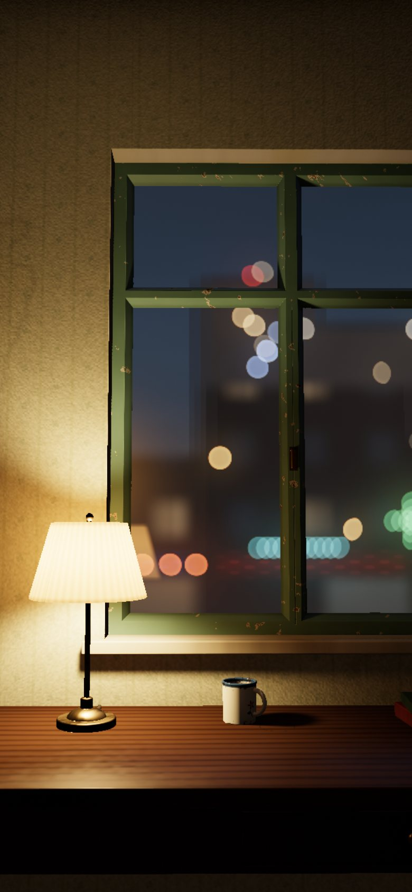 |

**自评与修改：**

- **墙上大片阶梯状色带。** 前后排查了两个原因：
  1. 包围体返回的是距离下界，被半影估计当成了「擦边遮挡」。修法：包围体距离只用于加速步进，不参与半影。
  2. 每条阴影射线都终止在紧贴灯座的灯泡上，半影公式对「贴着光源的遮挡物」失效。修法：灯体不参与阴影。
- **窗外地平线一条亮线。** 视线接近水平时地面交点趋于无穷，产生 Inf/NaN。加了保护。
- **构图看不到书桌，台灯像落地灯。** 重新取景，缩小灯罩。
- **其他：**
  - 灯罩过曝发白。
  - 灯罩边缘的光斑太硬：按灯泡角半径算出半影约 0.2 rad，据此加宽。
  - 窗帘一大片死黑。
  - 天空太暗，不像傍晚。
  - bokeh 像贴纸、数量太少：加了远处楼群的灯火（顶点着色器里做遮挡测试），霓虹改成多个精灵叠成的灯管。
  - 商铺像灰色方块。
- **玻璃里看不到台灯的倒影。** 台灯挪近窗户后，倒影出现在左扇玻璃里。

## 阶段 2：雨滴系统

| 第一次：雨滴全黑（bug） | 修复后 | 近看：雨滴里的倒置街景 |
|---|---|---|
| 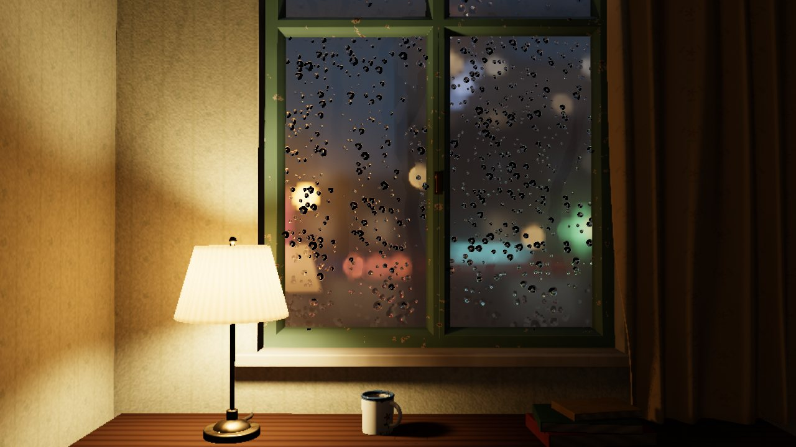 | 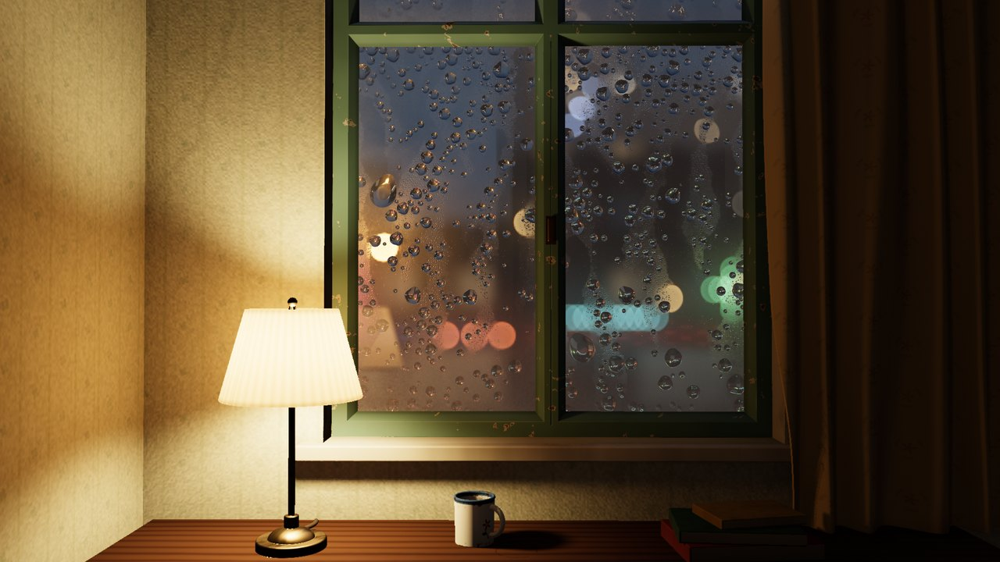 | 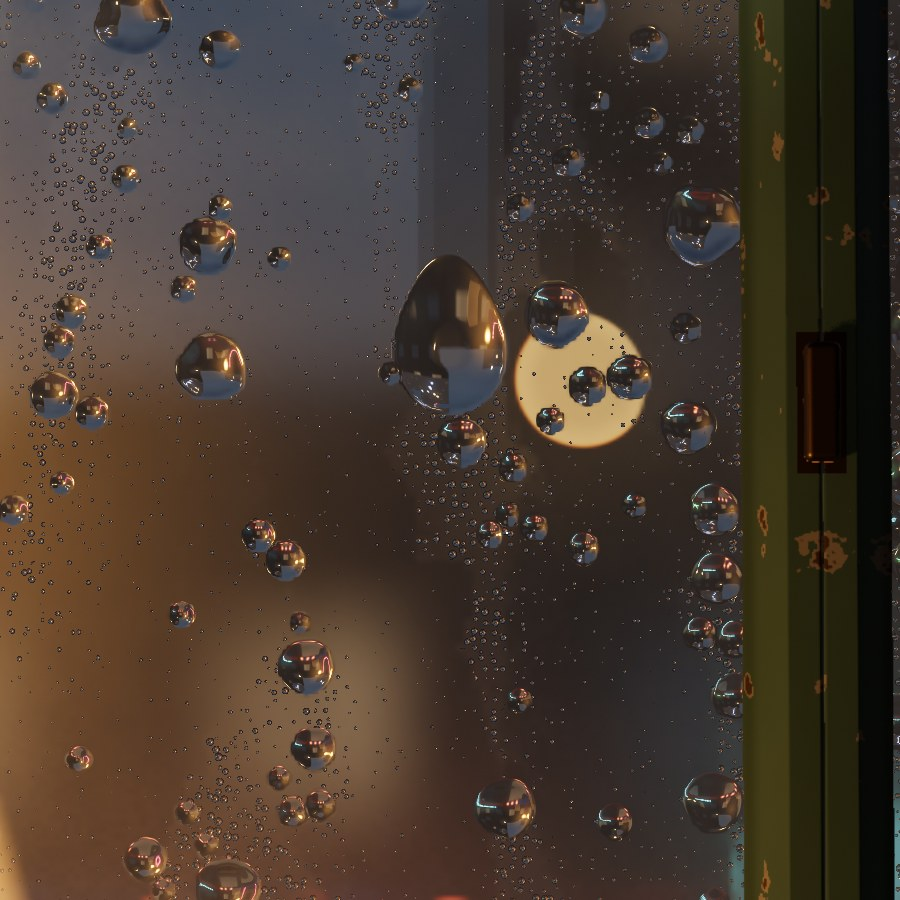 |

**自评与修改：**

- **雨滴是黑色斑点。** 逐项输出调试通道后定位：全反射被「困住」的射线方向被置为 −0.0 分量的零向量，室内追踪里 `x / −0.0 = −Inf`，最后 `0·Inf = NaN`，而 NaN×0 仍是 NaN。修法：方向安全化，被困光线改为取房间平均亮度（真实情况下这些光多次反射后会从别处出射，而不是变黑）。
- **雨滴像金属珠。** 原因有两个：傍晚的天空太暗，水滴下半部分（看向天空）没有亮的东西；接触角偏大，折射过强。修法：天空调亮到「傍晚」；接触角取 32–52°，这是风化窗玻璃上常见的范围。
- **覆盖率只有 18%，几乎没有滑落和水痕。** 用模拟统计（覆盖率、半径分位数、滑动数）定位到两个原因：
  1. 钉扎滞后范围太窄，大滴形成不了。
  2. 合并后长大的水滴下一步不再检查邻居，级联合并丢失。
- **大滴仍像水晶球。** 加了 Bond 数大于 1 时的重力压扁。
- **滑落太快、太焦躁。** 原来 3 mm 的水滴约 1.5 s 就滑过一格窗；提高接触线耗散后，速度落在真实的 1–5 cm/s。
- **擦拭效应不明显。** 雾珠层的模糊和纱幕不够，加强后，水痕才像清晰的通道。

## 阶段 3：后期与交互

| 擦拭冷凝雾 | 关灯 | 手机 UI |
|---|---|---|
| 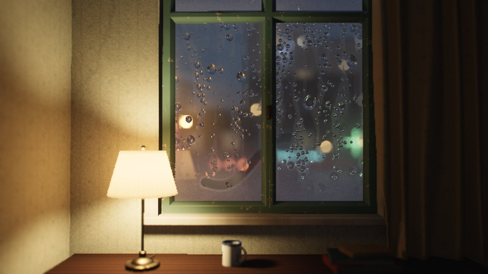 | 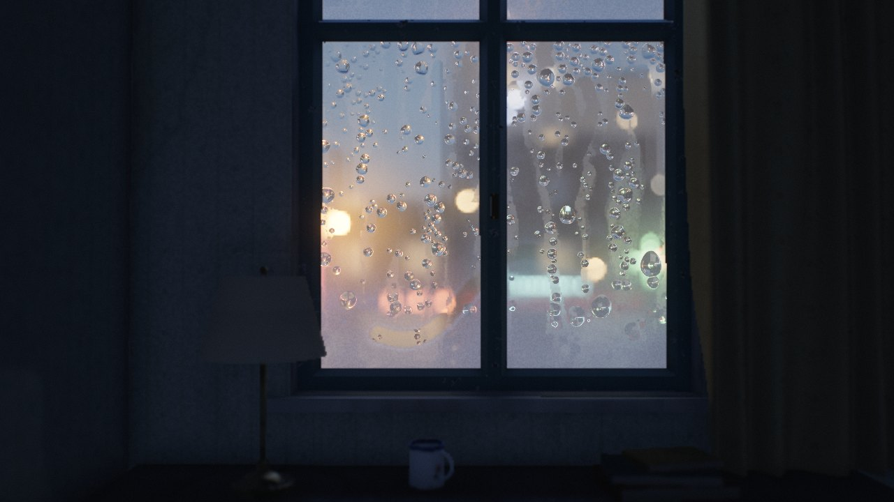 | 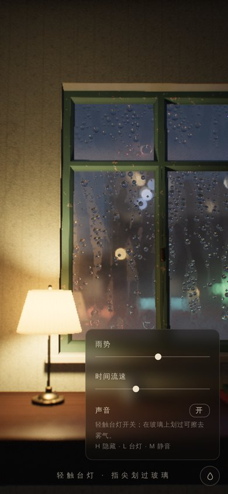 |

**自评与修改：**

- **调色过度。** 黑位提得太高加上去饱和，画面像褪色过头的照片，琥珀色丢了。收回一半。
- **景深太虚。** 光圈过大，杯子和台灯虚到「经不起近看」。光圈 34→30 mm，同时提高室内分辨率。
- **擦拭测试「没反应」。** 测试笔画起点落在台灯过宽的拾取圆柱里，被当成了台灯手势。拾取改为按灯罩、灯杆、底座的真实轮廓。
- **擦掉雾也看不出区别。** 冷凝雾的纱幕和背景一样亮。改成被室内灯照亮的乳白色，并让它模糊透过它看到的一切。
- **关灯后房间一片死黑。** 加深眼睛适应，并增加窗外冷光的环境项。

## 阶段 4：声音

在页面里给 AudioContext 接一个分析器，测得 RMS 约 −30 dBFS、峰值 < 0.13，四个频段都有能量，没有削波。另外确认了音频会在后台挂起、在静音和雨势变化时正确响应。音色本身未能试听。

## 批评—改进 第 1 轮

| 改前 | 改后 | 关灯 | 近看（2×） |
|---|---|---|---|
| 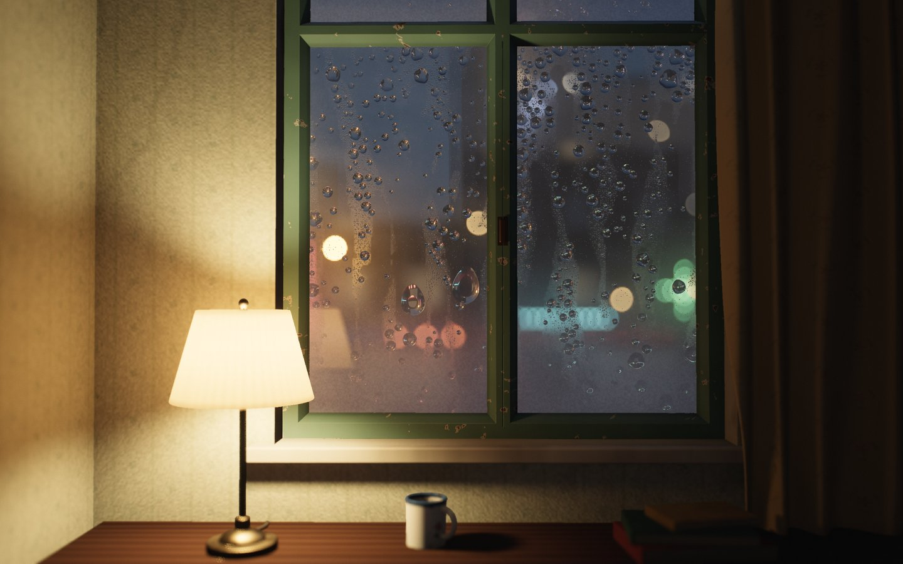 |  | 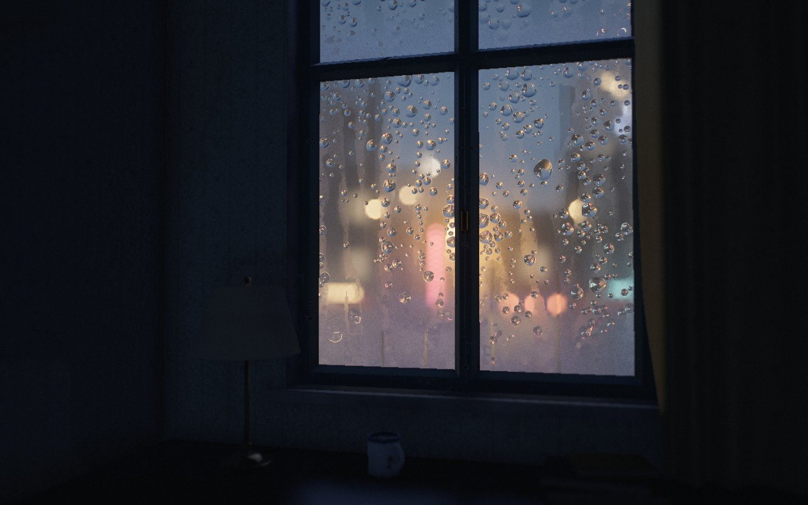 | 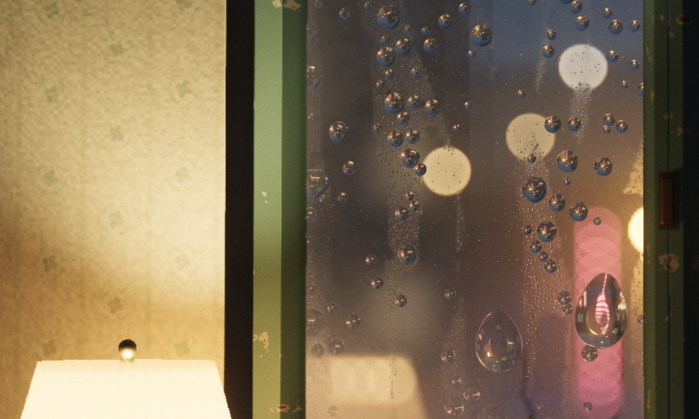 |

**看起来假或廉价的地方，以及处理：**

- **正对窗户，像一个舞台布景。** 改为轻微的 3/4 视角：窗洞左侧被灯照亮的侧壁露出来，有了纵深。取景包含气窗和一条傍晚的天空，桌面和杯子也留在画面里。
- **上沿只切到一条细细的上扇玻璃。** 取景调整后，上扇玻璃完整地留出一段天空。
- **冷凝雾是一条平直的横带。** 改为参差的雾线、斑块，以及冷凝水流下留下的细线。
- **墙纸花纹完全看不见。** 后来又变成僵硬的波点网格，最后改为不均匀褪色的花纹。
- **窗台像塑料。** 加了水渍、花盆留下的圈印和掉漆。
- **桌面偏红。** 调成更偏棕的木色。
- **灯罩仍过曝。** 改为看得见褶裥、织纹和边缘包边的布。
- **光泽表面上窗户的倒影太灰。** 倒影里的街景应有灯光的亮度。
- **雨势滑杆拉到 0 仍在下雨。** 修正。

## 批评—改进 第 2 轮（静帧之外：时间、运动、健壮性）

| 时间序列（每格 0.6 s：滑落的水滴清出通道，霓虹变清晰） | 窗外图层（车灯、柔和倒影、背光的落雨） | 室内 TAA：第 2 帧 vs 第 14 帧 |
|---|---|---|
| 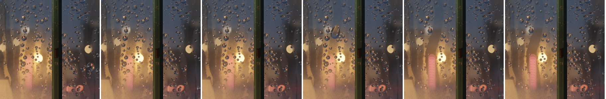 | 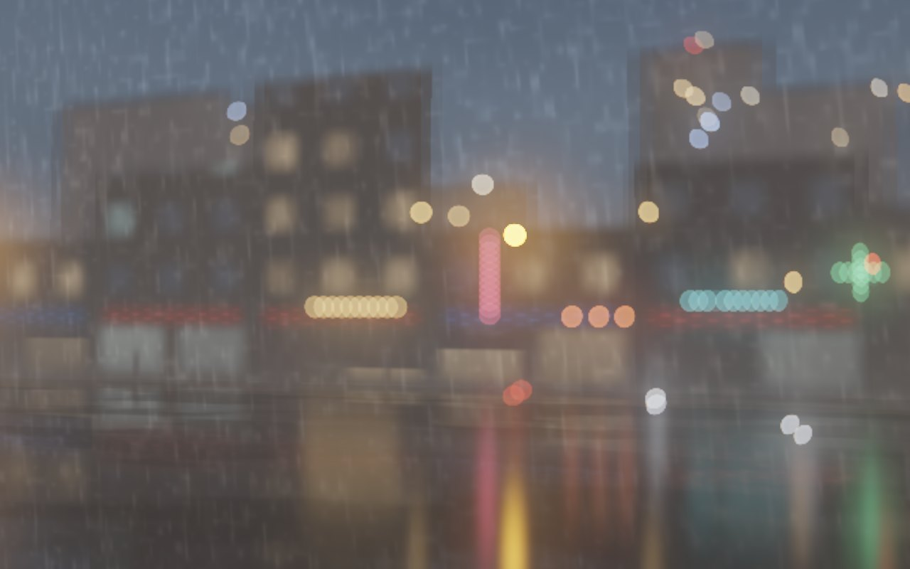 | 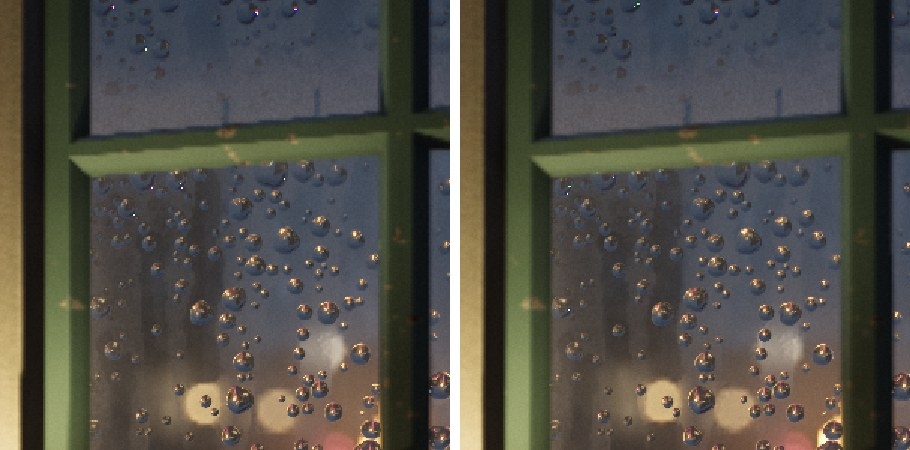 |

- **车根本看不见。** 按真实几何，坐在二楼窗边时，车道位于玻璃下沿以下。改为临街的高台一层，降低对街楼高，保住天空；侧看时车灯透镜仍有约 20% 的亮度。
- **湿路面倒影像一排梳齿。** 改为柔和的高斯光柱。
- **窗外看不出在下雨。** 加入几米外背光的落雨：宽度等于该深度的离焦弥散圆，长度等于快门拖影。第一版是硬细线，第二版有网格感，第三版用拉伸的值噪声，才像照片里的雨。
- **台灯在玻璃里的倒影边缘太硬。** 它的虚像在对焦平面后约 0.6 m，应当是虚的。
- **致命 bug：任何一次重新分配渲染目标都会抛异常。** `T.bloom` 是数组，被当成目标去释放。这会让旋转屏幕和动态分辨率都失效，通过「上下文丢失 → 恢复 → 竖屏」的自动化测试发现。
- **上下文恢复不完整。** VAO、缓冲和状态纹理没有重建，已修复。
- **启动阻塞。** 着色器编译改为先启动，预热模拟改为分片进行。
- **其他健壮性与性能：**
  - 初始分辨率按像素数估算。
  - 不可见时跳过微水珠循环。
  - 长时间运行时噪声坐标的精度问题。
- **低分辨率下室内边缘有锯齿（手机上尤其明显）。** 加了基于深度重投影和邻域裁剪的 TAA。移动视角时验证过没有拖影。

## 最终

| 桌面 | 擦拭 | 手机 |
|---|---|---|
| 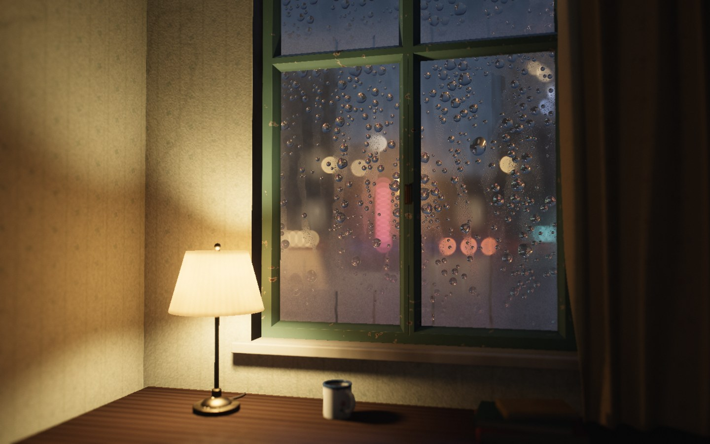 | 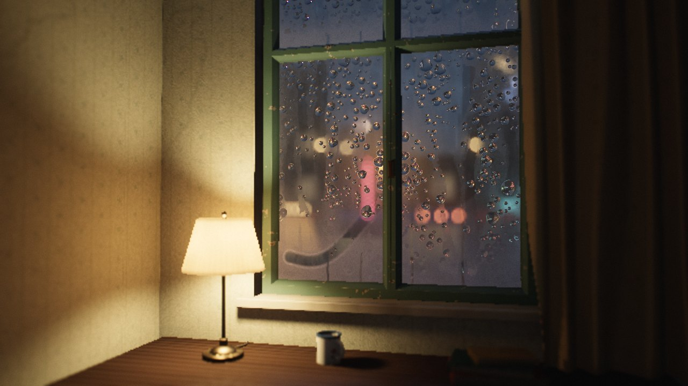 | 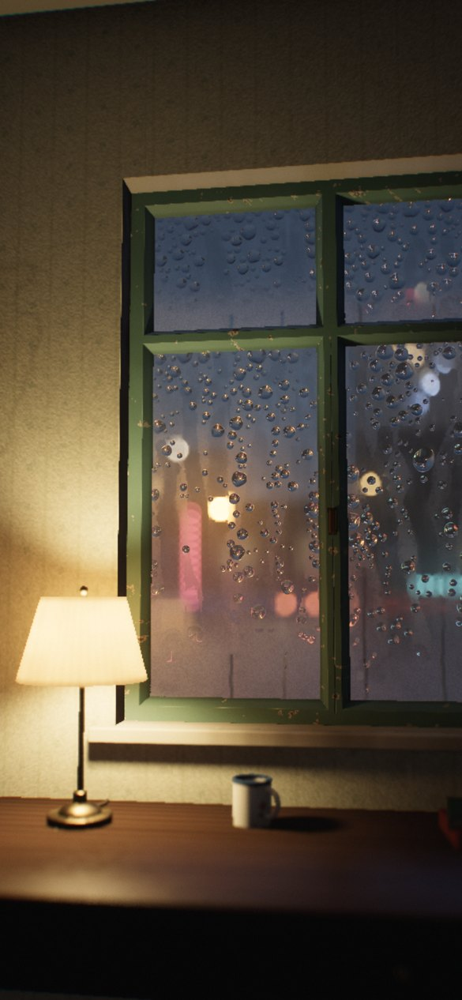 |
