# 开发记录：分层搭建与「批评—改进」

所有截图都是在无头 Chromium + SwiftShader（软件 WebGL2）中实际运行页面得到的。桌面视口多为 1280×720、1440×900（部分用 2× DPR），手机视口为 390×844（DPR 2–3）。图在 `docs/shots/`。

## 阶段 1：构图与光照基调

| 第一帧 | 阶段末 | 手机 |
|---|---|---|
|  |  |  |

**自评与修改：**

- **墙上大片阶梯状色带。** 前后排查了两个原因：
  1. 包围体返回的是距离下界，被半影估计当成了「擦边遮挡」。修法：包围体距离只用于加速步进，不参与半影。
  2. 每条阴影射线都终止在紧贴灯座的灯泡上，半影公式对「贴着光源的遮挡物」失效。修法：灯体不参与阴影。
- **窗外地平线一条亮线。** 视线接近水平时地面交点趋于无穷，产生 Inf/NaN。加了保护。
- **构图看不到书桌，台灯像落地灯。** 重新取景，缩小灯罩。
- **其他：**
  - 灯罩过曝发白。
  - 灯罩边缘的光斑太硬：按灯泡角半径算出半影约 0.2 rad，据此加宽。
  - 窗帘一大片死黑。
  - 天空太暗，不像傍晚。
  - bokeh 像贴纸、数量太少：加了远处楼群的灯火（顶点着色器里做遮挡测试），霓虹改成多个精灵叠成的灯管。
  - 商铺像灰色方块。
- **玻璃里看不到台灯的倒影。** 台灯挪近窗户后，倒影出现在左扇玻璃里。

## 阶段 2：雨滴系统

| 第一次：雨滴全黑（bug） | 修复后 | 近看：雨滴里的倒置街景 |
|---|---|---|
|  |  |  |

**自评与修改：**

- **雨滴是黑色斑点。** 逐项输出调试通道后定位：全反射被「困住」的射线方向被置为 −0.0 分量的零向量，室内追踪里 `x / −0.0 = −Inf`，最后 `0·Inf = NaN`，而 NaN×0 仍是 NaN。修法：方向安全化，被困光线改为取房间平均亮度（真实情况下这些光多次反射后会从别处出射，而不是变黑）。
- **雨滴像金属珠。** 原因有两个：傍晚的天空太暗，水滴下半部分（看向天空）没有亮的东西；接触角偏大，折射过强。修法：天空调亮到「傍晚」；接触角取 32–52°，这是风化窗玻璃上常见的范围。
- **覆盖率只有 18%，几乎没有滑落和水痕。** 用模拟统计（覆盖率、半径分位数、滑动数）定位到两个原因：
  1. 钉扎滞后范围太窄，大滴形成不了。
  2. 合并后长大的水滴下一步不再检查邻居，级联合并丢失。
- **大滴仍像水晶球。** 加了 Bond 数大于 1 时的重力压扁。
- **滑落太快、太焦躁。** 原来 3 mm 的水滴约 1.5 s 就滑过一格窗；提高接触线耗散后，速度落在真实的 1–5 cm/s。
- **擦拭效应不明显。** 雾珠层的模糊和纱幕不够，加强后，水痕才像清晰的通道。

## 阶段 3：后期与交互

| 擦拭冷凝雾 | 关灯 | 手机 UI |
|---|---|---|
|  |  |  |

**自评与修改：**

- **调色过度。** 黑位提得太高加上去饱和，画面像褪色过头的照片，琥珀色丢了。收回一半。
- **景深太虚。** 光圈过大，杯子和台灯虚到「经不起近看」。光圈 34→30 mm，同时提高室内分辨率。
- **擦拭测试「没反应」。** 测试笔画起点落在台灯过宽的拾取圆柱里，被当成了台灯手势。拾取改为按灯罩、灯杆、底座的真实轮廓。
- **擦掉雾也看不出区别。** 冷凝雾的纱幕和背景一样亮。改成被室内灯照亮的乳白色，并让它模糊透过它看到的一切。
- **关灯后房间一片死黑。** 加深眼睛适应，并增加窗外冷光的环境项。

## 阶段 4：声音

在页面里给 AudioContext 接一个分析器，测得 RMS 约 −30 dBFS、峰值 < 0.13，四个频段都有能量，没有削波。另外确认了音频会在后台挂起、在静音和雨势变化时正确响应。音色本身未能试听。

## 批评—改进 第 1 轮

| 改前 | 改后 | 关灯 | 近看（2×） |
|---|---|---|---|
|  |  |  |  |

**看起来假或廉价的地方，以及处理：**

- **正对窗户，像一个舞台布景。** 改为轻微的 3/4 视角：窗洞左侧被灯照亮的侧壁露出来，有了纵深。取景包含气窗和一条傍晚的天空，桌面和杯子也留在画面里。
- **上沿只切到一条细细的上扇玻璃。** 取景调整后，上扇玻璃完整地留出一段天空。
- **冷凝雾是一条平直的横带。** 改为参差的雾线、斑块，以及冷凝水流下留下的细线。
- **墙纸花纹完全看不见。** 后来又变成僵硬的波点网格，最后改为不均匀褪色的花纹。
- **窗台像塑料。** 加了水渍、花盆留下的圈印和掉漆。
- **桌面偏红。** 调成更偏棕的木色。
- **灯罩仍过曝。** 改为看得见褶裥、织纹和边缘包边的布。
- **光泽表面上窗户的倒影太灰。** 倒影里的街景应有灯光的亮度。
- **雨势滑杆拉到 0 仍在下雨。** 修正。

## 批评—改进 第 2 轮（静帧之外：时间、运动、健壮性）

| 时间序列（每格 0.6 s：滑落的水滴清出通道，霓虹变清晰） | 窗外图层（车灯、柔和倒影、背光的落雨） | 室内 TAA：第 2 帧 vs 第 14 帧 |
|---|---|---|
|  |  |  |

- **车根本看不见。** 按真实几何，坐在二楼窗边时，车道位于玻璃下沿以下。改为临街的高台一层，降低对街楼高，保住天空；侧看时车灯透镜仍有约 20% 的亮度。
- **湿路面倒影像一排梳齿。** 改为柔和的高斯光柱。
- **窗外看不出在下雨。** 加入几米外背光的落雨：宽度等于该深度的离焦弥散圆，长度等于快门拖影。第一版是硬细线，第二版有网格感，第三版用拉伸的值噪声，才像照片里的雨。
- **台灯在玻璃里的倒影边缘太硬。** 它的虚像在对焦平面后约 0.6 m，应当是虚的。
- **致命 bug：任何一次重新分配渲染目标都会抛异常。** `T.bloom` 是数组，被当成目标去释放。这会让旋转屏幕和动态分辨率都失效，通过「上下文丢失 → 恢复 → 竖屏」的自动化测试发现。
- **上下文恢复不完整。** VAO、缓冲和状态纹理没有重建，已修复。
- **启动阻塞。** 着色器编译改为先启动，预热模拟改为分片进行。
- **其他健壮性与性能：**
  - 初始分辨率按像素数估算。
  - 不可见时跳过微水珠循环。
  - 长时间运行时噪声坐标的精度问题。
- **低分辨率下室内边缘有锯齿（手机上尤其明显）。** 加了基于深度重投影和邻域裁剪的 TAA。移动视角时验证过没有拖影。

## 最终

| 桌面 | 擦拭 | 手机 |
|---|---|---|
|  |  |  |

## 第 3 轮：丰富场景（回应「能不能更丰富」）

| 第一版加入的物件 | 不同的打开（3 个随机种子 + 关灯） | 窗外图层：梧桐、公交、行人 |
|---|---|---|
| 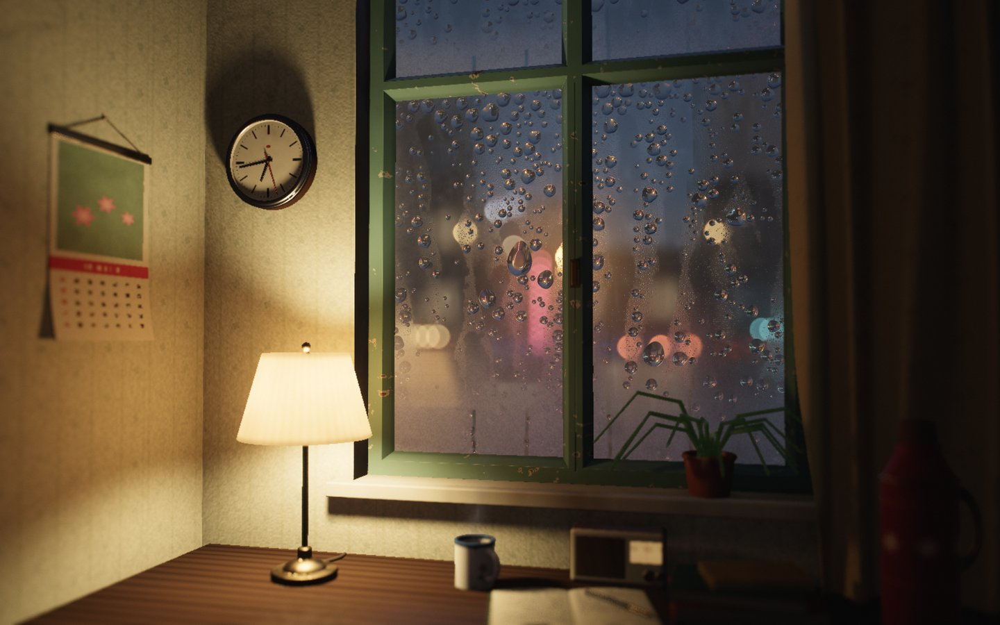 | 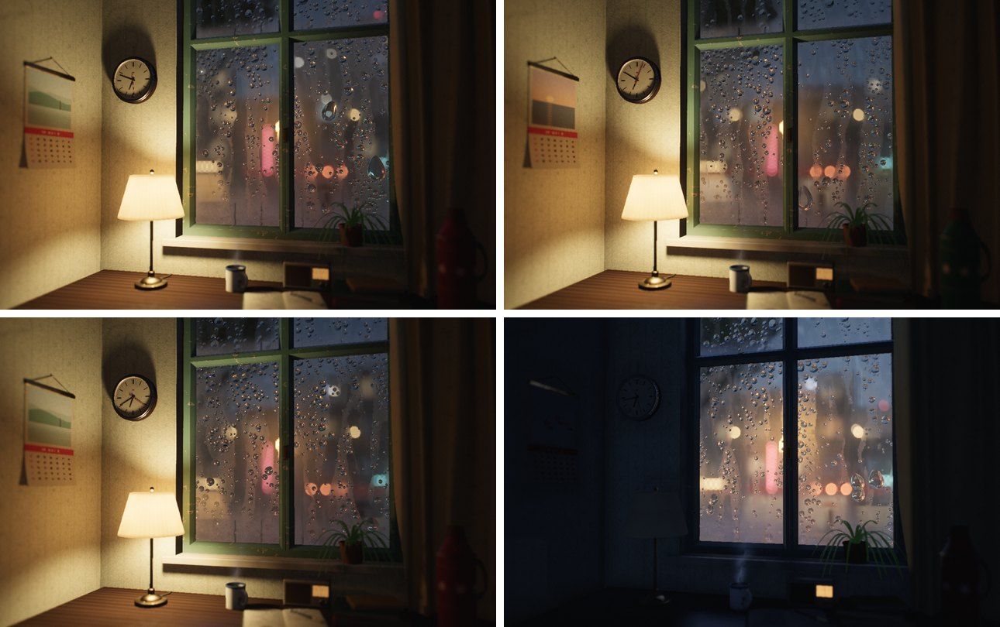 | 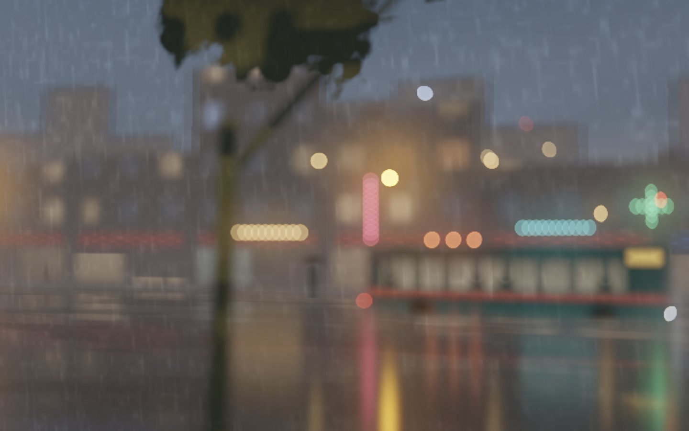 |

| 吊兰（最终） | 挂钟与挂历（2× 局部） |
|---|---|
| 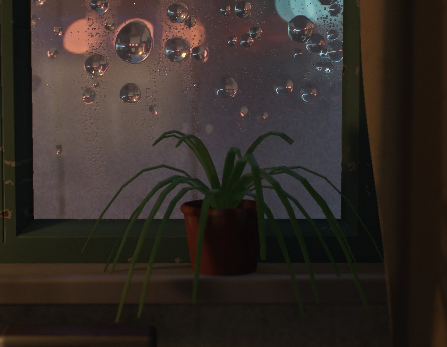 | 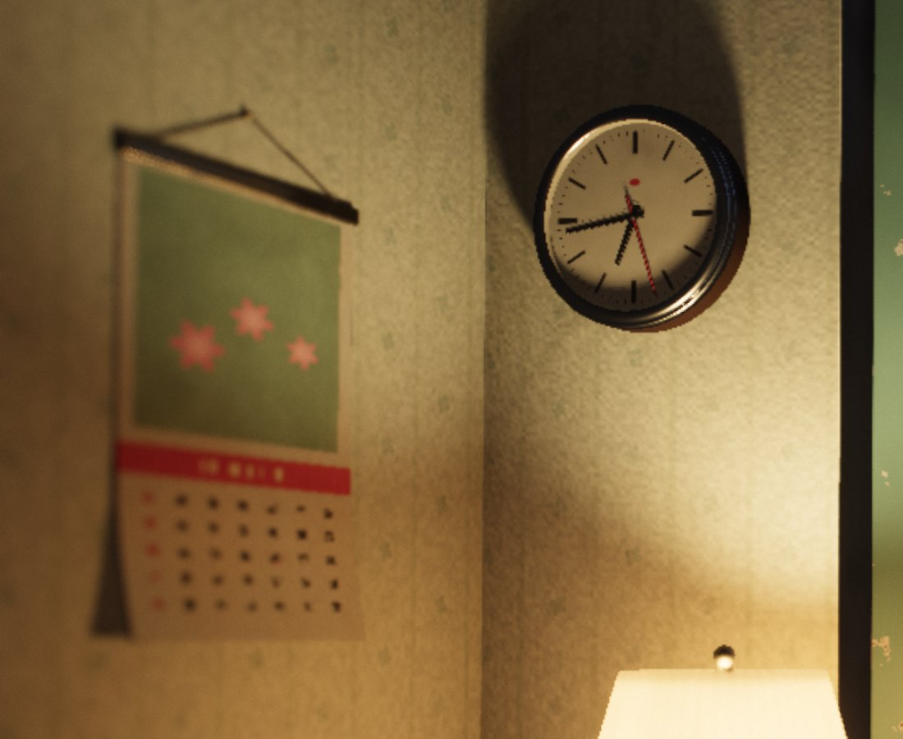 |

**新增：**

- **房间物件**：吊兰、停在傍晚的挂钟、挂历、铁皮暖水瓶、练习本和钢笔、半导体收音机、茶的热气。
- **窗外**：梧桐树冠、打伞的行人、老公交、开关的窗灯。
- **每次打开都不同**：物件的颜色、挂历的画、钟点、对街布局；雨势也会时大时小。

**自评与修改：**

- **吊兰像一只蜘蛛。** 叶子是三段直的胶囊体，弯折生硬。前后改了三版：
  1. 改成有宽度的扁平叶带。
  2. 叶子按抛物线拱起，向房间一侧的叶子垂过窗台边沿，朝两侧的叶子留在窗台以上。
  3. 再缩短叶长、增加分段，形状才像吊兰。
- **挂历的画像贴纸。** 改成褪色的胶印风景，牡丹画层层叠叠。纸面发黄，下沿被翻得发灰。
- **收音机像一块灰砖。** 外壳压暗，表盘改为琥珀色的暗光。
- **新物件抢戏。** 挂钟表盘和练习本的纸太白，都压暗了；只有台灯能是画面里最亮的东西。
- **树在离焦图里像一块黄色剪纸，树干正好立在画面中央。** 树干移出视野，只留树冠伸进气窗左上角；叶片压暗，只有离钠灯最近的叶底泛一点光。
- **公交透过玻璃完全看不见。** 用调试通道排查：外侧雾珠层和内侧冷凝雾叠在一起，把窗下半部的街景洗成了均匀的灰。于是把冷凝雾压成只占窗格底部四分之一的一条带，车厢灯也调亮。
- **性能：** 每片叶子先用包围球剔除，不计算离当前点很远的叶子，避免吊兰的 20 片叶子让每次 SDF 求值多出 140 次胶囊计算。

## 第 4 轮：细节

| 台板玻璃（2× 局部，收敛后） | 窗花近看 | TAAU：第 2 帧 vs 第 20 帧（2×） |
|---|---|---|
| 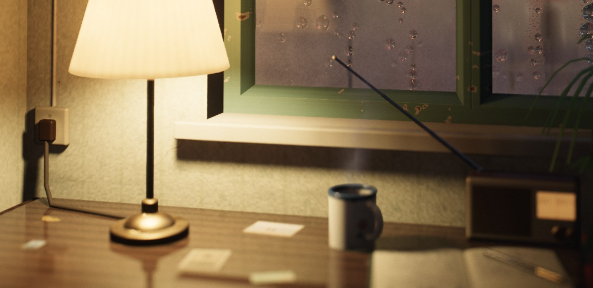 | 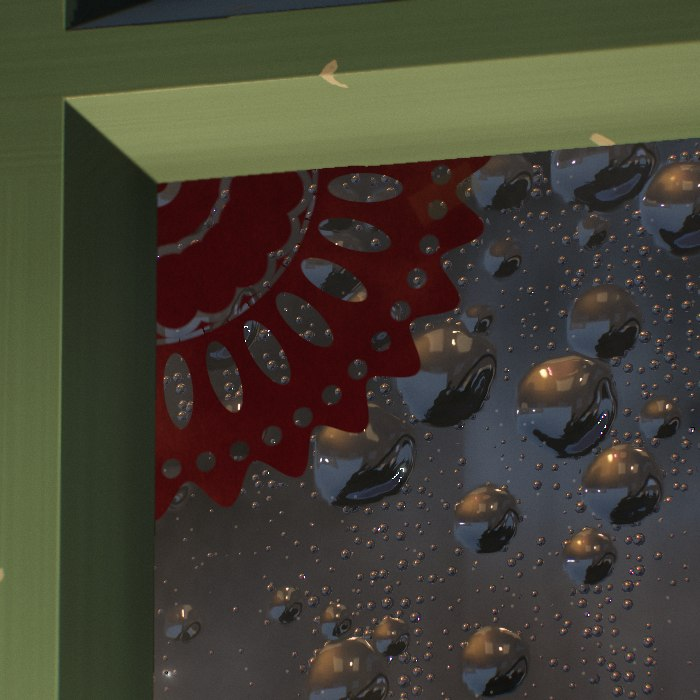 | 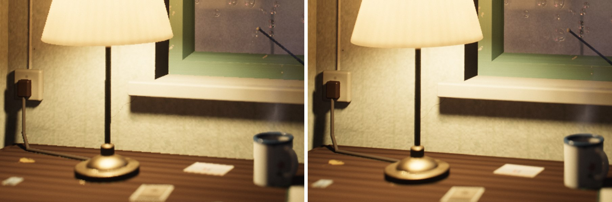 |

**清晰度先行。** 高分屏上，室内只按约一半的分辨率 raymarch，再好的细节也会被放大糊掉。所以先做了时域上采样（TAAU）：

- 每帧给采样位置加不同的亚像素抖动（Halton 序列，16 帧一轮）。
- 每个输出像素取最近的那个低分辨率样本，按距离加权，混入一张全分辨率的历史画面。
- 历史按深度重投影，用 Catmull-Rom 采样避免变软，再夹在当前 3×3 邻域内，防止台灯开关和热气留下拖影。
- 静止时约 20 帧收敛到全分辨率；移动视角时已验证无拖影。

**新增的细节：**

- **台板玻璃**：
  - 压在桌面上，下面压着老照片、合影、一寸照、车票和银杏叶。
  - 玻璃面再追踪一次反射，所以台灯杆、底座、杯子和电线都映在玻璃里，墙面也映在上面。
  - 玻璃切口泛绿。
- **墙上的明线**：电线一路钉到胶木插座，台灯的编织线从插头垂下，沿着玻璃接到灯座。
- **窗花**：内侧玻璃上角贴着两张红纸角花，背后有街灯透过来，正面被台灯照亮。右边那张缺了一角，用胶带粘着。
- **其他**：
  - 收音机拉出的拉杆天线。
  - 吊兰垂下的匍匐茎和小吊兰。
  - 窗框漆的刷痕和一道流挂。
  - 窗洞角上的细裂缝。
  - 旧挂历留下的印子、钉眼和锈迹、桌上方墙面的手蹭污渍。
  - 灯罩上的焦黄、杯壁的茶渍线、水面的茶叶。
  - 玻璃上的油渍和灰尘点。

**自评与修改：**

- **台板玻璃看不出是玻璃。** 原因是之前的球形光源高光乘了 Karis 的 (α/α')² 归一化。这个因子属于他的「代表点」方法，而这里没有用那个方法，结果光滑表面的高光几乎被抹掉。去掉后，镜面里灯泡的亮度和物理值（灯泡辐亮度 × F）一致。但从这个视角，玻璃的镜面方向看到的是窗台下的墙和桌上的东西，所以又加了一次真实的反射追踪。
- **桌下的照片在画面最下沿看不见。** 移到台灯和杯子之间那片光里。
- **窗花像橙红色的塑料片。** 加深颜色，减弱正面受光，加上纸纤维纹理和日晒褪色的斑块。
- **20 帧收敛截图超时。** 软件 GL 下 JS 计帧比 GPU 实际完成得快。截图模式改为每帧 `gl.finish()` 同步。

## 第二期：季节、昼夜、室外（方案见 `PLAN-2.md`）

### M1：世界状态与昼夜

| 一天中的几个时刻 | 雨天正午 | 面板 |
|---|---|---|
| 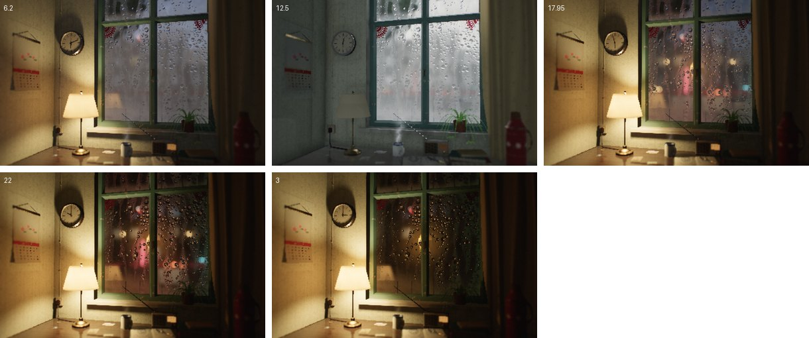 | 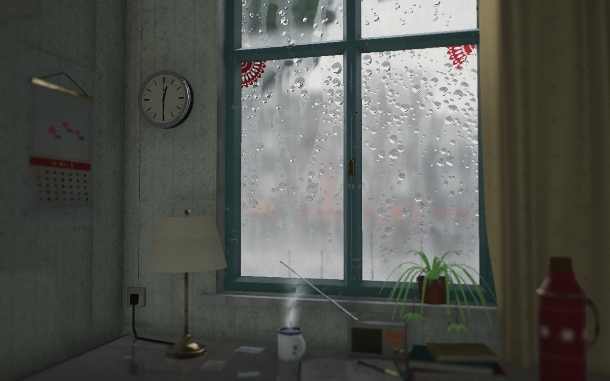 | 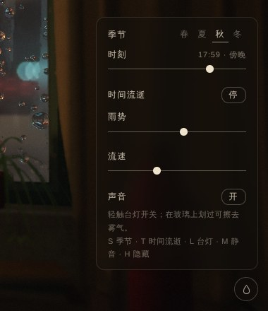 |

- **太阳与天空**：太阳高度角按北纬 31° 和季节赤纬计算。阴雨天空白天用 CIE 阴天分布，日落后每下降约 3.5° 暗一个数量级，夜里以城市光照亮的云底为下限。原来的傍晚画面对应 h ≈ −4°，所以傍晚的样子没有变。
- **窗外着色器重构**：每个表面都是「反照率 × 天光照度 + 自发光」，白天看得见楼面的颜色、卷帘和招牌底色。
- **作息**：
  - 路灯在 h < −2° 时开、h > −1° 时关，开灯后有高压钠灯的预热过程。
  - 每扇窗按各自的哈希值跨过占用率阈值，所以灯是一盏一盏亮起和熄灭的。
  - 商铺各有开门和关门时间。车流、行人、公交都按时段变化。
- **曝光**：由已知光照解析地估计场景亮度，不做 GPU 回读。只部分补偿：白天窗户偏亮，夜里关灯后房间仍是暗的。
- **自评**：白天第一版发白，原因有两个：亮环境下补偿不足；冷凝雾的纱幕把窗外光又加了一遍。于是改为非对称的补偿指数，并把纱幕里的窗外光减半。

### M2：四季

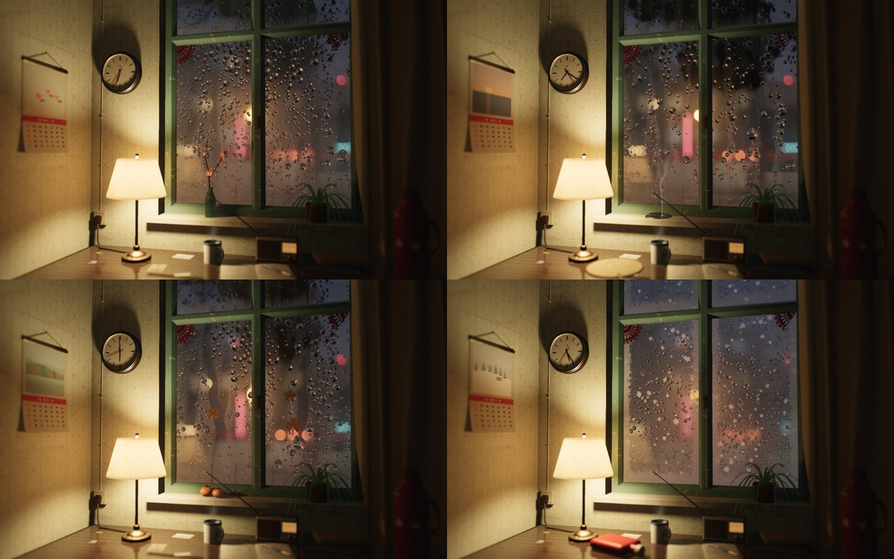

| 冬夜 | 夏天的闪电 | 手机竖屏（冬） |
|---|---|---|
| 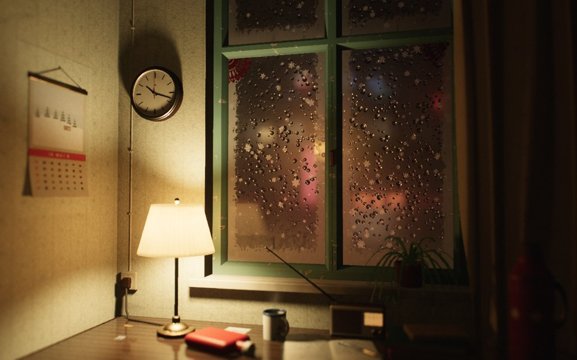 | 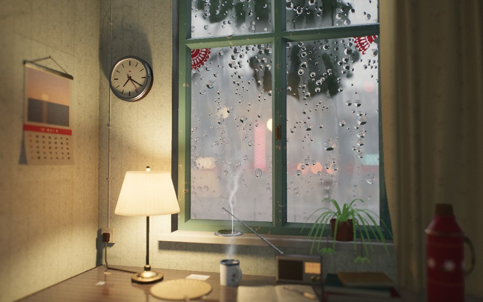 | 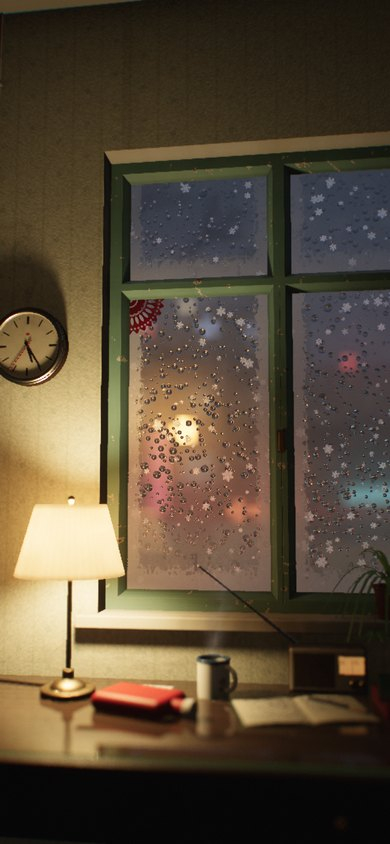 |

| 玻璃上的雪花与冰花（局部） | 蚊香与烟（局部） |
|---|---|
| 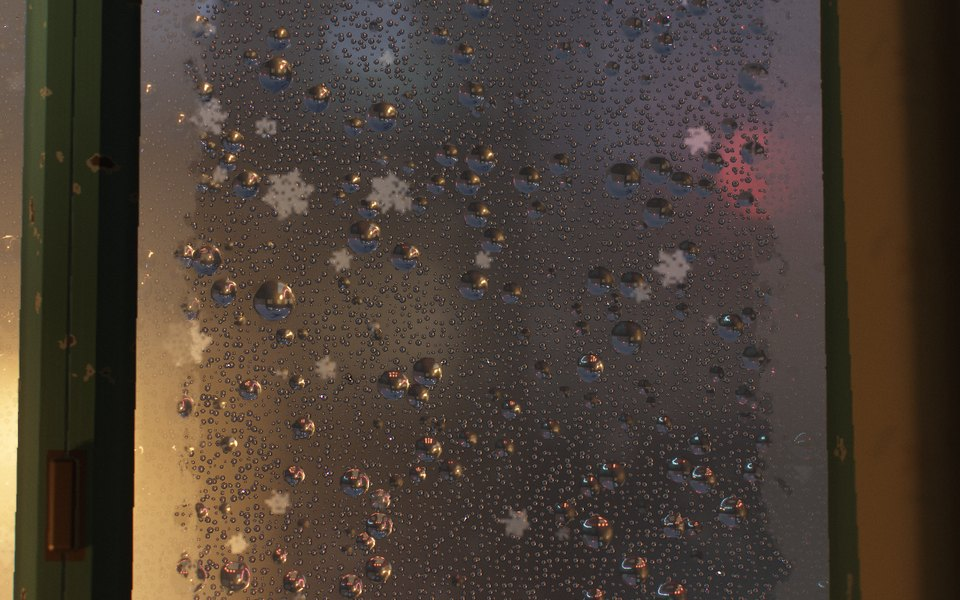 | 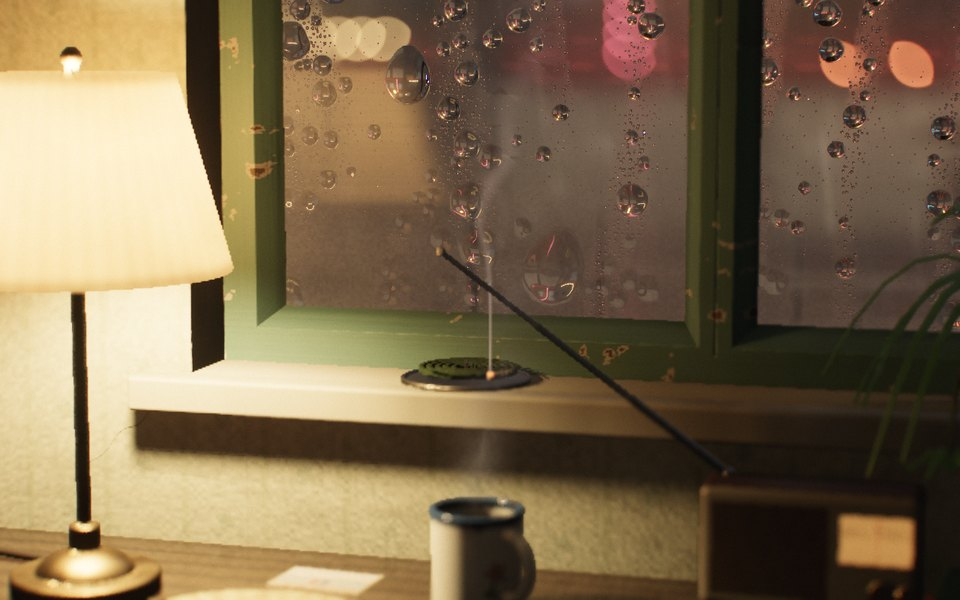 |

- **降水**：
  - 春天是细雨，雾珠重；夏天是雷阵雨，雨滴大、来得急；秋天风一阵一阵；冬天下雪。
  - 雪花落在玻璃上，以六角枝晶的形状写进高度场纹理的第二个通道，停留 8–22 s 后化成一颗等水量的小水滴。
- **梧桐**：骨架在 JS 里递归生成，叶幕挂在外侧的细枝上。春天稀而嫩绿，夏天浓绿，秋天金黄、叶子飘落，冬天只剩枝，枝上积雪。
- **玻璃**：
  - 秋天有三片湿梧桐叶贴在外侧。
  - 冬天内侧玻璃从下沿和角上结出冰花：用脊状噪声叠出分形的羊齿纹，擦不掉。
- **时令物件**（都是 SDF 建模）：
  - 春：汽水瓶里插一枝桃花，花瓣半透明，迎着窗光。
  - 夏：窗台上一盘蚊香，火头微微明灭，一缕烟笔直升起约 8 cm 后开始摆动、分叉、散开。桌上一把蒲扇。
  - 秋：窗台上两只柿子。
  - 冬：桌上一只红色热水袋。
- **挂历**：画随季节换。春是牡丹，夏是荷塘（或海边落日），秋是湖山，冬是雪村。
- **闪电**：
  - 一道闪电由 2–5 次回击组成，间隔 40–150 ms，有的带持续电流。
  - 云底被照亮，天光、窗光、对街楼面陡然变亮。曝光只看不含闪电的天光，所以眼睛来不及适应。
  - 雷声按距离 / 343 m/s 延迟到达。它是程序合成的一串此起彼伏的滚动，近雷有一声撕裂的「咔」，越远越闷。
- **声音**：
  - 下雪时雨声几乎消失，并被压暗。
  - 风声随阵风扫频，窗缝里有一丝口哨声。
  - 春夏的黎明有鸟叫，是麻雀的短促「啾」和起伏的几个音。

**蚊香的烟怎么做的。** 一开始想用和热气一样的体积步进，但这缕烟只有 2 mm 粗，12 步采样会全是噪点。改为解析的做法：

- 烟由 14 段高斯管连成，每段对一条视线贡献的光学厚度有闭式解：σ·s·√π·exp(−d²/s²)/sinθ。
- 结果在空间和时间上都是平滑的，不会闪烁。
- 上半段换成沿烟柱向上传播的波，再从主干分出第二缕。

**自评与修改：**

- **冬天的窗只像一块毛玻璃。** 冰花一开始从每条边向里长了约 12 cm，冷凝雾又加重，整窗发白。改为冰花只占下沿约 5 cm、边上约 3 cm，并从角上先长。
- **冬天看起来还是在下雨。** 雪花融成的水和雨一样多，玻璃上约 1000 颗水滴，而雪花在桌面分辨率下被抗锯齿系数整个淡掉了，这是个 bug。修正后：融水按枝晶的实际含水量（约 0.07 r³）算；雪花停留更久、更白、轮廓更清楚；冬天的撞击率降到雨天的 0.3。
- **夏天的烟看不见。** 光学厚度随烟柱变宽按 1/s 衰减，转捩之后几乎消失。改为按 1/√s 衰减，因为湍流段的烟卷成薄片，常常是侧着看到的。也加强了台灯光的侧向散射。
- **蒲扇像一只白盘子。** 往后挪进画面，加深草色，并让叶脉从扇柄处放射出来。

### M3：窗外

| 傍晚，走到楼下回头看 | 手机竖屏：水洼里的窗 |
|---|---|
| 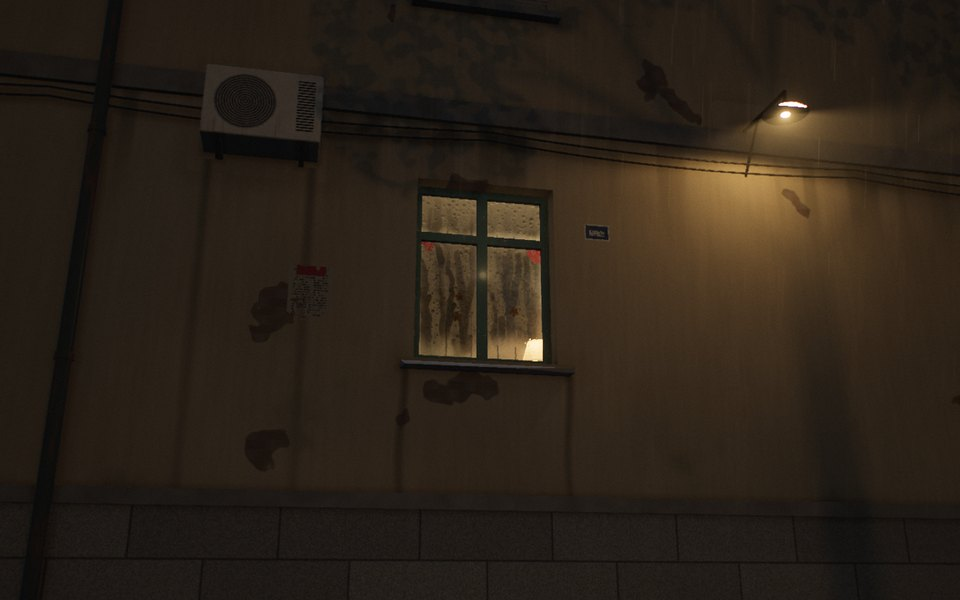 | 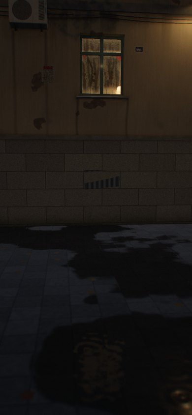 |

| 雨天正午 | 冬夜（雪） | 夏天的闪电 | 从外面看这扇窗（局部） |
|---|---|---|---|
| 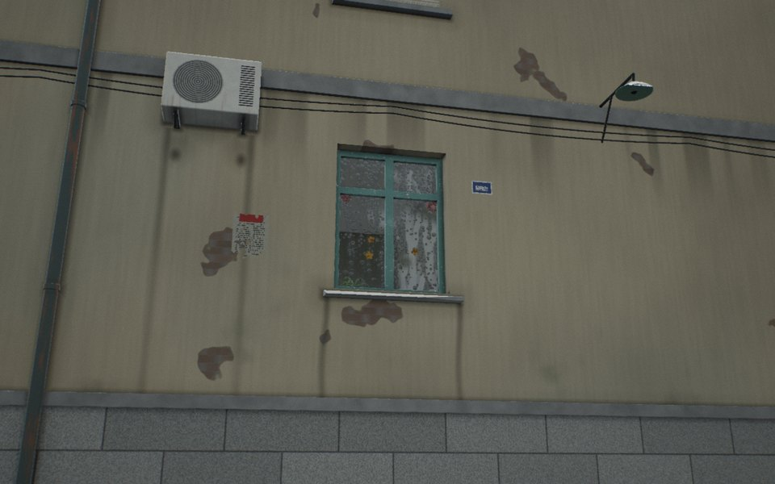 | 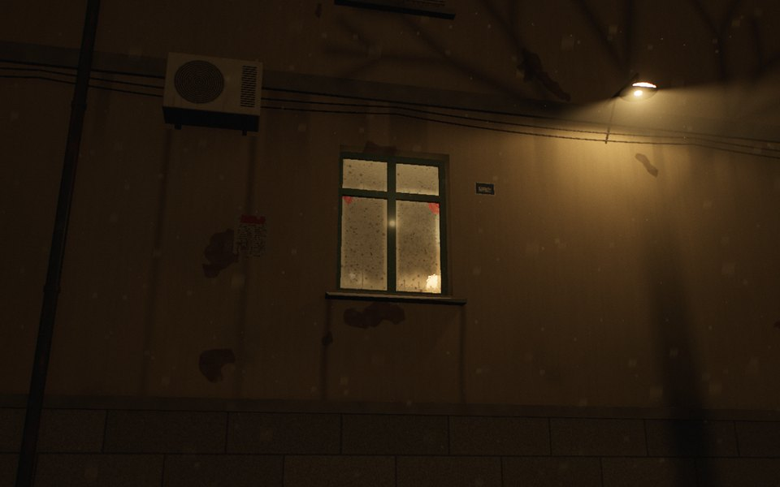 | 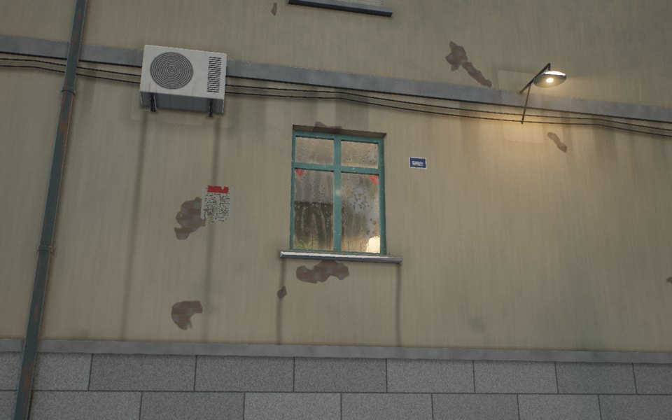 | 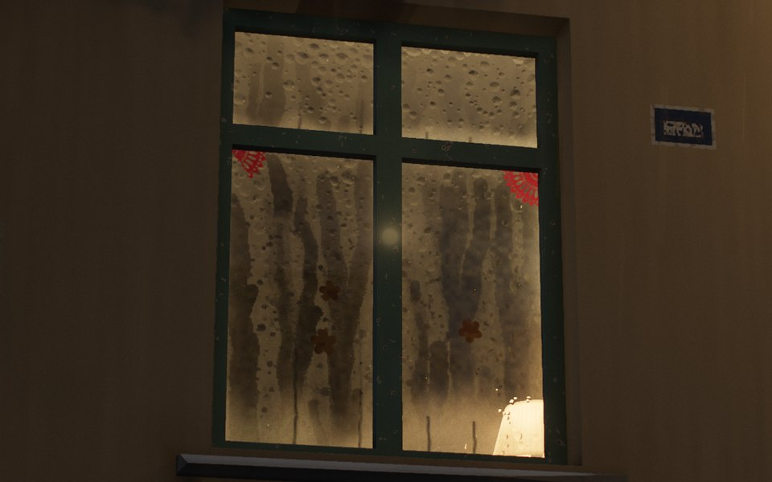 |

**结构。** 室内 raymarcher 的全部函数（SDF、材质、光照、热气和烟）拆成 `ROOM_LIB`，玻璃光学和窗花拆成 `GLSL_GLASS`。窗外的 street pass 把它们和一个小的街景 SDF 拼在一起：

- 射线先在街景里走，到达这扇窗的玻璃平面时停下。
- 读取同一张雨滴高度场：雨滴表面反射街景和巷灯（雨滴上的亮点），折射光按 Snell 定律穿过雨滴和平板玻璃，带着偏折后的方向进入房间。
- 在房间里接着 raymarch，用房间自己的 `shade()` 着色。
- 冷凝雾、擦痕、冰花、窗花在玻璃内侧，按同一张状态纹理叠上去。所以在里面擦掉的雾，出去以后还能看到那道擦痕。
- 之后照常经过景深、TAAU、bloom 和输出。雨丝和灯的光晕在 TAA 之后叠加，避免快速下落的雨丝被时域累积抹掉。

**按需编译。** street 着色器包含整个房间，很大，所以只在第一次走出去时编译。画面先暗下，编译就绪后再亮起，没有卡顿。

**自评与修改：**

- **布局左右反了。** 从街上看，世界坐标的 +x 在观者左边，所以巷灯跑到了左边。把外墙上的东西整体镜像。机位不变，因为只有从左边看过去，台灯才在窗里。
- **巷灯下的墙上有一圈圈等高线。** 先怀疑是灯罩自己挡光，排除了。真正的原因是两根 5 mm 的电线：它们的软阴影在离散步进下量化成了条带。
  - 改为只让凸出物投影：平墙被前方的光照亮时不会遮挡自己，掠射时测试它只会产生条带。
  - 细电线不投影。
  - 窗洞里面仍然测试墙。
- **墙上出现矩形的亮框。** AO 采到了巷灯和空调的包围盒距离，于是把包围盒的轮廓印在了墙上。AO 和阴影改为只看真实的遮挡物。
- **墙皮剥落处像一块块血迹。** 减少数量，降低饱和度，加上碎裂边缘的阴影。
- **对街钠灯打出的树影是方块。** 值噪声的网格露出来了。改为旋转的两层噪声，叶影成了斑驳的光斑。
- **水洼看不到。** 窗户在路面以上 3 m，抬头看窗的机位看不到脚下。算了一下：窗的倒影在地平线以下约 32°，窗在约 16° 以上，只有竖屏的高画幅装得下两者。
  - 所以横屏保持抬头看窗。
  - 竖屏站到路缘、镜头更广、略向下看，在倒影落下的位置放一片水洼。
- **树干的影子正好竖在画面中间。** 换成另一盏对街的钠灯，让树干的影子落到窗的一侧。

### M4：第 5 轮批评与回归测试

**批评与修改：**

- **窗外的雨几乎看不见。** 雨丝的亮度只算了被灯照亮的那一点，又被镜头弥散圆摊得很薄，巷灯下也只剩几根淡线。把亮度提高 2.5 倍，密度提高约三成。现在灯下是一片斜斜的亮雨丝，墙的暗处仍然看不到雨，这符合真实情况：雨只在逆光时可见。
- **第一次走出去，不知道还能做什么。** 第一次切到窗外时，底部淡入一行字：「轻触亮着的窗 · 开关屋里的台灯」。

**回归测试**（无头 Chromium + SwiftShader）：

- **WebGL 上下文丢失再恢复，然后旋转成竖屏**：窗内、窗外各跑一遍，无报错，画面恢复。窗外的着色器在恢复时会重新编译。
- **实时切换视角**：在正常循环里按 V，按需编译、暗下、切换、亮起，再按 V 回到窗内，无报错。
- **声音**：窗内、窗外、夏天强制打一声雷，音频图都正常运行，无削波。近处的雷峰值约 0.5，雷声延迟与距离一致。软件渲染下每秒只有约 1 帧，窗内外的电平对比不可靠，音色和平衡仍需真机用耳朵检查。
- **面板**：新增「视角」一行，桌面和手机竖屏下布局正常。
