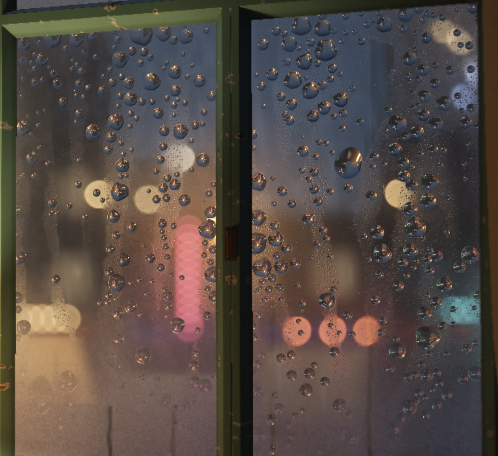
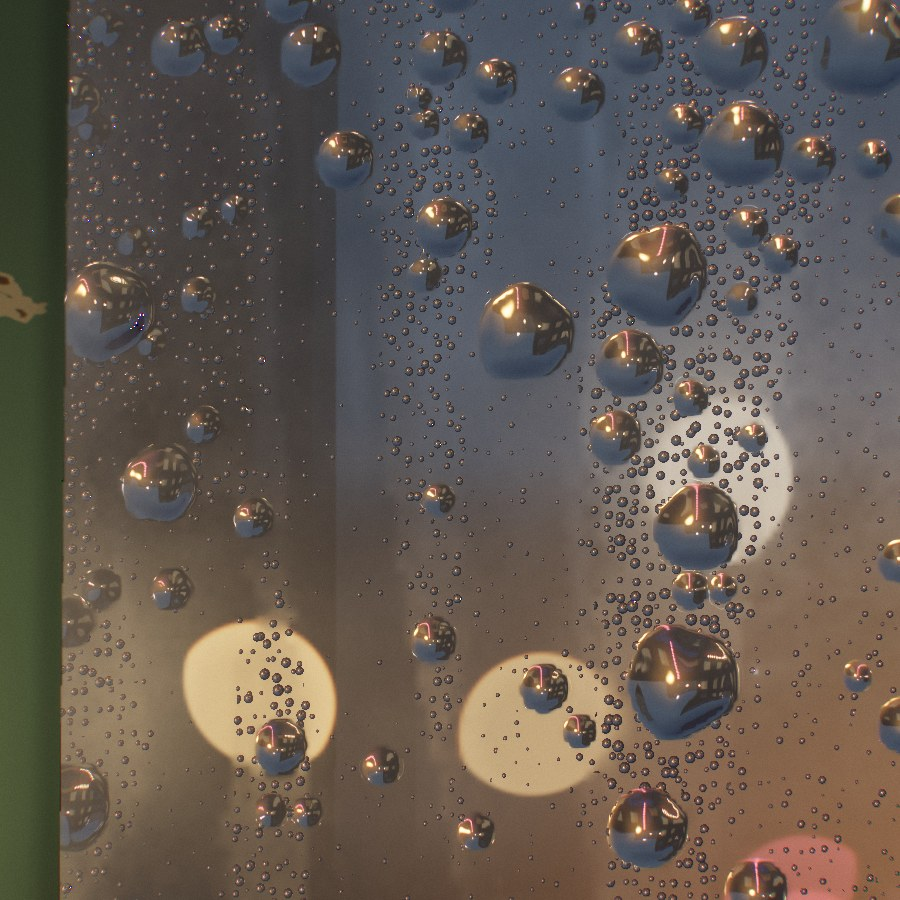
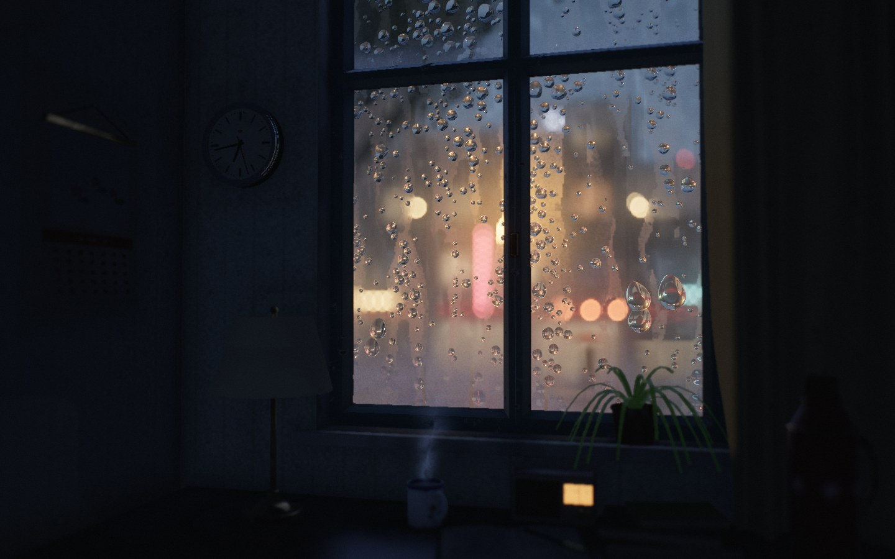

# 傍晚 · 雨窗

一个永远停在傍晚的旧房间，窗外下着雨。

**直接用浏览器打开 `index.html` 即可**（桌面和手机都可以）。单文件，不加载任何外部资源。所有几何、纹理和声音都是程序生成的。

| 凑近看玻璃（2× 截图局部） | 雨滴里倒置的街景 | 关灯以后 |
|---|---|---|
|  |  |  |

## 怎么玩

- **台灯**：轻触可开关。灯丝有热惯性，开灯约 0.12 s 亮起，关灯冷却更慢，色温随之变红。关灯后眼睛会慢慢适应黑暗，房间里只剩窗外的冷光。
- **玻璃**：手指或鼠标划过，可以擦掉内侧的冷凝雾，笔画边缘会留下一圈被推开的水。之后雾气会一点一点重新长回来。
- **视角**：鼠标移动或在玻璃以外拖动可以小幅改变视角；手机上倾斜即可（iOS 会请求陀螺仪权限）。
- **声音**：第一次交互后开始，音量跟随雨势。
- **右下角的水滴按钮**：雨势、时间流速、声音开关。闲置时自动隐去。
- **快捷键**：`H` 隐藏 UI，`L` 开关台灯，`M` 静音。

## 场景里有什么

- **房间**：
  - 窗边：漆皮剥落的老式绿漆木窗、旧书桌、布罩台灯。
  - 书桌上：搪瓷杯（茶还冒着一缕热气）、一叠旧书、写了一页半的练习本和钢笔、表盘透着暖光的半导体收音机、印着牡丹的铁皮暖水瓶。
  - 墙上：停在傍晚六点半多的挂钟，侧墙上下角卷起的挂历。
  - 窗台上：一盆吊兰。窗户另一侧是花窗帘，墙上贴着褪色的墙纸。
- **窗外**：
  - 对街：一排二三层的旧铺面，楼上的窗灯偶尔开、偶尔关；招牌、霓虹灯管、药店的绿十字、灯笼、红绿灯、钠灯。
  - 远处：高楼的灯火和闪烁的航空障碍灯。
  - 近处：窗边一棵梧桐的树冠在风里轻轻晃动。
  - 来往的：打伞走过的行人（伞有黑、红、蓝、黄，还有透光的透明伞），偶尔驶过的车和亮着车厢灯的老公交。
  - 雨与路面：背光才看得见的落雨，以及倒映着这一切的湿路面。
- **每次打开都不完全一样**：暖水瓶的漆色、挂历的画（湖山、海边落日、牡丹）、钟停住的那一分钟、对街楼群的高低和店铺布局都会变；雨势也会以几分钟为周期在设定值附近时大时小。

## 实现了什么

**渲染**：WebGL2，全程线性 HDR。每帧依次是：

1. 窗外·清晰：程序化街景（广角、等距柱状投影）。
2. 窗外·失焦：同一街景按屏幕视角渲染，光源画成解析 bokeh。
3. 雨滴高度场。
4. 室内 SDF raymarch：动态分辨率，加 TAA。
5. 室内景深。
6. 全分辨率玻璃合成。
7. Bloom。
8. ACES、调色、sRGB、颗粒、抖动。

**雨滴（CPU，按真实毫米计算）**：

- **形状与钉扎**：每颗水滴是一个球冠，重力对抗接触角滞后造成的钉扎力（Furmidge），由此得出的临界半径约 1.7–2.8 mm。
- **滑动**：过阻尼滑动；玻璃不均匀场造成走走停停（stick-slip）和蜿蜒，并倾向沿着旧水痕走。
- **合并与拖尾**：合并时体积、质心和动量守恒。滑动时吸收沿途雾珠，尾部按概率脱落小珠。
- **新雨滴**：直径服从 Marshall–Palmer 分布，大滴撞击时溅出卫星滴。
- **大滴压扁**：超过毛细长度的大滴会被重力压扁。

**玻璃光学（逐像素）**：

- **折射成像**：视线经过平板玻璃进入水中，再在高度场法线处做 Snell 折射，采样清晰的街景。凸透镜的出射方向随位置翻转，于是自然得到缩小、倒置的像。
- **反射**：用精确的非偏振菲涅尔。全反射时看到的是室内（台灯、桌面）的解析模型，所以雨滴边缘发暗，台灯在其中形成高光。
- **外侧雾珠层**：让背景更模糊、更灰，雨滴和水痕扫过的地方会变得清晰（擦拭效应）。
- **内侧冷凝雾**：下浓上淡，边界参差，并有冷凝水流下留下的细线；它会软化透过它看到的一切，并被台灯照出暖色。

**室内光照**：

- **台灯**：被灯罩调制的点光源。上下开口全透，布面透射约 18% 且偏暖，所以墙上出现双曲线光斑。软阴影的半影由灯泡尺寸决定。
- **窗户**：Lambert 多边形公式解析求面光源辐照度，再乘一条宽半影的软阴影。
- **间接光**：虚拟点光源加 radiosity 常量，再乘 AO。
- **色温**：用 Planck 轨迹（Kim 2002）转 sRGB，再做 3900K 的 von Kries 白平衡。2700K 的灯是琥珀色，9500K 的天光是冷青色。

**窗外**：

- **街景内容**：对街的旧楼、灯窗、商铺、霓虹（灯管由多个精灵叠成，失焦后成为一条光带）、灯笼、钠灯、红绿灯，远处高楼的灯火和航空障碍灯（顶点着色器里做遮挡测试）。
- **车**：偶尔驶过，车灯离轴变暗，前后灯随朝向改变。
- **湿路面**：倒影是柔和的竖直光柱。
- **落雨**：几米外的雨只在被背后的灯照亮时才看得见，所以只在光前出现。

**声音（Web Audio 实时合成）**：

- **雨幕**：隔着玻璃被低通的雨声，带阵风起伏。
- **窗台雨点**：外面窗台上的雨点。
- **玻璃上的「嗒」声**：由模拟里真实落到玻璃上的雨滴触发，响度 ∝ D^1.5，声像随落点左右移动。
- **滴水**：水从窗框流下时触发，是气泡共振上扬的「叮」声。
- **车声**：与画面同步，响度随距离、声像随位置变化，带多普勒。
- **其他**：房间底噪、台灯开关的咔哒、手指擦玻璃的声音，以及程序生成的房间混响。

**健壮性**：

- 处理 devicePixelRatio（上限 2）、窗口缩放和横竖屏切换。
- 按帧时间动态降低或恢复分辨率。
- 页面切到后台时暂停渲染并挂起声音。
- WebGL 上下文丢失后会自动恢复。
- 着色器并行编译时，用分片模拟「已经下了 2.5 分钟的雨」，页面保持响应。
- 首屏是「雨还在下」的淡入，没有黑屏。
- 没有 WebGL2 时给出温和的提示。

## 做了哪些取舍

- **雨滴放大 8 倍显示**。这是最主要的艺术取舍。物理（钉扎、临界半径、速度）都按真实毫米计算，但如果按真实尺寸显示，1 米外的雨滴只有 2–3 个像素，看不到透镜里的倒像。
- **只用 WebGL2，不做 WebGPU**。这个场景的开销全在片元着色，WebGPU 不会带来额外的画面能力。WebGL2 在手机上覆盖更广，而同时维护 WGSL 和 GLSL 两套着色器，两条路径画面不一致的风险会翻倍。所以检测链是 WebGL2，否则给出提示，不存在「依赖 WebGPU」的路径。
- **一处位置上的取舍**。房间是临街的高台一层，地面比街道高约 2.3 m：按真实几何，若在二楼坐在窗边，是看不到街面车流的。
- **窗外是方向参数化的远景**，bokeh 是能量守恒的解析圆盘，而不是散射式景深。好处是便宜、可控、在手机上稳定。
- **间接光是近似**（虚拟点光源 + 常量 + AO），不是真正的全局光照。
- **雾珠不逐颗模拟**：用 0.5 mm 网格上的连续密度场表示，渲染时再程序化地还原成小水珠。
- **景深焦点在玻璃上**，所以离玻璃 30 cm 的台灯和杯子会略虚。这是照片上该有的样子，但近处细节因此不如玻璃上锐利。

## 还可以继续提升

- **真机性能**：本次只在无头 Chromium + SwiftShader（软件渲染）里验证了正确性和画面，没有测过真机帧率。动态分辨率会自动适配，但中低端手机上的室内 raymarch 仍可能偏重。可以把静态的阴影和 AO 预烘焙进 3D 纹理，每像素只剩一次查表。
- **声音**：在浏览器里验证过音频图能运行、电平合理、没有削波，但我无法亲耳试听，音色和平衡值得再用耳朵调一遍。
- **雨水投影**：窗外一盏小而远的路灯，可以把玻璃上的雨滴投成在墙上缓慢流动的光斑（雨窗影子）。现在的几何下光线进不到可见的墙面，所以没有做。
- **内侧水珠**：内侧冷凝水目前是连续的雾场。可以让它在擦拭边缘凝成小水珠并流下。
- **更多变化**：现在的变化都在同一个房间、同一个视角里。还可以做季节（窗外的梧桐变黄、落叶粘在玻璃上），做不同的房间布置，或让雨偶尔停下、玻璃慢慢干掉。
- **近景的清晰度**：书桌前沿的物件（本子、收音机）离镜头近、在景深外，凑近看是虚的。这符合「焦点在玻璃上」的设定，代价是这些细节只能远看。
- **WebGPU 计算**：可以用 WebGPU 计算着色器把雨滴模拟搬到 GPU，支持上万颗雨滴，并把 GLSL 后端保留作为回退。

## 文件

- `index.html`：作品本身（约 3150 行，按「参数 → 色彩 → 场景 → GLSL → GL 封装 → 窗外 → 雨滴模拟 → 相机 → 光照 → 渲染 → 交互 → UI → 声音 → 主循环」组织，关键物理近似都写在注释里）。
- `PLAN.md`：动手前写的方案。
- `DEVLOG.md`：各阶段截图与每一轮的「批评—改进」记录。
- `docs/shots/`：截图。

调试参数（截图和排查用）：`?shot&seed=7&warm=150&lamp=0&still&view=room|defocus|sharp|height|state|bloom&zoom=6&zx=-0.3&zy=1.6`
