# 《一粒光》开发记录

方案见仓库根目录的计划（世界先行，多审）。主角是从台灯灯丝里跳出来的一粒光；四个世界：雨夜的房间、盛夏午后、雪夜木刻、深海，最后回到房间。

## M1：骨架、房间、跳出来的光

| 跳出灯罩（连续帧） | 在茶的热气上 |
|---|---|
|  |  |

**结构。** 雨窗整段搬进 `src/room.js`，作为宿主：它拥有 WebGL 上下文、主循环、动态分辨率、上下文恢复和声音。

- 导演（`director.js`）和主角（`hero.js`）是普通脚本，通过 `window.YL` 拿到宿主的状态和工具函数。
- 后面的世界也这样挂进来。
- 好处是双击 `index.html` 就能打开，不用打包。
- 搬过来以后，用同样的参数和原版对比截图，平均每像素差 2/255，来自颗粒和抖动的随机性。

**一粒光：**

- **照明**：它是一个真实的球形小光源（半径 5.5 mm，2100–2400 K），接进房间的 `shade()`。
  - 有自己的软阴影，光滑表面上有高光，近处的东西还能拿到一点它的反弹光。
  - 透过吊兰叶子和窗帘，它会把叶子从背后照亮。
- **它自己的样子**：一个热的核心、一圈光晕，以及镜头对任何亮点都会有的一点眩光。房间空气里的散射用单次散射的闭式积分。挡在它前面的东西会把它挡住。
- **跟它互动的东西**：
  - 茶的热气会散射它的光；
  - 窗玻璃内侧的冷凝雾在它靠近时被照亮；
  - 它还在灯罩里时，灯罩是被它从里面照亮的。
- **性格**：
  - 路径是带停留的路点，用 Catmull-Rom 平滑，飞行时稍稍弧起；停留时绕着小圈东张西望，平时在空气里轻轻浮动。
  - 光标靠近，它会凑过去；光标甩得太快，它吓得一暗，躲开。
  - 它的明暗呼吸节奏是固定的，全片不变。

**第一幕的流程：**

- 台灯亮着。你点它，或者等它自己闪两下（约 7.5 s），十秒后一粒光从灯丝里跳出来，灯熄了。
- 它依次飞过：茶的热气、练习本、挂钟、吊兰，最后停在窗玻璃上。
- 镜头跟拍时，目标和焦点都跟着它，景深随之移动。快到窗前时，镜头推成玻璃的近景。

**自评与修改：**

- **光在画面里认不出来。** 半分辨率下，5.5 mm 的核心只有两三个像素，而它在台板玻璃上的高光被 GGX 拉成了一长条，看起来反而像主角。
  - 核心加一圈光晕和镜头眩光，让它读成一颗发光的小球。
  - 高光按它约 2 cm 的辉光尺寸来算，更柔和。
- **灯罩熄得太突然。** 光还在灯罩里时，灯罩就已经黑了，断了连续性。改为灯罩也被它从里面照亮。
- **热气上不亮。** 热气的体积散射原来只算台灯，加上它以后，它钻进热气时，热气会亮起来。

## M2a：盛夏午后（只做世界，还没放主角）

| 云的局部 | 手机竖屏 | 风（连续 4 帧） |
|---|---|---|
|  |  |  |

**色彩脚本：**

- 天：头顶是浓的天青，往地平线褪成被暑气蒸白的浅青。
- 云：一座积雨云塔，加几朵晴天积云。
- 远山：三层蓝紫色，越远越淡，越高。
- 坡：一道绿坡，坡顶一棵孤零零的樟树。
- 草：近处齐腰，阳光从左上方来。

**做法：**

- **背景**：全屏片元着色器，按视线方向画天、云、远山、坡和远处的草地。每朵云只在自己的包围盒里计算。
- **近处的草**：一万八千片真实几何的草叶，实例化绘制，4× MSAA，两三阶的赛璐璐明暗。
  - 风场 = 持续的风 + 一阵阵跑过草地的阵风带 + 光标的轨迹（光标就是风）。
  - 被风压倒的草露出发亮的草背。
  - 草丛的颜色成片地变。
  - 云影从草地上飘过。
- **声音**：三只知了（窄带噪声加快速的调幅，各自涨落）和草里的风声，随阵风和光标起伏。房间的雨声淡出。

**迭代过程（四轮，见下图）：**

1. **第一版，云像一块歪着的白石头。** 几个大球平滑地并在一起，没有积云一团团翻滚的样子。
2. **第二版，换成一团团的「云朵」，每团各自按球体打光，结果像一堆雪球。** 画家画积云时，光是整块云的大明暗：左边亮，右边是蓝色的阴影；一团团的云只是这个大明暗上的起伏。
3. **第三版，改为整块云的法线加起伏的法线。** 起伏来自一张高度场：各团云的球冠取软最大值。轮廓用较紧的平滑并集。读起来对了一半，亮面却到处是迷彩一样的阴影斑块。
4. **查出一个符号错误。** 高度场的法线应该是 (−∇h, 1)，我写成了 (+∇h, 1)，每一团都被从反方向照亮。改正后：
   - 亮面平静，阴影面一团团的云块清楚地雕出来，像手绘动画里的夏日积雨云。
   - 再在亮面给每团云朝下的一侧加一层淡紫的半调。
   - 云的内部加一个实心的核，不会再透出天空。

**其他修改：**

- **相机。** 视点从 1.1 m 降到 0.85 m，加了几十片高高的前景草叶，人是站在草里的，而不是俯看一片草坪。
- **草。** 草叶加宽、减少数量，读起来是一笔一笔的颜色，而不是一层细纹理。
- **远山。** 原来是一条细线，改成峰形更尖、更高的三层山脊。
- **手机竖屏。** 镜头稍向左转，让云塔在画面里。

## M2b：光到了夏天；转场「雨滴里的白昼」

| 雨滴里的白昼（窗外仍是雨夜） | 光在夏天 |
|---|---|
|  |  |

**转场，连续 6 帧：**

1. **雨滴里的白昼。**
   - 房间的合成着色器里，雨滴的折射本来采样窗外街景的等距柱状图。
   - 夏天的背景着色器多了一个模式：从窗口的位置、用同一套等距柱状参数，渲染出一张夏天的全景。
   - 转场时，两张图在 4.5 s 里交叉淡入。于是每一颗雨滴里都出现了一个倒置的小夏天：天在下，草地在上，这是现成的光学自然算出来的。
   - 透过干玻璃看到的，仍然是夜里虚掉的街。
2. **扎进雨滴。**
   - 镜头推到玻璃前，视场从 30° 收到 12°。
   - 光所在的那颗雨滴从它身上张开一个圆：先慢后快，指数地变大。圆的边缘像一圈透镜，里面的夏天被挤弯，外沿有一道亮的水的弯月面。
   - 最后一下短暂的白闪，夏天占满整个画面。
3. **同一处落地。** 光在夏天里出现的屏幕位置，就是那个圆张开的地方。
4. **声音交叉淡变**：雨声淡出，知了和风声淡入。

**光在夏天的样子：** 用这个世界的画法画，硬边的白色核心、硬边的暖黄光圈、柔和的辉光，加上几道慢慢转的光芒。它和房间里是同一个呼吸节奏。

- 它照亮身边的草：两阶赛璐璐的暖色，近处的草尖直接变成亮黄。
- 你划过的地方起风，草和它一起被吹走，一根弹簧把它拉回它喜欢待的地方。
- 按住不动，风慢慢停下，草静下来，知了的声音涌上来。

**自评与修改：**

- **雨滴里看不到夏天。** 调试时直接跳到 `daydrops`，夏天的世界从没初始化过，全景图也就不存在。改为转场开始时按需初始化（正常播放时，在光停到窗上那一刻就预先编译）。
- **雨滴太亮，像一颗颗蓝色弹珠，而不像玻璃。** 亮度系数从 0.55 降到 0.45。
- **光在夏天里一直高高地挂在天上，像一颗星。** 把它喜欢待的位置降到草尖的高度，它在那里才能把草照亮。

## M3a：雪夜·木刻（只做世界，还没放主角）

| 手机竖屏 | 2× 局部：灯笼与人家、雪峰、冰窟窿与小船、老树 |
|---|---|
|  |  |

一张三块版套印的木刻：墨版（黑）、靛版（夜里雪的阴影、冰、天）、朱版（灯笼、窗光、春联）。纸是暖白的。

**它是怎么「刻」出来的：**

1. **刻线是一条一条的刀。**
   - 所有的线都是某个场的等值线，所以线顺着形体走：天是横的，雪峰阴面是绕着山体的弧线，雪堆是顺着雪棱的，树皮是顺着枝干的，灯笼是顺着它的经线的。
   - 每条线被切成一刀一刀，每一刀中间宽、两头尖，就是刀进去、刀出来的样子。线会轻微游走，刀与刀的长短不一。
   - 暗处是在黑里刻出白线，越亮刀口越宽；亮处反过来，是纸上留下的细黑线。线太密、刻不出来的尺寸，就退成平涂的色调，不会出摩尔纹。
2. **靛版是「擦」出来的渐变**（ぼかし），只有平滑的过渡，没有喷枪式的软斑。
3. **印的时候分两遍。**
   - 第一遍把三块版的覆盖量画进一张图。
   - 第二遍把它们「印」到纸上：三块版各自错一点位；纸有纤维和起伏；黑版的大块里看得见木纹，偶尔有没吃上墨的白点；靛版有马连（baren）擦过的痕迹，块面边缘墨会积得深一点。颜色按透光相乘，黑叠在靛上是蓝黑。
4. **每秒「重印」8 次。** 雪、灯笼的摆、烟、冰窟窿里的涟漪都以 8 fps 走；每一印的刀线、墨色、套色都有一点点不同。看起来像一张一张印出来的定格动画。
5. **雪花是刻掉的白点。** 落在黑处是白的，落在雪地（纸）上就看不见了，和真版画一样。
6. **右下角一方朱文印「光」**，用笔画画出来，不依赖系统字体。

**画面（从远到近）：**

- 落雪的夜空，三座雪峰。
- 黑松坡下一排粉墙人家：亮着几扇窗，一家贴着春联，烟囱冒烟。
- 前景一棵老树，粗干，挂雪的枝条横过天空。一盏红灯笼挂在它的低枝上，灯笼的光是一圈刻掉的放射白线，背后是黑山坡，所以光显得出来。
- 结冰的河：靛蓝，上面有横的刻线和冰上的反光；人家亮窗的倒影是一列朱红的短横；一条小船冻在冰里。
- 河心一个冰窟窿，四周一圈碎冰；一串脚印从近岸走过去。
- 近岸是大片的纸白，只有几道雪坡的阴影、几丛挂雪的枯苇。

**声音：**

- 几乎无声，只有很低的风。
- 隔一会儿，远处一声寺钟：低频带拍频的分音，长长的混响。
- 偶尔有一声雪从屋顶滑落。

**性能：** 场景这一遍很重（上百段树枝、几十根苇子、房子、山）。好在每秒只需要印 8 次：下一印分成 6 条，每个屏幕帧画一条，画进不显示的那块缓冲；到点就交换。截图和镜头跳变时整张一次画完。

**自评与修改**（四个版本见下图）：

1. **第一版：像电脑滤镜。**
   - 天上的刻线太乱，像等高线。
   - 远山看不见。
   - 房子是一排积木。
   - 冰面和雪地是软糊糊的噪声斑，版画里不会有这种东西。
   - 于是整个重写：线顺着形体走、按色调变宽窄；分两遍渲染；套色错位。
2. **第二版：像版画了，但是像剪贴画。**
   - 山是规整的三角形，松树像圣诞树，冰上的雪斑像一张地图。
   - 画面全是横条，没有纵深，也没有视觉中心。
   - 于是：前景加一棵老树把画面框住，灯笼挂在它的枝头、背靠黑山；房子放大 1.5 倍；冰上的雪改成贴着岸的细长雪痕；加了冻在冰里的小船。
3. **第三版：近处的雪地变成了大理石纹。**
   - 用噪声坡度做的雪堆阴影，满地都是蓝色迷彩，里面还有一圈圈等高线。
   - 改成几道设计好的长雪坡：每道雪棱下面一小段阴影、顺着雪棱的排线，其余大片留纸白。
   - 树枝从直线改成一节一节拐弯的老枝。
4. **2× 细看后的修改：**
   - 细枝外面那圈白色勾边太粗，像霓虹灯管。真的刻工不会给每根细枝刻勾边，而是让天上的刻线在枝条处断开。现在只有粗干留一根细勾边。
   - 炊烟在白色雪山前看不见了。现在烟的线在黑处是白的，在白处是黑的。
   - 冰窟窿的冰沿先像一圈饼边，后来像一朵花，改成一块块直边的碎冰，各自远近不同。
   - 小船像一只轮胎，改成只露出冰面以上的一段船帮，两头翘起，里面积着雪。
   - 苇叶像天线，改成从秆上垂下来。
   - 雪峰亮面的蓝太重，读起来像浅蓝的山而不是雪，减淡了。
   - 手机竖屏时，取景往左挪，让灯笼完整地在画面里。

## M3b：光在版画里；转场「被抽走的颜色」；下刀

**转场，从左到右、从上到下：**

1. **上升气流（updraft，6.5 s）。** 夏天过了 30 秒，一阵上升的风把光带走。
   - 它朝那座最高的积云飞去，越来越远。
   - 镜头跟着它转过去、仰起来、慢慢推近。
   - 它远去时缩小得比透视慢一点，让眼睛跟得住。
2. **钻进云里（cloud，6 s）。** 夏天的画面上叠一层合成：
   - 两层云絮从镜头前往下流过：近的快、反差大，远的慢。这是在往上升。
   - 白慢慢变灰、变冷、变暗，四周更深，颜色被一层层抽走。
   - 雪落下来：远处细小，近处大而虚，斜着飘。
   - 整个画面里只剩那一点光是暖的。
   - 最后一秒，画面淡成一张纸：这就是木刻世界还没上版时的纸，同一张。
3. **印上去（print，4.8 s）。** 三块版依次印上：先靛版，再墨版，最后朱版，每块都像马连（baren）从左往右擦过去，边缘是一道毛糙的锯齿。印完，右下角才盖上那方印。

**光在这里是一团火：**

- **它是版画里的一团小火苗**：朱红的水滴形，白热的芯（留纸白），细黑的边，四周一圈刻掉的放射线。
- **只有它是平滑地动的。** 它是在「印纸」那一遍画的，每个屏幕帧都画；而它周围的世界每秒只重印 8 次。它不属于这里。
- **它随着雪落下，找到那盏黑着的灯笼，钻进去。**
  - 没点的灯笼是一盏暗红的灯，上面满是排线。
  - 灯一亮，排线从中心被烧掉，光变成一圈刻出来的白线，这一下会冲得比平时更亮。
  - 同时响起它的三音动机，这一次是木头的声音，像敲在木琴的音板上。
- **然后村里的窗一扇扇亮起来**，离灯笼近的先亮。
- **雪会积在灯笼顶上**，光随之暗下去一点；隔一阵，灯笼一抖，雪团飞出去，光猛地一亮。雪团背光的下半圈有一道细黑边，所以落在亮处也看得见。

**下刀：**

- 按住划过，就是在木板上下刀。刻掉的地方印出来是纸白。
- 慢的手刻得宽，快的手刻得窄；刀进去的地方细，抬刀的地方收成尖。
- 黑和靛都被刻掉，所以只能在暗处刻出光：在白雪（纸）上，本来就没有东西可刻。
- 你刻完一刀，光就离开灯笼（灯笼只剩一点余烬），飞到刀痕的起点，沿着刀痕跑一遍。它刚经过的那段刀痕还带着一点朱红的余温，然后回到灯笼里，重新点亮。
- 刻刀有声音：一种干的、随手速变化的刮擦声。
- 灯笼点亮后，屏幕下方出现一次提示「在黑处划一刀」。

**离开（leave）：**

- 在这里待 50 秒后，光从灯笼里出来，自己当刀，一路刻出一条白线，穿过冰面走到冰窟窿，沉进黑水。
- 灯笼暗回一盏没点的红灯，村里的窗还亮着。
- （冰窟窿把纸面撕开、通到深海的那一下，在 M4b 里做。）

**自评与修改：**

- **光在全景里太小，几乎看不见。** 放大到原来的 1.25 倍。
- **云里那几秒像一块平的灰板，雪像均匀的噪点。**
  - 改成两层远近不同、往下流过的云絮，四周更暗。
  - 雪分大中小三层，近处的大雪片是虚的，数量也减少了。
- **光被带进积云时，在白云前完全看不见。** 让它远去时缩小得慢一些。
- **抖落的雪团在光芒里看不见。** 加了背光的细黑边，并且放大了。
- **刻刀的那一遍画进一张覆盖整张版的遮罩**，用「取最大值」混合，不会因为来回划而越刻越深、出现接缝。

调试：`?phase=updraft|cloud|print|woodcut|leave&pt=秒`；`&wh=x,y` 把火苗放在版画上某一点；`&shiver=秒` 看抖雪后的那一刻。

## M4a：深海（只做世界，还没放主角）

| 手机竖屏 | 2× 局部：海月水母、栉水母、Atolla |
|---|---|
|  |  |

漆黑的水，没有上下。只有那一团暖光照亮的一小块水是看得见的。（光在这一步是固定的占位；到 M4b 它就是主角。）

**水与光：**

- **水按颜色吃光。** 光去照东西的那一段，红光一米就去掉一半多，绿和蓝走得远；东西回到眼睛的那一段吸收得轻一些。这是电影式的取舍：光照到的东西留住暖意，远处沉成蓝黑。
- **光在水里散开：** 点光源的单次散射，沿视线 12 个等角采样，没有噪点。
  - 粗颗粒对所有颜色散射得一样，而且集中在前方，所以光的近旁是暖的。
  - 细颗粒多散射蓝光、方向更散，所以外圈是青的。
  - 再加一层很宽很淡的多次散射，让光的周围有一团有体积的水。
- **后期：** ACES 色调映射；最暗处轻轻偏向深蓝；胶片颗粒让黑色不出色带；暗角。

**海雪：**

- 几千粒碎屑，在镜头周围 4 m 的立方体里循环漂移、缓慢下沉。只有光照到的地方才看得见。
- 景深以光的距离为焦点：焦外的变成虚的光斑，亮度按面积守恒变暗；焦内的是不规则的小絮。
- 约 7% 是会闪的蓝色浮游生物，在光照之外也看得见。

**三种生物（全用解析的椭球求交，薄膜的边是锐的）：**

- **海月水母。**
  - 伞是一只碟子：椭球在赤道以上被切开，伞缘是一道斜的薄边。
  - 它约 1.6 秒收缩、舒张一次，每收缩一次就往前游一点。
  - 光穿过它的路程越长越亮，所以它的轮廓自然发亮。
  - 看得见 16 条极淡的辐射管、伞缘的环管、四瓣乳白带粉的马蹄形生殖腺，伞缘垂着 96 根细触手（几何线条，随它的脉动摆动）。
- **栉水母（瓜水母）。** 透明的长囊，玻璃般的边光。八条栉板带是一排排小栉板，被光照到时颜色随光和视线的夹角变化，沿着栉板带往下流，纤毛的拍打像波一样传下去。
- **Atolla。**
  - 深红的伞，有冠沟。红光是深处最先消失的颜色，所以离光远时它几乎是黑的，只剩一个暗红的影子。
  - 伞缘一圈蓝色生物光，一段光弧绕着它转。M4b 里，你一动它就会拉响这个「防盗铃」。

**声音：**

- 低频的水压嗡鸣，慢慢起伏，底下垫着一个 41 Hz 的低音。
- 远处的鲸歌：滑音加共振峰，几乎全是混响，每 20–40 秒一段。
- 偶尔一声咔哒，像黑暗里有什么小东西。
- 电平：RMS −33 至 −40 dB，峰值 0.07，没有削波。

**自评与修改**（四个版本见下图）：

1. **第一版：一缸发黄的脏水。**
   - 水对红光吸收太少，光晕是橄榄黄的。
   - 水母像一把带伞骨的灯罩，栉水母像圣诞彩球，Atolla 看不见。
2. **第二版：成了橄榄绿。**
   - 暖光本身几乎没有蓝，水吃掉红以后只剩绿。
   - 改成细颗粒偏蓝的散射，再加一层冷色的多次散射。这一版第一次像深海了。
3. **口腕像两条棕色的根，伞像一只实心的卡其色圆顶。**
   - 水母到眼睛这 1.3 m 又把红光吃掉，暖色的水母变成黄绿；改成光去、光回两段分开吸收。
   - 口腕试了三种画法都像实心的绳子，宁缺毋滥，去掉了。
4. **伞像一个侧壁竖直的药盒；生殖腺像贴纸。**
   - 把切口移到赤道以上，伞变成碟子。
   - 让水母朝镜头倾一点，露出伞顶那四瓣生殖腺，生殖腺也改成柔和的乳白色。
5. **海雪像太空里的星星。** 只让光照到的海雪可见，并开大光圈，让更多颗粒成为焦外的光斑。

运动（连续 6 帧，每帧隔 0.35 s）：伞的收缩与舒张，触手的摆动。

**鲸：还没达标，先不放进去。**

- 鲸的代码已经写了：SDF 的身体、眼窝和眼睛、带扇贝边的白色胸鳍、斑块、划痕、藤壶、喉部褶沟，海雪会被它挡住。
- 但现在的样子是一根带条纹的大香肠，眼睛像卡通，胸鳍从正面看只是一团黑影。
- 根本原因在取景：要做到「只看见一小片皮肤和一只眼睛」，鲸要贴着光、占满画面地滑过去，轮廓永远不出现。这要围绕主角的位置来设计镜头。
- 所以挪到 M4b，和主角一起做。在那之前，它只在调试参数 `&whale=x`（x 是它沿路线走到哪儿）下出现。

调试：`?world=deepsea`；`&whale=x`。

## M4b：光在深海；转场「冰窟窿」；好奇的小生命；另一粒光

**转场 3→4：冰窟窿撕开纸面。**

- 光在版画里沉进冰窟窿后，那片黑水先变成真的水：洞里透出深海，那粒光就在洞里。屏幕上的位置和它沉下去的地方相同。
- 然后纸从洞口撕开：边缘在每个尺度上都是毛糙的，有一圈白色的纸纤维；纸被掀起的地方暗一点；洞内靠边的水压着纸的影子。
- 洞越撕越大，越过四角；洞里的深海从远处推近，直到占满画面。
- 声音：干的撕纸声，接着一记沉重的下坠闷响；木刻世界的声音淡出，深海的嗡鸣淡入。

**光在深海：** 在这里它就是唯一的光，它照得到的地方就是你看得见的全部。

- 你的手牵着它，它在一米外跟着；放手，它就自己在中间缓缓漂。
- 它一直在下沉：海雪相对镜头慢慢往上飘。
- 它的明暗呼吸和其他世界一样。

**好奇，然后受惊。**

- 黑暗里游着十几条发光的小鱼，每条身侧一排四个蓝绿色的发光器。
- 你的手静下来几秒，它们就一条条游过来，在一段距离外绕着光转。越胆小的来得越晚。
- 你一动，它们猛地一闪，熄灭，四散；远处的 Atolla 拉响它的「防盗铃」，一段蓝光飞快地绕着伞缘转，几秒后才平息。

**另一粒光。**

- 进入深海 24 秒后，黑暗的左边亮起另一粒光。它和我们的一模一样：一样的暖，一样的呼吸（只是错开一点），也照亮它身边的海雪和水。
- 它不慌不忙地靠近。等我们的光能照到它身后时，才看见那是一张嘴：
  - 深色的头；
  - 上颌一排向下、下颌一排向上的细长獠牙，长短不一，下颌往前突；
  - 一只会映光的眼；
  - 挑着饵的细柄。
- 我们的光吓得暗下去、往后退。那张嘴猛地合上，饵熄灭，鱼退回黑暗。
- 声音：现形时一声低沉的起伏，合嘴时一记闷响。

**自评与修改：**

- **灯笼鱼正对着我们张嘴时，只看得见一圈放射状的牙，像一朵花。**
  - 改成从侧面横着游过来，我们看到的是它的侧脸。
  - 牙从「一圈环」改成上下颌两排交错的獠牙，长短、粗细、角度都不规则，下颌往前突。
  - 皮肤略微提亮，加了湿润的高光，头的形状才显出来。
- **深海整体偏橄榄黄。** 把光去和光回两段对红光的吸收都减少了，暖光照到的东西现在是琥珀色的。

**鲸：第二次尝试，仍未达标，仍不放进片子。**

- 这次取景对了：身体加大到真实的粗细，从光后面约 35 cm 处贴着滑过，画面里只有一片皮肤，轮廓不再出现。
- 但皮肤和眼睛还不够真：
  - 眼周的皱褶成了一圈圈同心椭圆，像靶子；
  - 眼球是扁平的褐色；
  - 皮肤只是模糊的斑驳。
- 它仍然只在 `&whale=x` 下出现。要真的做好，需要专门的一轮：用参考照片定眼睑、皮肤纹理和藤壶的样子。我把它列为 M6 的待办；如果那时还达不到，就从计划里拿掉。

调试：

- `?phase=tear|deepsea&pt=秒`；
- `?world=deepsea` 下另有：
  - `&calm=秒`：手静了多久，小鱼靠过来没有；
  - `&scare=秒`：手动了之后多久；
  - `&lure=米`：饵离光多远，小于 0.65 时鱼现形。

## M5：杯底，回到房间

**转场 4→5：往上浮。**（深海里约 46 秒后，等饵的那一幕演完）

- 光不再跟着手走，它往上浮，镜头跟着它升起、仰起来。
- 头顶有一圈暖光，杯口那么大：
  - 水面透下来的光，中间最亮，随水波晃动；
  - 边上一圈白搪瓷，是杯子的口沿；
  - 几片卷曲的茶叶漂在上面，是暗的剪影。
- 越往上，水越像茶：黑里透出琥珀和棕。雨声隐约从水面上传下来。
- 最后一片暖光。

**第五幕：回到房间。**

1. **穿出水面。** 暖光从画面上散开，是书桌上那只印着小红花的搪瓷杯。镜头从茶面上方慢慢往后拉开，露出雨夜的房间。
2. **回家。** 光从杯口的热气里升起，停一停，四下看看，然后飞向台灯，照亮它经过的书桌、收音机和墙。
3. **灯重新亮起。** 它钻进灯丝，灯「咔」地一声亮了，响起房间里那个钢片琴音色的三音动机。光渐暗，消失在灯丝里，镜头回到片头的位置。
4. **雨还在下。** 结束后再点一下台灯，光又会跳出来，整部片子从头再来一遍。各个世界的状态都会重置。

调试：`?phase=rise|surface&pt=秒`。

## M6：通篇、健壮性、文档

**不碰任何东西，从头到尾播一遍。**

- 用加速参数 `&fast=6` 在软件渲染下自动播放，每次换阶段截一张（缩略图分辨率很低，只用来看流程）：
  房间 → 漫游 → 窗前 → 扎进雨滴 → 夏天 → 上升气流 → 云里 → 印出来 → 木刻 → 离开 → 撕纸 → 深海（饵出现、靠近、现形、退走）→ 上浮 → 回家 → 结束。
- 整部片子约 3 分 30 秒，没有卡住，没有报错。

**这一轮看出来、改掉的：**

1. **木刻那一幕，不碰的话太静了，观众也不知道这里能「下刀」。**
   - 现在如果 20 秒内没人下刀，光会自己飞出灯笼，在夜空里慢慢刻出一弯新月：外弧，内弧，再加两道顺着月形的刻线。然后回到灯笼。
   - 这一下既演示了玩法，又是一个小小的意外。月亮会一直留在版画上。
   
2. **深海里，光被灯笼鱼吓退时退到了画面边缘，镜头没有跟。** 加了一个死区跟随：光在画面中间时镜头不动，靠近边缘时镜头慢慢转过去。
3. **刚开始上浮时，镜头仰得比光升得快，光掉出画面，有一两秒只剩黑水。** 上浮时光跟得更紧。

**健壮性：**

- **WebGL 上下文丢失后恢复。**
  - 宿主本来就会重建自己的资源。现在导演会清掉转场合成用的缓存，各个世界会重建自己的着色器、缓冲和渲染目标，但保留时间和主角的状态，不会跳回开头。
  - 「丢失」事件晚一帧才派发，这一帧里画布尺寸读成 0。原来木刻世界会据此去重建渲染目标而报错；现在这一帧直接跳过。
  - 三个世界都实测过：丢失、恢复、继续画，没有报错。
  
- **减少动态效果：** 系统设了这一项时，木刻的线条和套色不再在每一印之间抖动。
- **慢的设备：** 主循环把每帧时间限制在 0.05 秒以内，帧率低时整部片子只是放慢，物理不会失控。
- **单文件：** `node yiliguang/tools/inline.mjs` 把所有脚本合进 `yiliguang-single.html`（约 480 KB），可以单独发给别人。

**README：** [`README.md`](README.md) 写了怎么打开、五幕各自可以做什么、文件结构和调试参数。

**仍然没做到的：**

- 鲸（见 M4a、M4b）。
- 没在真机、真显卡上测过，所有截图都来自软件渲染。
- 声音只验证了技术层面。

---

# 第二阶段：做成一部节奏紧凑的短片

计划见对话里批准的方案：七种画风、约 2 分 10 秒、离线逐帧渲染、配乐。按顺序一项一项做，每项提交一次。

## A：鲸，第三次——这次是「设计好的近景」

前两次失败（M4a、M4b）的原因：用 3D 距离场去拼一头鲸的解剖结构，再靠 3D 噪声堆皮肤细节。结果是香肠一样的身体、条纹、卡通的眼睛、一圈圈同心的褶子。

这次换了做法：

- **画面里永远不出现鲸的轮廓。** 只有眼睛周围的一片皮肤，像一面墙从光后面滑过。
- **皮肤是画出来的一张起伏图，不是噪声。** 在皮肤自己的坐标上（x 沿身体向前，y 向上，眼睛在原点），逐项设计：
  - 杏仁形的眼裂：两段圆弧相交，后眼角收尖、略低，前眼角圆一些；
  - 上下眼睑的肉棱：上厚下薄，粗细不匀；
  - 顺着眼睑的褶子：每一道都是一条弧，越往外越长、越平，只绕眼睛走一段，两头收尖、朝眼角收拢；每道褶是「一卷皮压着下一卷」，外侧陡、内侧缓；
  - 从眼睛往外放射的短皱纹，和弧形褶子交叉，把眼周的皮肤分成一格格鼓起的小块（象皮一样）；
  - 后眼角的鱼尾纹、前眼角的几道细纹；
  - 下面的嘴线：下唇是一道圆润的肉边，高出上颌；嘴角是一个深窝，嘴线在嘴角后面变成一道褶，慢慢消失在脸颊上；
  - 下颌上一排疙瘩（座头鲸的结节），每个顶上一个小坑，里面是一根硬毛；
  - 下巴上一簇藤壶：带棱的白色火山口，深深嵌在皮肤里，周围的皮肤隆起，顶上是灰色的壳盖和一道黑缝；嘴角后面还有落单的两只。
- **用掠射的点光照出来。** 光就是主角，离皮肤只有十几厘米，所以每一道褶都有自己的影子：从命中点朝光源在起伏图上走一段，做软阴影。画面只有光照到的一片看得见，往外就沉进黑水里。
- **湿的皮肤**：宽而弱的高光显出形体；眼睑贴着眼球的地方有一道断断续续的水光。
- **眼睛**：
  - 一只湿的、几乎全黑的眼球，深棕色的虹膜，瞳孔在这么暗的地方是张大的；
  - 一个干净的高光，是光自己的倒影；
  - 它会转过来看光，转动上限约 30°。这时后眼角露出一点眼白，这就是情感的那一拍。
- **测试视角**：`?world=deepsea&whaletest=x&still`，x 是鲸滑过了多远。其他参数：
  - `&look=0…1` 看不看光；
  - `&blink=0…1` 眨眼；
  - `&wz=k&wa=x,y` 推近 k 倍看某一处（看局部细节用）；
  - `&wl=x,y,z` 光的位置。

**第一轮**，构图对了，别的都不对：

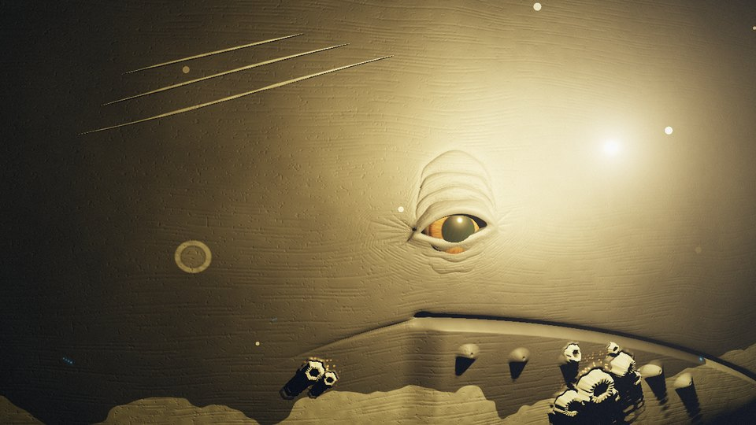

1. 整张是米色的石膏。光离皮肤太近，鲸皮的反照率给高了（0.05）。改成近乎全黑的 0.007，高光也压低。
2. 眼睛像卡通青蛙：鼓出来的绿球，橙色虹膜一圈。
   - 眼球埋深，让眼睑压在它上面。
   - 去掉瞳孔里的「反光膜」（它在这里发成了绿色），虹膜压暗。
3. 眼睛上面的褶子叠成一个蜂窝。
   - 原因：用到眼裂的距离场画同心褶，越往外越圆，就成了一圈圈。
   - 改成逐条画的弧：越往外越长、越平，各自只走一段。
4. 藤壶像玩具，下颌的白斑像一片地形，三道虎鲸咬痕像刻上去的槽。
5. 全身横向的细纹像拉毛的墙。

**第二到第五轮**，逐项改：

- 褶子从「雕塑的拱」变成「一格格鼓起的皮」：加了放射的短皱纹。
- 放射纹太长太细，像睫毛：缩短、加宽，上眼睑那边减少。
- 下眼睑一圈霓虹似的亮边：水光改成断续的细线。
- 皮肤上米粒一样的短划和毛孔：去掉，换成很弱的细颗粒。
- 眼周顺着眼睑的细纹又成了等高线：改成短而断续的放射细纹。
- 眼睛左边的一条竖直接缝：鱼尾纹的区域在一条竖线上被截断，改成按角度淡出。
- 虎鲸的咬痕和圆形旧疤，在暗处读起来像流星和光斑，删掉。宁缺毋滥。
- 皮肤上细小的橙色鲸虱，读起来像火星，也删掉。

**结果：**

推近 2.5 倍看眼睛。左：平视；右：转过来看光，后眼角露出眼白。

| | |
|---|---|
| 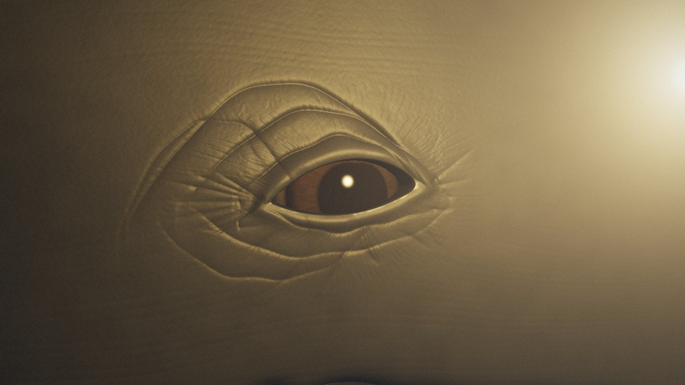 | 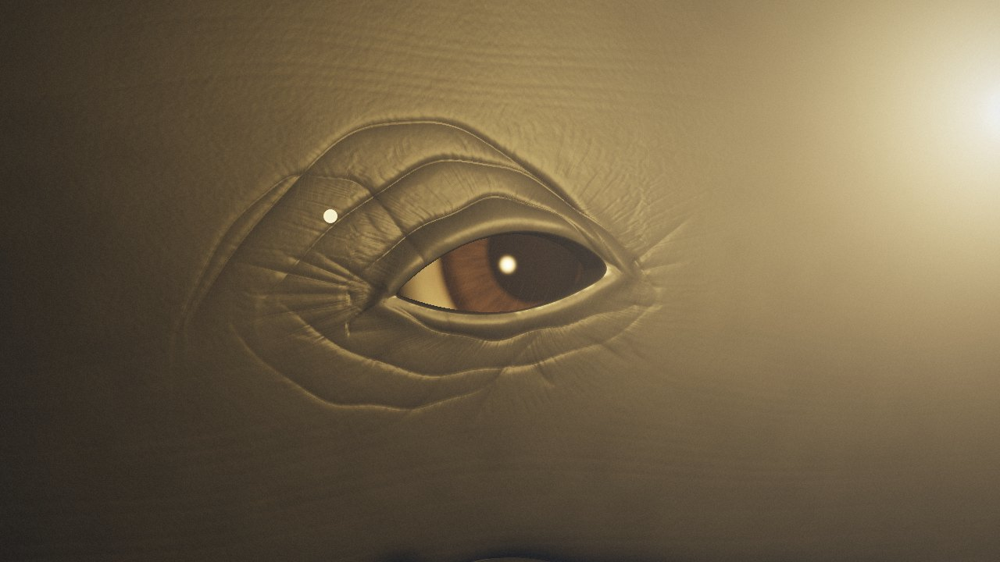 |

藤壶（推近 3 倍）。不再是白色的雏菊，而是嵌在皮里的、带棱的灰白火山口：

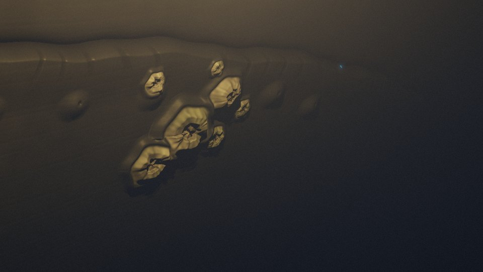

**滑过时的三帧。** 这里光是绑在鲸上的，只为了看皮肤在不同位置的样子；放进片子以后，光是独立的：

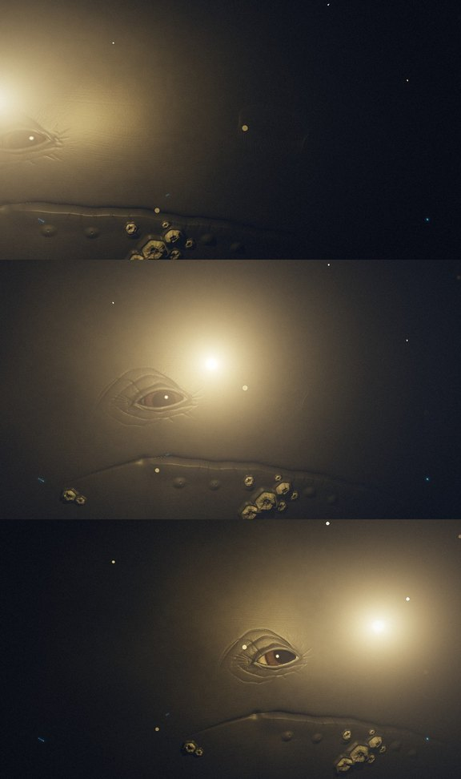

**代价：** 720p 下鲸占满画面时约 0.9 秒一帧（软件渲染）。比没有鲸时还快：鲸挡住了后面的水母和长长的散射积分。

**还要在片子里做的**（任务 C）：

- 编排它滑过的时机；
- 眼睛跟着光转，眨一次眼；
- 镜头推近；
- 黑水化开成墨，进入水墨世界。

## B：录制管线与成片模式

- **`?rec&fps=24&dur=秒`**：不跟真实时间走，每帧固定 1/24 秒。
  - 声音换成一个 `OfflineAudioContext`。它在每一帧的边界 `suspend()`：在这个空隙里，整部片子推进一帧（各个世界照常在 `ctx.currentTime` 上排它们的声音）、画出来、交给录制程序存下，然后 `resume()`，声音往前渲染这一帧。
  - 所以环境声和画面逐帧对齐，与机器快慢无关；软件渲染一帧要一两秒也没关系。
  - 片子结束时，离线上下文把剩下的声音一口气渲染完，编成 16 位 WAV 分块交出来。
- **`tools/rec.mjs`**：Playwright 截下每一帧 PNG，直接流进 ffmpeg（不落盘），最后把 WAV 合进去。
  - 测试：3 秒的夏天，72 帧，音频 3.000 秒，响度随蝉声渐起。
- **指针用片子自己的时钟。** 原来几处用 `performance.now()` 判断「手按住多久了」。录制时一帧要一秒多，真实时间和片子时间对不上；现在成片和录制模式下统一用片子时间。
- **定时动作也用片子时钟。** 原来导演用 `setTimeout` 延后播动机，录制时会错位，现在改成 `D.after()`。
- **`?film`**：成片的节奏，替观众动手：
  - 夏天里先一阵风扫过草地（一次从左下到右上的划动）；
  - 然后按住不动三秒（风停，蝉声涌上来）；
  - 深海里小鱼一齐闪一下逃开——因为鲸来了。
  - 开头从黑里亮起，结尾暗回黑里。

**节奏的第一次通篇**（旧结构，256×144，用来看流程）：

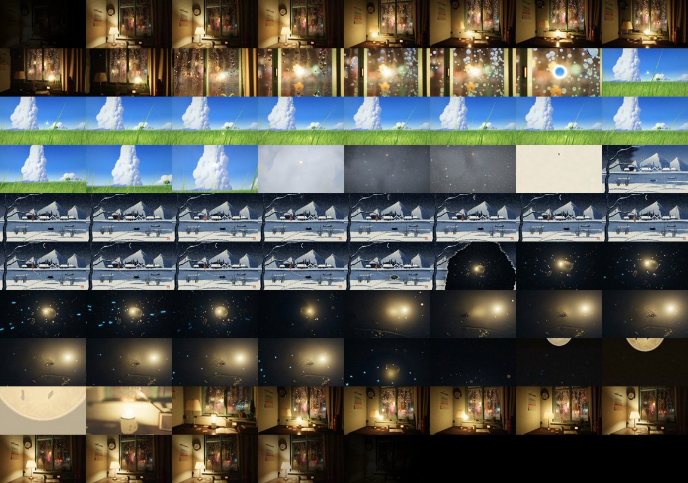

## C：重剪

成片里每个世界只演最好的两三拍：

| 段落 | 原来（互动版） | 成片 |
|---|---|---|
| 房间：灯闪两下，光跳出来 | 等 10 秒 | 3.4 秒 |
| 房间里的路线 | 茶、本子、挂钟、吊兰、窗，约 18 秒 | 茶的热气、吊兰、窗，约 8 秒 |
| 雨滴里的白昼 + 扎进去 | 7 秒 | 3.7 秒 |
| 夏天 + 上升气流 + 云里 | 42 秒 | 15 秒 |
| 木刻：印版、火落进灯笼、刻月亮 | 55 秒以上 | 约 12 秒（月亮一回家就刻） |
| 深海 + 鲸 | 46 秒 | 15 秒 |

鲸的那一拍：
- 小鱼受惊逃散后，它的下颌和眼睛从左边滑进光里，慢下来，停住；
- 眼睛转过来看光，眨一次眼；
- 再继续游走。

光会先过去，停在它眼睛将要停下的地方等着。

## D：走马灯·皮影

**做法：**
- **影子是逐像素投出来的。** 纸幕上每一点，从烛火连一条线过去，看它穿过了哪几片皮影（每片皮影是轮上的一个平面），取那里皮的透光颜色。
- **烛火有大小。** 离纸近的影子清楚，远的发虚、放大：按半影的宽度，在图集的 mipmap 里取相应的模糊层。
- **皮影本身用 Canvas 2D 画在图集上：**
  - 骑马人（马身、两条前腿、两条后腿、骑手，各是一片，腿在铆钉上摆）；
  - 鲤鱼（尾巴另一片，会甩）；
  - 渔船；
  - 一条浪。
  - 每片皮都有染色、刻掉的花纹（旋涡、鳞、格子）、贴着边缘刻的一道细线（皮影的做法），边缘是黑的。
- **纸幕：**
  - 纤维、两张纸重叠的接缝；
  - 八根竹骨和上下两道箍的影子；
  - 上下是红漆木框，带一道金线。
  - 透过前面的纸，隐约能看见后半圈纸上的影子（反着跑）和后面那道箍的椭圆。

**自评和修改：**
1. 第一张：纸是一片饱和的黄色，像塑料；16 根竹骨像栅栏。曝光降到四分之一，竹骨减到 8 根、变细。
2. 浪是八片平的皮，首尾相接时中间漏了光：平面要够到切线的长度，不是弧长。
3. 浪的下半截发亮：
   - 先以为是浪没挡住光。用调试视图（只看透光率）一看，浪是对的：青色的皮在橙色的烛光下本来就透不过多少红光。
   - 真正的原因是后半圈纸的光：视线从纸幕下面穿出去，后面已经没有纸了，却照样加了光。
   - 修好后，浪改成深靛绿，读起来是一片暗的海，里面刻着发亮的旋涡。
4. **进入：** 从木刻的灯笼推进去，推到只剩它透亮的纸，一道暖光里化成走马灯的纸，再拉开。
5. **离开：** 烛火一缩一沉，变暗。火往下沉，每一片皮影的影子就往上涌、变大，把纸幕吞掉，最后只剩那一点火，落进深海。

| 推进灯笼，化开，拉出走马灯 | 烛火一沉，影子涌上来 |
|---|---|
| 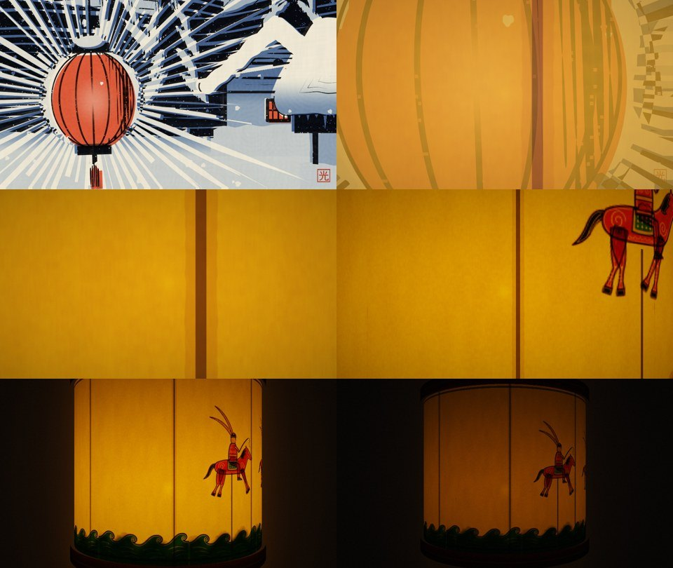 | 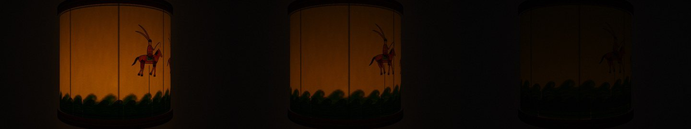 |

## E：水墨·烟雨山水

**做法：**
- 远山、中景、远岸用着色器算：每一块墨都是「湿的」：
  - 边往纸里洇开，毛边顺着纸纤维；
  - 边上积一圈深墨；
  - 里面的墨不匀，有颗粒。
- 近处的石壁、老松和芦苇是**画出来的**：一支模拟的毛笔，每笔二三十根毫，各自带墨，外侧的毫先干，干了就跳着走（飞白）；提笔时外侧的毫离开纸面。
  - 画在一张和画面一样大的画布上，分三个通道（石壁、松、芦苇），各自在自己的时刻洇开。
- 雾一层层流过山腰；细雨斜斜地下。
- 一点朱砂（那粒光）落在小舟上，水里一道淡淡的倒影。
- 印章是木刻里那方「光」，这里刻成白文。
- 从深海进来：黑水化开，墨团变薄的地方拉成细丝，像墨落进静水，再沉下去，沉成山。

**自评和修改：**
1. 石壁的皴法算出来是一排排规则的斜纹，像屋顶；松树是几根直棍加蒲公英。改成用笔画。
2. 用笔画的第一版：斧劈皴成了一排鲨鱼鳍，淡墨铺的底像一摞铅笔。
   - 原因是收笔时我让所有笔毫挤到笔尖，墨在那里叠得最浓——真的毛笔正相反，提笔时外侧的毫离开纸面。
   - 改了笔的物理，石壁改成：淡墨渐变的底、一道有力的轮廓、两道干笔的石纹、几笔宽而干的擦笔。
3. 中景山上的披麻皴原来是同心的条纹，改成顺坡往下、断断续续的笔。
4. 松干上的鳞纹像一条链子，去掉，只留几个墨点。

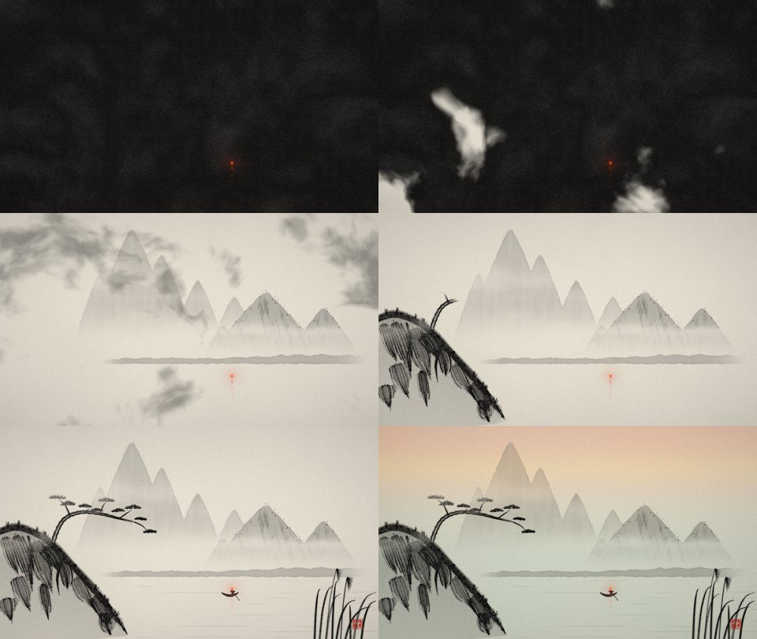

## F：印象派·清晨睡莲池

**做法：**
1. **打底**：在四分之一分辨率上画两张图：
   - 颜色；
   - 笔该往哪个方向走、多大、是什么（水、叶、花、柳）。
   画的内容：
   - 雾里的远岸（一团团树冠）、天光从金到玫瑰到淡紫；
   - 水里倒映的天、太阳在水上铺开的一条碎金的路；
   - 透视里一簇簇睡莲叶（带缺口）、粉白的花；
   - 从右上垂下来的柳条。
2. **底色**：打底放大、模糊、压暗，笔触之间露出来。
3. **两层笔触**（2600 笔大的，9000 笔小的），实例化，每一笔：
   - 取它所在处的颜色，色相、饱和度、明度各自抖一点，偶尔用补色；
   - 按方向和大小摆；
   - 有鬃毛的纹路，提笔处变细；
   - 有颜料的厚度：向光的一侧亮起一道。
   - 每秒重摆六次，整张画在呼吸。
4. 画布纹理、暗角。
5. 从水墨的黎明进来：笔触从太阳那里一圈圈往外铺开。
6. 离开：光停进近处一片叶子上的露珠，露珠滚落，一片白——是那杯茶。

**自评：**
- 第一张已经像一幅印象派，但叶子太少太小，像一小堆一小堆；
- 远岸的树是一排竖笔，像篱笆；
- 柳条只有几根线；
- 水面上补色的黄点太多，像撒了彩纸。
改为：九簇更大的叶子、圆的树冠、十六根柳条、补色只留 2.5%。

**通篇（后半，新结构，480×270）**：深海、鲸、墨化开、水墨一笔笔洇开、破晓、睡莲池炸开、露珠落进茶、回家、灯亮。

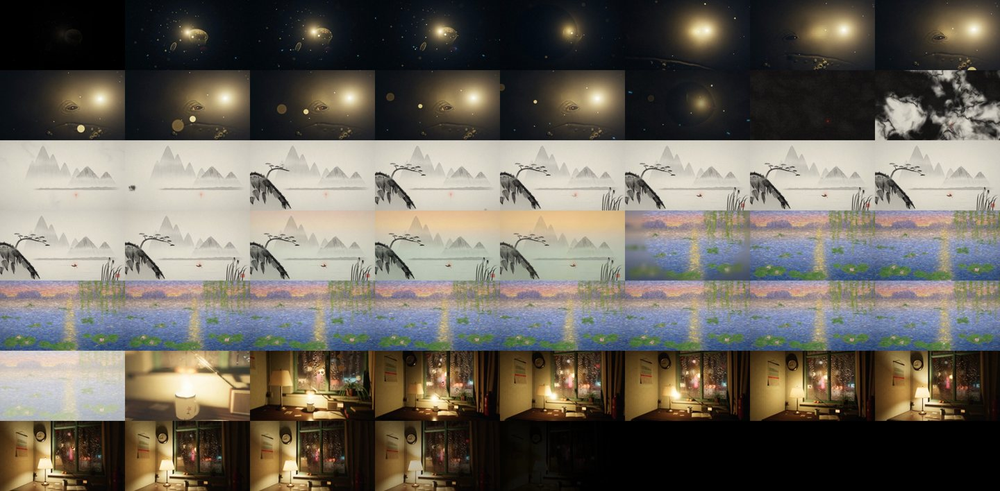

## G：配乐与混音

- **找开源素材。** Musopen 本身访问不了；Wikimedia Commons 的接口在这台机器上被限流。能用的是 Kevin MacLeod 的 incompetech（CC BY 4.0），它有一份完整的曲目清单。
- **筛选：** 先按长度（2–5 分钟）、乐器（钢琴、弦乐、竖琴、钢片琴，不要鼓和吉他）、情绪（不要滑稽、动作、恐怖）筛出约一百首。再下载其中五首，算响度曲线和频谱，看结构：

  | 曲目 | 时长 | 结构 |
  |---|---|---|
  | Eternal Hope | 4:44 | 真正在积累，但要到第四分钟才到高潮 |
  | Luminous Rain | 1:54 | 名字最贴题，可在第 35 秒就到顶，之后一路收 |
  | Aquarium（圣桑） | 2:24 | 段落分明，但最后一段全是滑音 |
  | Frozen Star | 3:41 | 起伏杂 |
  | **Dreamy Flashback** | **2:07** | 从头到尾一样的推进感，每约 9 秒一次乐句的涌起 |

  选 **Dreamy Flashback**：竖琴、钟、拨弦，三连音的分解和弦，利底亚调式。七个世界接连穿过，要的正是这种不停向前的推进；长度也正好。
- **对齐：**
  - 测得速度正好是 110 BPM，一小节 2.18 秒，四小节一个乐句 8.7 秒。
  - 配乐从光跳出台灯那一刻（第 3.4 秒，它的三音动机）进来。
  - 片子加长到约 122 秒（木刻、走马灯、鲸、水墨、睡莲池各多给一两秒），配乐的结尾正好落在片名上；进夏天、起风、印版几处转场离乐句的起点都不远。
- **混音**（`tools/master.mjs`）：
  - 配乐约 −21 dBFS；
  - 各个世界自己的声音垫在下面：房间的雨约 −23，鲸的叫声 −19，睡莲池的鸟只有 −36 左右；
  - 整体响度归一到约 −16 LUFS，片尾三秒淡出。
- **片名**：「一粒光」用思源宋体（Noto Serif SC，从 npm 上的 Fontsource 包取得，OFL），在黑场上淡入，下面是配乐的署名。

## H：成片

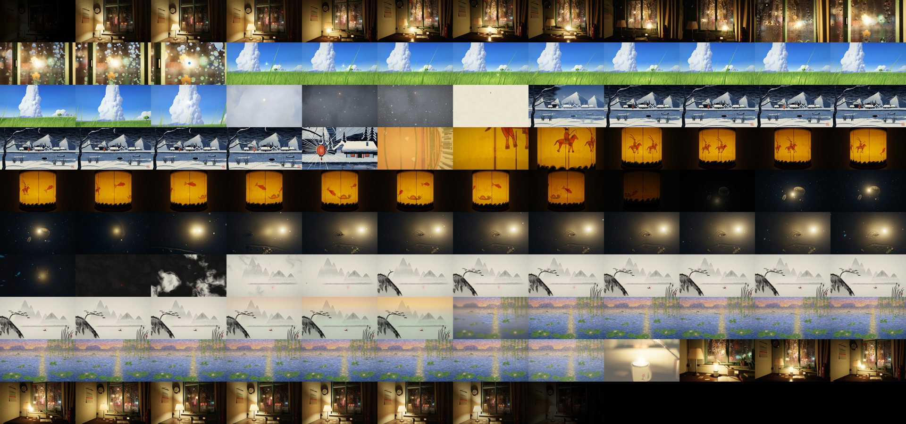

- **1280×720，24 帧，2 分 07 秒**（片子 116.5 秒 + 片名 10.5 秒），H.264 + AAC，响度 −15.7 LUFS。
- 配乐从第 0.5 秒进来，它自己的最后一个和弦落在片名上。
- **为什么是 720p 而不是 1080p：**
  - 录的时候才发现：之前的速度测试低估了软件渲染的代价，差了约十倍。原来的测法只是数帧数，GPU 命令其实没有真正执行完。
  - 改成逐帧从画布读出画面以后，真实的数字是：
    - 720p 下房间满分辨率 16.5 秒一帧，半分辨率光线追踪 5.5 秒；
    - 深海加鲸约 8 秒；
    - 其他世界 1–3 秒。
  - 整部片子在 720p 下渲了 2 小时 15 分；1080p 要两倍多。
  - 所以按约定交 720p。在有显卡的机器上用同样的命令渲 1080p 会快得多。
- 抽查的整帧：

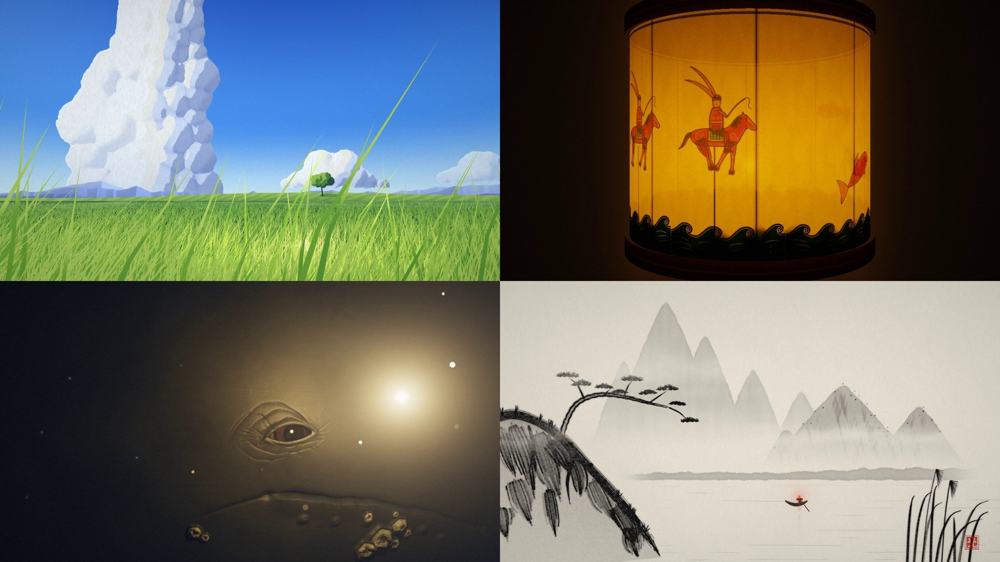

## I：第二轮——每个世界做透，光造出下一个世界

第一版成片的反馈：「完全达不到惊艳」。具体是：
- 房间的雨声太大，像站在室外；
- 每个世界都单薄、基本静止，没有生气；
- 皮影只有一盏灯笼，水墨简陋；
- 世界之间转得生硬，房间到夏天之间还有一处剪辑错误（光飞向窗户时卡了一下，就跳到了窗前）。

后来又补充了一条：转场要有意思。比如草原里的一张纸，被光钻进去就成了那幅画，而且要把「画」的过程本身表现出来；灯笼里的光进到一个黑暗的地方，把它照亮，才有了皮影。

**每个世界都按八条标准来做：**
1. 镜头一直在动。
2. 有前、中、远三层。
3. 至少五种东西在动，大中小都有。
4. 有天气、空气和变化的光。
5. 光有一件事可做，世界会回应它。
6. 至少四层声音，跟画面里的事件对得上。
7. 经得起整帧细看，也经得起 2 倍局部。
8. 不卡、不跳。

**工具：**
- `tools/cuts.py`：逐帧比较相邻两帧的画面差，和前后一秒的中位数比，列出所有计划外的突增。最初就是用它找到了房间里的两处跳切。之后每个预览片段都先过它。
- 成片模式下的镜头路径：关键帧，用 Catmull-Rom 插值，切线按段长缩放，所以速度在关键帧处是连续的。

### 房间

- **声音：**
  - 雨隔着玻璃：低通、压低；
  - 近处稀疏清脆的雨点；
  - 墙上钟的嘀嗒；
  - 整体约 −32 dBFS，在配乐下面。
- **镜头：** 一条连续的关键帧路径，从台灯一路推到窗上的雨滴。原来三个镜头的混合就是跳切的来源，这次去掉了。
- **光：**
  - 它的路线改成「流」，在路点上不再停下；
  - 冲进雨滴时，它离起雾的玻璃只有两厘米，把雾照成一片白。所以冲进去时它自己逐渐收暗。
- **会动的东西：**
  - 光经过时吊兰叶子被拂动；
  - 窗帘在缝隙的风里鼓动；
  - 茶的热气被光搅开。

### 盛夏

- **镜头：** 跟着被风带着走的光，低空贴着草尖往前飞。草叶在一块随镜头平移的地砖里循环，所以前面永远有草。
- **会动的东西**（全是时间的纯函数，逐帧可重现）：
  - 蒲公英种子；
  - 蝴蝶，悬停后突然掠走的蜻蜓；
  - 低空掠过的燕子；
  - 云影在田野上滑过。
- **声音：** 云雀、燕子的叫声。

### 盛夏到木刻：一张纸

- 夏天末尾，一张白纸被风从草上卷过来，翻着跟头。光追上去，镜头转向它。纸转过来正对着镜头，镜头推近，光落在纸上，钻进去，纸从里面暖暖地亮起来。纸占满画面时，就成了版画那张空白的纸。
- **印版画：**
  - 光在纸上横扫三遍（天、村、河与雪），蓝、黑两版印在它扫过的地方。做法是沿它的路线在一张小图上一笔笔「揉」出显影的范围，墨的边是毛的。
  - 光回到灯笼里，朱红版再像拓印一样扫上去。
- 原来的转场（上升气流、进云、变白、只剩一张纸）去掉了。

### 木刻

- **镜头：** 光从一个屋檐跳到下一个、点亮村里小灯笼的时候，推近跟着它看村子：人、窗、檐灯；刻新月时拉开看整张版画。
- 另修了两个问题：
  - 调试时直接跳进版画的入口没有设置镜头状态，所以两版预览都是静止的全景；
  - 推进灯笼时，镜头先跳回全景再推进，现在改成从眼睛已经在的地方推。
- **会动的东西：**
  - 提灯的村人沿河边走，狗跟着跑；
  - 冰窟窿边坐着钓鱼的人；
  - 乌鸦。
  - 这些都在每秒八印的版画里。

### 皮影：灯笼里的整个世界

- 画面就是那张发亮的纸幕。镜头贴着它，跟着一支迎亲的队伍绕灯笼走。所有影子仍然是从烛火逐像素投出来的。
- **几层皮影离烛火远近不同，转速也不同，所以有视差：**
  - 远山、云：在离火很近的环上，投得又大又虚；
  - 城墙和城门、宝塔、柳树、松、拱桥；
  - 近处：河岸、河、渔船、跃起的鲤鱼、芦苇、荷花。
- **队伍：**
  - 举旗的人（旗子往后飘）；
  - 四人抬的花轿（轿夫走路，前后两人错半步）；
  - 超过他们的骑马人；
  - 天上逆着飞的仙鹤；
  - 一条顺着自己的轨迹游过云里的龙。
- **图集**扩到 4096×2048，新画了二十来片皮影。花纹有格子、鱼鳞、砖、点。皮影可以翻面、可以在风里摆（柳条、芦苇），每片可以有自己的透光度。
- **半影原来算宽了 1/s 倍。** 改成物理的半影；很宽的半影改用四次采样，因为单取一层粗的 mipmap 会出方块。
- **龙尾巴一会儿没了一会儿又出来**（用户指出的）：视野里的皮影一多，就超过了上限，而龙是最后加进去的，尾巴最先被丢掉。改法：
  - 加大上限；
  - 灯笼背面那半圈，只画远层和中层。
- **进入**（按用户说的思路）：
  - 镜头穿过木刻灯笼的纸，里面一片黑，只有一点火苗；
  - 火苗一闪，点着了（一声锣）；
  - 光从离火最近的那一点向四周铺开，边缘像烛光一样摇曳，影子随光出现；
  - 等光铺满，热气才推动轮子，队伍走起来。
- **离开：** 烛火一缩一沉，纸幕暗下去，只剩火苗那一点。深海不再从黑里淡入，光在同一个位置直接接着下去。
- **声音是幕后的戏班：**
  - 火点着时一声锣；
  - 梆子跟着轿夫的步子；
  - 骑马人经过时的马蹄；
  - 鹤唳；
  - 龙出场时镲声渐强，加一阵鼓；
  - 河水、风、灯芯的毕剥声。

### 深海

- **生物：**
  - 更大的灯笼鱼群；
  - 一条管水母，闪光沿着它往下传；
  - 受惊的小虾吐出一团蓝光。
- **鲸，先是一整头：**
  - 最初的设计是从光后面擦过一段身侧、白色的长鳍扫过光，试了三版都不成形：身子要么占满画面，要么只是一道墙。
  - 改成：它从高处游过光的上方，镜头仰起来看。远处极淡的一点蓝光从上面来（顺带呼应结尾要浮上去的那杯茶），鲸就是这片蓝里的一个剪影。
  - 两片长胸鳍像翅膀一样张开，慢慢扇一下，尾鳍最后过去。
  - 它惊动的浮游生物沿着它闪蓝光。这些浮游生物是专门的一群粒子，铺在它要经过的路上，越靠近轮廓越亮，所以整个形状是用蓝色的火星勾出来的。
  - 它经过时焦点从光拉到鲸身上，再拉回来。
- 然后它绕回来，近近地看这粒光（原来的眼睛特写，节奏收紧了）。

### 水墨：光是画笔，画出一整幅长卷

- **画面变成一幅约三屏长的手卷，镜头沿着它横移。** 依次是：
  - 老松和石壁；
  - 两叠的瀑布：石壁由一块块山石叠成，每块都有断续、有粗细的轮廓，渐淡入雾的淡墨，顺着形体弯下去的披麻皴，石顶点苔；
  - 瀑布底下的深潭和湿石；
  - 溪岸和草；
  - 一座石拱桥，一个打伞的行人从桥上走过；
  - 柳树；
  - 树丛里的几间草房，树叶是不同的点叶；
  - 芦苇里飞起的白鹭；
  - 渔舟；
  - 卷尾的印章。
- **光就是画笔。** 它从深海浮上来的地方出发，先回去画老松，然后沿着山脊走，顺着瀑布下来，过桥，进村，到渔舟上停下，成了船灯。
- **做法：** 沿它的路线，在一张小图里记下笔「何时」到达每个地方：近笔一个范围，淡墨洇开另一个更大的范围。
  - 笔触在它经过时出现；
  - 刚落下的墨是湿的，颜色更深；
  - 淡墨稍晚才洇开；
  - 它从没经过的地方，最后一起补上。
- **这一版也重画了笔法。** 中间一版的山石像一摞箱子，房子像眼睛，柳树像伞：
  - 山石改成鼓出来又收进去的块面，淡墨顺着形体渐隐；
  - 草房改成斜铺的干笔茅草加一道屋脊；
  - 柳条改成从树冠直垂下来。

### 印象派·睡莲池

- **进入：** 天亮时，那点朱砂从渔舟上升起，变大、变成金色，成了太阳。睡莲池的笔触从它那里炸开。
- **会动的东西：** 所有会动的东西都画进「打底」，所以它们和其余部分一样，被重新画成笔触：
  - 鱼咬水、青蛙跳水、光碰到水面的地方荡开一圈圈涟漪，笔触顺着圈走；
  - 一阵阵风扫过水面，碎金闪得更厉害，柳条跟着摆；
  - 蜻蜓突然窜出去又悬停；
  - 一只青蛙从叶子上跳进水里；
  - 远水上有晨雾。
- **光有事可做：** 它沿着阳光的路跑下来，从一个花苞跑到下一个，每朵睡莲在它经过时张开。
- 光原来只画在四分之一分辨率的打底里，被笔触吃掉了。现在另外画在成品上面。太阳也从远岸的树后面挪到了树上面，好让升起来的光有处可接。
- 镜头沿岸在柳荫下慢慢移。

### 转场，第二版：光分出一粒光，去叫醒下一个世界

看过第一版转场后的意见：光不该从一个世界「穿梭」到另一个世界。下一个世界本来就在那里，只是暗着、睡着；光分出一粒新的光，去找到它，把它点亮。另一条意见是：光穿过一个界面时，穿过去的那一半就该已经是新的画法。

- **盛夏到木刻：**
  - 风卷来的那张纸上，本来就印着那个雪夜村子。纸上的画就是木刻世界本身，实时渲染到一张图上贴在纸面：褪成灰色，一动不动，没有灯。
  - 光在纸侧转开时从纸面钻进去。深度测试把穿过纸面的那部分遮掉，版画里在它进去的位置出现一朵火苗。
  - 村子从那一点醒过来：一道暖光往外推，墨色变浓，雪开始下，推到哪家，哪家的窗就亮。
  - 镜头推到纸刚好占满画面，然后以完全相同的取景切进木刻世界。跳帧检测：0。
- **木刻到皮影：**
  - 村尾的杆子上挂着一盏暗着的走马灯，纸面就是皮影世界的实时画面。
  - 刻完新月，大灯笼分出一粒火星（大灯笼自己仍然亮着），沿着村子飞进走马灯。
  - 里面的烛火点着，光铺开，影子出现，轮子转起来。镜头推进它的纸，就在皮影里了。
- **皮影到深海：**
  - 烛火再分出一粒火星，往下落进皮影里的河。河面打开，下面是深海。深海是按屏幕坐标透出来的，所以推到最后一帧正好是深海自己的画面。
  - 火星在水面上是纸上的一点热光，在水面下是深海自己的那团光跟着它走。镜头跟下去。
- **深海到水墨：**
  - 鲸走后，一只乌贼冲向那团光，受惊喷出一团墨，倒退着喷水逃走。
  - 光分出一粒火星钻进墨里。这粒火星就是原来灯笼鱼诱饵用的那第二个光源，墨团被它从里面照得发暖。
  - 墨顺着「眼睛—火星」那条线朝镜头涌开，火星在画面上的位置不动，最后只剩墨。
  - 水墨世界从这团墨里化开，那粒火星成了朱砂。
- **水墨到睡莲池：** 朱砂留在渔舟上当船灯，分出一粒火星升上天，从朱红变成金色，成了太阳。睡莲池的笔触从它那里炸开。
