# 《一粒光》开发记录

方案见仓库根目录的计划（世界先行，多审）。主角是从台灯灯丝里跳出来的一粒光；四个世界：雨夜的房间、盛夏午后、雪夜木刻、深海，最后回到房间。

## M1：骨架、房间、跳出来的光

| 跳出灯罩（连续帧） | 在茶的热气上 |
|---|---|
| 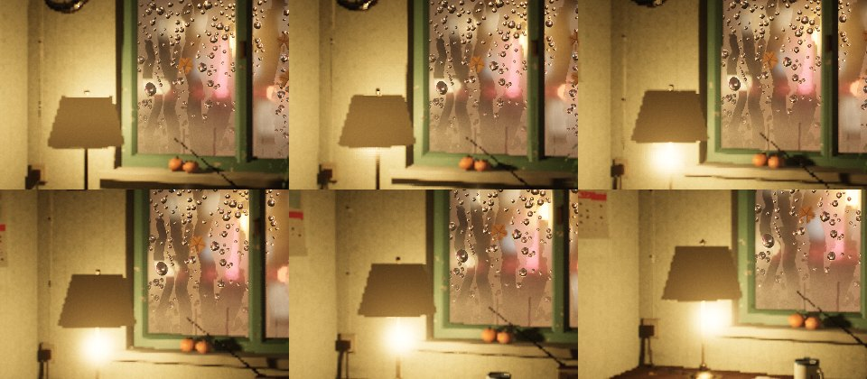 | 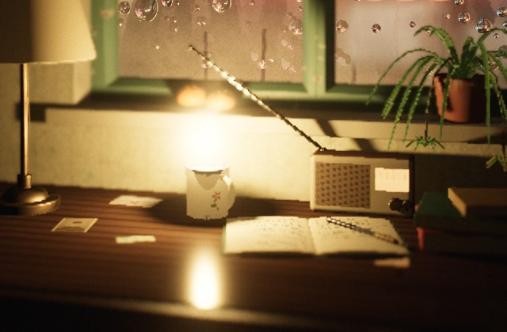 |

**结构。** 雨窗整段搬进 `src/room.js`，作为宿主：它拥有 WebGL 上下文、主循环、动态分辨率、上下文恢复和声音。

- 导演（`director.js`）和主角（`hero.js`）是普通脚本，通过 `window.YL` 拿到宿主的状态和工具函数。
- 后面的世界也这样挂进来。
- 好处是双击 `index.html` 就能打开，不用打包。
- 搬过来以后，用同样的参数和原版对比截图，平均每像素差 2/255，来自颗粒和抖动的随机性。

**一粒光：**

- **照明**：它是一个真实的球形小光源（半径 5.5 mm，2100–2400 K），接进房间的 `shade()`。
  - 有自己的软阴影，光滑表面上有高光，近处的东西还能拿到一点它的反弹光。
  - 透过吊兰叶子和窗帘，它会把叶子从背后照亮。
- **它自己的样子**：一个热的核心、一圈光晕，以及镜头对任何亮点都会有的一点眩光。房间空气里的散射用单次散射的闭式积分。挡在它前面的东西会把它挡住。
- **跟它互动的东西**：
  - 茶的热气会散射它的光；
  - 窗玻璃内侧的冷凝雾在它靠近时被照亮；
  - 它还在灯罩里时，灯罩是被它从里面照亮的。
- **性格**：
  - 路径是带停留的路点，用 Catmull-Rom 平滑，飞行时稍稍弧起；停留时绕着小圈东张西望，平时在空气里轻轻浮动。
  - 光标靠近，它会凑过去；光标甩得太快，它吓得一暗，躲开。
  - 它的明暗呼吸节奏是固定的，全片不变。

**第一幕的流程：**

- 台灯亮着。你点它，或者等它自己闪两下（约 7.5 s），十秒后一粒光从灯丝里跳出来，灯熄了。
- 它依次飞过：茶的热气、练习本、挂钟、吊兰，最后停在窗玻璃上。
- 镜头跟拍时，目标和焦点都跟着它，景深随之移动。快到窗前时，镜头推成玻璃的近景。

**自评与修改：**

- **光在画面里认不出来。** 半分辨率下，5.5 mm 的核心只有两三个像素，而它在台板玻璃上的高光被 GGX 拉成了一长条，看起来反而像主角。
  - 核心加一圈光晕和镜头眩光，让它读成一颗发光的小球。
  - 高光按它约 2 cm 的辉光尺寸来算，更柔和。
- **灯罩熄得太突然。** 光还在灯罩里时，灯罩就已经黑了，断了连续性。改为灯罩也被它从里面照亮。
- **热气上不亮。** 热气的体积散射原来只算台灯，加上它以后，它钻进热气时，热气会亮起来。

## M2a：盛夏午后（只做世界，还没放主角）

| 云的局部 | 手机竖屏 | 风（连续 4 帧） |
|---|---|---|
|  | 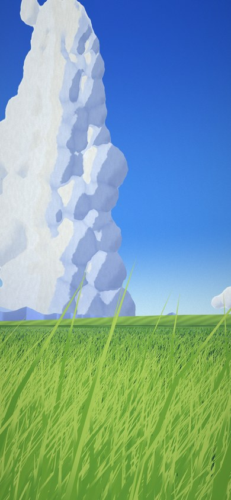 | 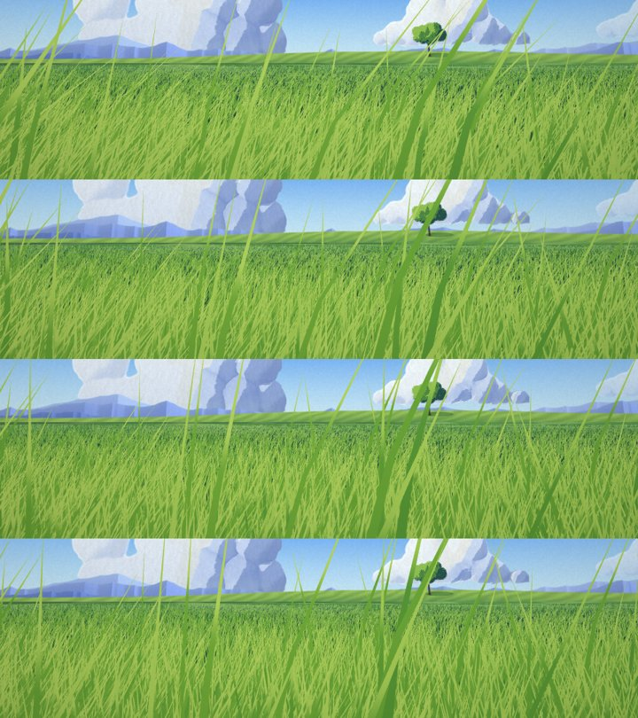 |

**色彩脚本：**

- 天：头顶是浓的天青，往地平线褪成被暑气蒸白的浅青。
- 云：一座积雨云塔，加几朵晴天积云。
- 远山：三层蓝紫色，越远越淡，越高。
- 坡：一道绿坡，坡顶一棵孤零零的樟树。
- 草：近处齐腰，阳光从左上方来。

**做法：**

- **背景**：全屏片元着色器，按视线方向画天、云、远山、坡和远处的草地。每朵云只在自己的包围盒里计算。
- **近处的草**：一万八千片真实几何的草叶，实例化绘制，4× MSAA，两三阶的赛璐璐明暗。
  - 风场 = 持续的风 + 一阵阵跑过草地的阵风带 + 光标的轨迹（光标就是风）。
  - 被风压倒的草露出发亮的草背。
  - 草丛的颜色成片地变。
  - 云影从草地上飘过。
- **声音**：三只知了（窄带噪声加快速的调幅，各自涨落）和草里的风声，随阵风和光标起伏。房间的雨声淡出。

**迭代过程（四轮，见下图）：**

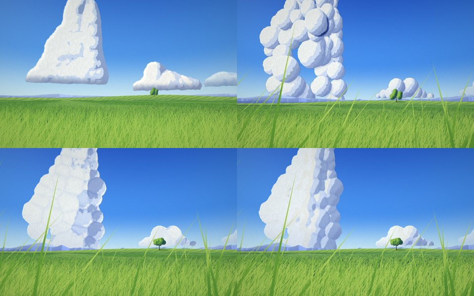

1. **第一版，云像一块歪着的白石头。** 几个大球平滑地并在一起，没有积云一团团翻滚的样子。
2. **第二版，换成一团团的「云朵」，每团各自按球体打光，结果像一堆雪球。** 画家画积云时，光是整块云的大明暗：左边亮，右边是蓝色的阴影；一团团的云只是这个大明暗上的起伏。
3. **第三版，改为整块云的法线加起伏的法线。** 起伏来自一张高度场：各团云的球冠取软最大值。轮廓用较紧的平滑并集。读起来对了一半，亮面却到处是迷彩一样的阴影斑块。
4. **查出一个符号错误。** 高度场的法线应该是 (−∇h, 1)，我写成了 (+∇h, 1)，每一团都被从反方向照亮。改正后：
   - 亮面平静，阴影面一团团的云块清楚地雕出来，像手绘动画里的夏日积雨云。
   - 再在亮面给每团云朝下的一侧加一层淡紫的半调。
   - 云的内部加一个实心的核，不会再透出天空。

**其他修改：**

- **相机。** 视点从 1.1 m 降到 0.85 m，加了几十片高高的前景草叶，人是站在草里的，而不是俯看一片草坪。
- **草。** 草叶加宽、减少数量，读起来是一笔一笔的颜色，而不是一层细纹理。
- **远山。** 原来是一条细线，改成峰形更尖、更高的三层山脊。
- **手机竖屏。** 镜头稍向左转，让云塔在画面里。

## M2b：光到了夏天；转场「雨滴里的白昼」

| 雨滴里的白昼（窗外仍是雨夜） | 光在夏天 |
|---|---|
| 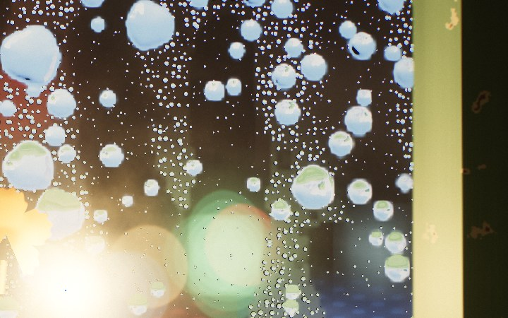 |  |

**转场，连续 6 帧：**

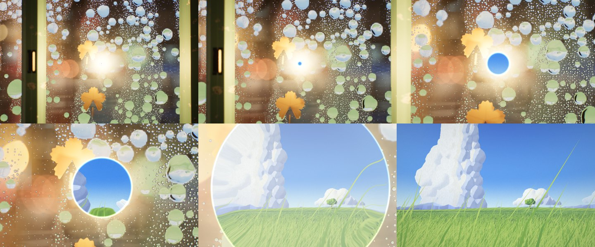

1. **雨滴里的白昼。**
   - 房间的合成着色器里，雨滴的折射本来采样窗外街景的等距柱状图。
   - 夏天的背景着色器多了一个模式：从窗口的位置、用同一套等距柱状参数，渲染出一张夏天的全景。
   - 转场时，两张图在 4.5 s 里交叉淡入。于是每一颗雨滴里都出现了一个倒置的小夏天：天在下，草地在上，这是现成的光学自然算出来的。
   - 透过干玻璃看到的，仍然是夜里虚掉的街。
2. **扎进雨滴。**
   - 镜头推到玻璃前，视场从 30° 收到 12°。
   - 光所在的那颗雨滴从它身上张开一个圆：先慢后快，指数地变大。圆的边缘像一圈透镜，里面的夏天被挤弯，外沿有一道亮的水的弯月面。
   - 最后一下短暂的白闪，夏天占满整个画面。
3. **同一处落地。** 光在夏天里出现的屏幕位置，就是那个圆张开的地方。
4. **声音交叉淡变**：雨声淡出，知了和风声淡入。

**光在夏天的样子：** 用这个世界的画法画，硬边的白色核心、硬边的暖黄光圈、柔和的辉光，加上几道慢慢转的光芒。它和房间里是同一个呼吸节奏。

- 它照亮身边的草：两阶赛璐璐的暖色，近处的草尖直接变成亮黄。
- 你划过的地方起风，草和它一起被吹走，一根弹簧把它拉回它喜欢待的地方。
- 按住不动，风慢慢停下，草静下来，知了的声音涌上来。

**自评与修改：**

- **雨滴里看不到夏天。** 调试时直接跳到 `daydrops`，夏天的世界从没初始化过，全景图也就不存在。改为转场开始时按需初始化（正常播放时，在光停到窗上那一刻就预先编译）。
- **雨滴太亮，像一颗颗蓝色弹珠，而不像玻璃。** 亮度系数从 0.55 降到 0.45。
- **光在夏天里一直高高地挂在天上，像一颗星。** 把它喜欢待的位置降到草尖的高度，它在那里才能把草照亮。

## M3a：雪夜·木刻（只做世界，还没放主角）

| 手机竖屏 | 2× 局部：灯笼与人家、雪峰、冰窟窿与小船、老树 |
|---|---|
| 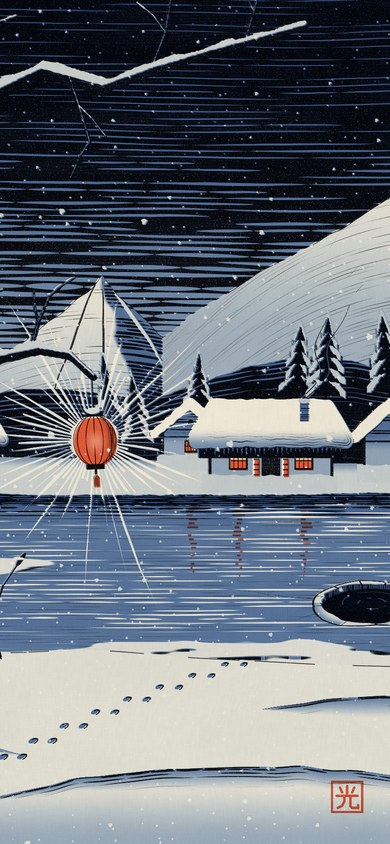 | 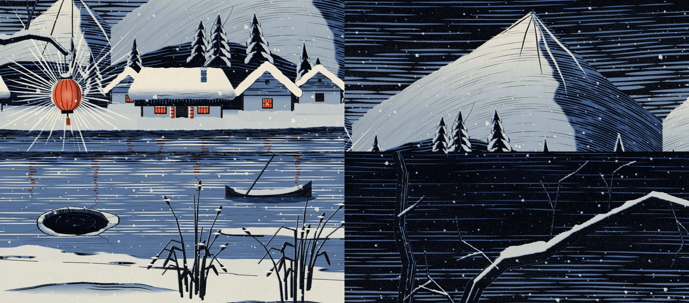 |

一张三块版套印的木刻：墨版（黑）、靛版（夜里雪的阴影、冰、天）、朱版（灯笼、窗光、春联）。纸是暖白的。

**它是怎么「刻」出来的：**

1. **刻线是一条一条的刀。**
   - 所有的线都是某个场的等值线，所以线顺着形体走：天是横的，雪峰阴面是绕着山体的弧线，雪堆是顺着雪棱的，树皮是顺着枝干的，灯笼是顺着它的经线的。
   - 每条线被切成一刀一刀，每一刀中间宽、两头尖，就是刀进去、刀出来的样子。线会轻微游走，刀与刀的长短不一。
   - 暗处是在黑里刻出白线，越亮刀口越宽；亮处反过来，是纸上留下的细黑线。线太密、刻不出来的尺寸，就退成平涂的色调，不会出摩尔纹。
2. **靛版是「擦」出来的渐变**（ぼかし），只有平滑的过渡，没有喷枪式的软斑。
3. **印的时候分两遍。**
   - 第一遍把三块版的覆盖量画进一张图。
   - 第二遍把它们「印」到纸上：三块版各自错一点位；纸有纤维和起伏；黑版的大块里看得见木纹，偶尔有没吃上墨的白点；靛版有马连（baren）擦过的痕迹，块面边缘墨会积得深一点。颜色按透光相乘，黑叠在靛上是蓝黑。
4. **每秒「重印」8 次。** 雪、灯笼的摆、烟、冰窟窿里的涟漪都以 8 fps 走；每一印的刀线、墨色、套色都有一点点不同。看起来像一张一张印出来的定格动画。
5. **雪花是刻掉的白点。** 落在黑处是白的，落在雪地（纸）上就看不见了，和真版画一样。
6. **右下角一方朱文印「光」**，用笔画画出来，不依赖系统字体。

**画面（从远到近）：**

- 落雪的夜空，三座雪峰。
- 黑松坡下一排粉墙人家：亮着几扇窗，一家贴着春联，烟囱冒烟。
- 前景一棵老树，粗干，挂雪的枝条横过天空。一盏红灯笼挂在它的低枝上，灯笼的光是一圈刻掉的放射白线，背后是黑山坡，所以光显得出来。
- 结冰的河：靛蓝，上面有横的刻线和冰上的反光；人家亮窗的倒影是一列朱红的短横；一条小船冻在冰里。
- 河心一个冰窟窿，四周一圈碎冰；一串脚印从近岸走过去。
- 近岸是大片的纸白，只有几道雪坡的阴影、几丛挂雪的枯苇。

**声音：**

- 几乎无声，只有很低的风。
- 隔一会儿，远处一声寺钟：低频带拍频的分音，长长的混响。
- 偶尔有一声雪从屋顶滑落。

**性能：** 场景这一遍很重（上百段树枝、几十根苇子、房子、山）。好在每秒只需要印 8 次：下一印分成 6 条，每个屏幕帧画一条，画进不显示的那块缓冲；到点就交换。截图和镜头跳变时整张一次画完。

**自评与修改**（四个版本见下图）：

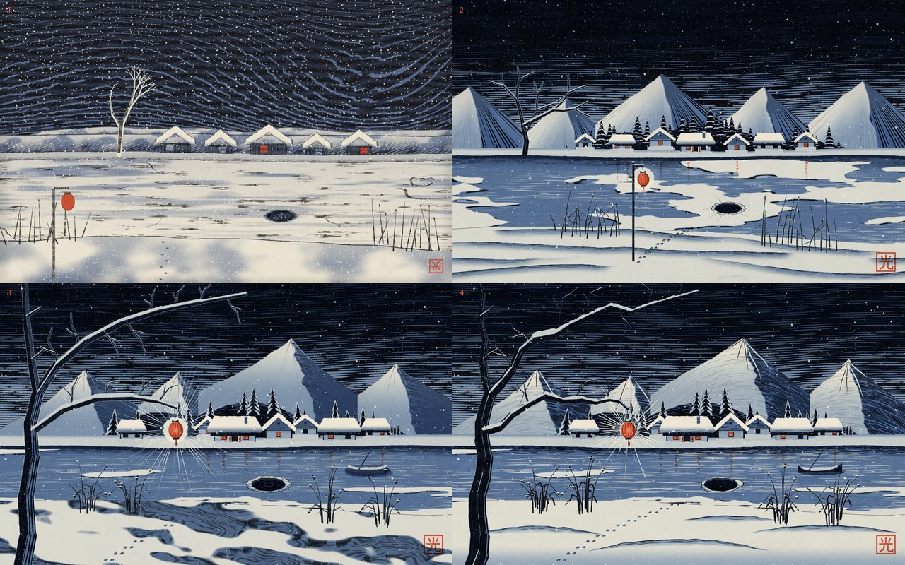

1. **第一版：像电脑滤镜。**
   - 天上的刻线太乱，像等高线。
   - 远山看不见。
   - 房子是一排积木。
   - 冰面和雪地是软糊糊的噪声斑，版画里不会有这种东西。
   - 于是整个重写：线顺着形体走、按色调变宽窄；分两遍渲染；套色错位。
2. **第二版：像版画了，但是像剪贴画。**
   - 山是规整的三角形，松树像圣诞树，冰上的雪斑像一张地图。
   - 画面全是横条，没有纵深，也没有视觉中心。
   - 于是：前景加一棵老树把画面框住，灯笼挂在它的枝头、背靠黑山；房子放大 1.5 倍；冰上的雪改成贴着岸的细长雪痕；加了冻在冰里的小船。
3. **第三版：近处的雪地变成了大理石纹。**
   - 用噪声坡度做的雪堆阴影，满地都是蓝色迷彩，里面还有一圈圈等高线。
   - 改成几道设计好的长雪坡：每道雪棱下面一小段阴影、顺着雪棱的排线，其余大片留纸白。
   - 树枝从直线改成一节一节拐弯的老枝。
4. **2× 细看后的修改：**
   - 细枝外面那圈白色勾边太粗，像霓虹灯管。真的刻工不会给每根细枝刻勾边，而是让天上的刻线在枝条处断开。现在只有粗干留一根细勾边。
   - 炊烟在白色雪山前看不见了。现在烟的线在黑处是白的，在白处是黑的。
   - 冰窟窿的冰沿先像一圈饼边，后来像一朵花，改成一块块直边的碎冰，各自远近不同。
   - 小船像一只轮胎，改成只露出冰面以上的一段船帮，两头翘起，里面积着雪。
   - 苇叶像天线，改成从秆上垂下来。
   - 雪峰亮面的蓝太重，读起来像浅蓝的山而不是雪，减淡了。
   - 手机竖屏时，取景往左挪，让灯笼完整地在画面里。

## M3b：光在版画里；转场「被抽走的颜色」；下刀

**转场，从左到右、从上到下：**

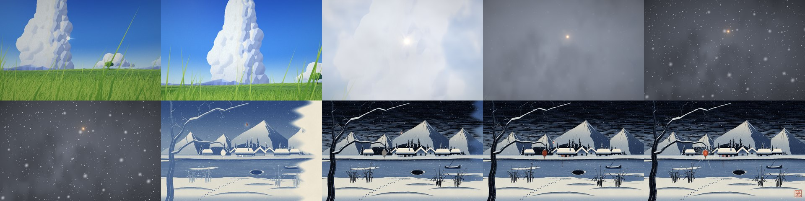

1. **上升气流（updraft，6.5 s）。** 夏天过了 30 秒，一阵上升的风把光带走。
   - 它朝那座最高的积云飞去，越来越远。
   - 镜头跟着它转过去、仰起来、慢慢推近。
   - 它远去时缩小得比透视慢一点，让眼睛跟得住。
2. **钻进云里（cloud，6 s）。** 夏天的画面上叠一层合成：
   - 两层云絮从镜头前往下流过：近的快、反差大，远的慢。这是在往上升。
   - 白慢慢变灰、变冷、变暗，四周更深，颜色被一层层抽走。
   - 雪落下来：远处细小，近处大而虚，斜着飘。
   - 整个画面里只剩那一点光是暖的。
   - 最后一秒，画面淡成一张纸：这就是木刻世界还没上版时的纸，同一张。
3. **印上去（print，4.8 s）。** 三块版依次印上：先靛版，再墨版，最后朱版，每块都像马连（baren）从左往右擦过去，边缘是一道毛糙的锯齿。印完，右下角才盖上那方印。

**光在这里是一团火：**

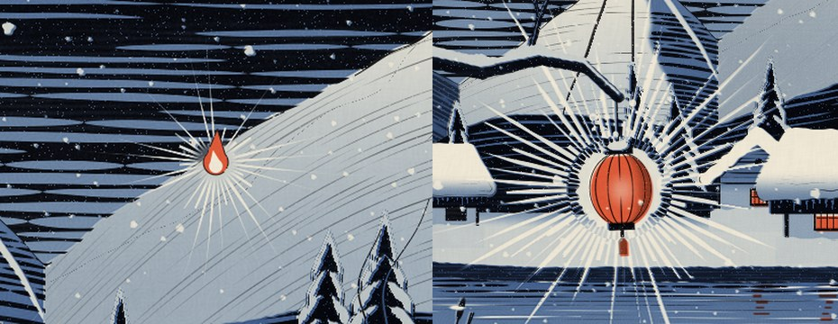

- **它是版画里的一团小火苗**：朱红的水滴形，白热的芯（留纸白），细黑的边，四周一圈刻掉的放射线。
- **只有它是平滑地动的。** 它是在「印纸」那一遍画的，每个屏幕帧都画；而它周围的世界每秒只重印 8 次。它不属于这里。
- **它随着雪落下，找到那盏黑着的灯笼，钻进去。**
  - 没点的灯笼是一盏暗红的灯，上面满是排线。
  - 灯一亮，排线从中心被烧掉，光变成一圈刻出来的白线，这一下会冲得比平时更亮。
  - 同时响起它的三音动机，这一次是木头的声音，像敲在木琴的音板上。
- **然后村里的窗一扇扇亮起来**，离灯笼近的先亮。
- **雪会积在灯笼顶上**，光随之暗下去一点；隔一阵，灯笼一抖，雪团飞出去，光猛地一亮。雪团背光的下半圈有一道细黑边，所以落在亮处也看得见。

**下刀：**

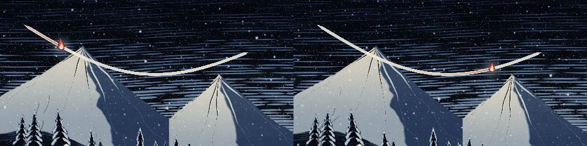

- 按住划过，就是在木板上下刀。刻掉的地方印出来是纸白。
- 慢的手刻得宽，快的手刻得窄；刀进去的地方细，抬刀的地方收成尖。
- 黑和靛都被刻掉，所以只能在暗处刻出光：在白雪（纸）上，本来就没有东西可刻。
- 你刻完一刀，光就离开灯笼（灯笼只剩一点余烬），飞到刀痕的起点，沿着刀痕跑一遍。它刚经过的那段刀痕还带着一点朱红的余温，然后回到灯笼里，重新点亮。
- 刻刀有声音：一种干的、随手速变化的刮擦声。
- 灯笼点亮后，屏幕下方出现一次提示「在黑处划一刀」。

**离开（leave）：**

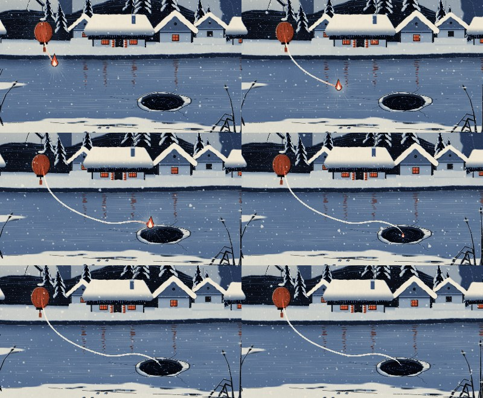

- 在这里待 50 秒后，光从灯笼里出来，自己当刀，一路刻出一条白线，穿过冰面走到冰窟窿，沉进黑水。
- 灯笼暗回一盏没点的红灯，村里的窗还亮着。
- （冰窟窿把纸面撕开、通到深海的那一下，在 M4b 里做。）

**自评与修改：**

- **光在全景里太小，几乎看不见。** 放大到原来的 1.25 倍。
- **云里那几秒像一块平的灰板，雪像均匀的噪点。**
  - 改成两层远近不同、往下流过的云絮，四周更暗。
  - 雪分大中小三层，近处的大雪片是虚的，数量也减少了。
- **光被带进积云时，在白云前完全看不见。** 让它远去时缩小得慢一些。
- **抖落的雪团在光芒里看不见。** 加了背光的细黑边，并且放大了。
- **刻刀的那一遍画进一张覆盖整张版的遮罩**，用「取最大值」混合，不会因为来回划而越刻越深、出现接缝。

调试：`?phase=updraft|cloud|print|woodcut|leave&pt=秒`；`&wh=x,y` 把火苗放在版画上某一点；`&shiver=秒` 看抖雪后的那一刻。

## M4a：深海（只做世界，还没放主角）

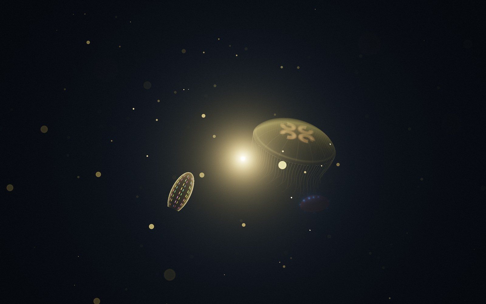

| 手机竖屏 | 2× 局部：海月水母、栉水母、Atolla |
|---|---|
| 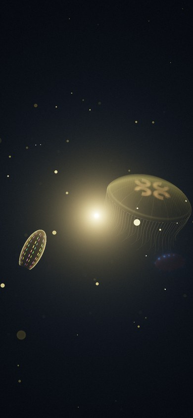 | 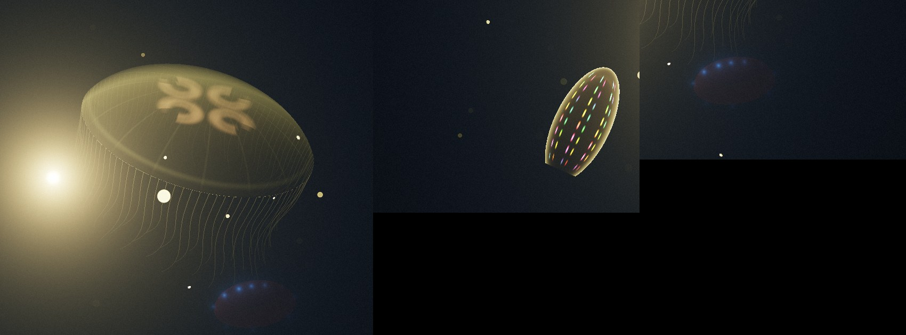 |

漆黑的水，没有上下。只有那一团暖光照亮的一小块水是看得见的。（光在这一步是固定的占位；到 M4b 它就是主角。）

**水与光：**

- **水按颜色吃光。** 光去照东西的那一段，红光一米就去掉一半多，绿和蓝走得远；东西回到眼睛的那一段吸收得轻一些。这是电影式的取舍：光照到的东西留住暖意，远处沉成蓝黑。
- **光在水里散开：** 点光源的单次散射，沿视线 12 个等角采样，没有噪点。
  - 粗颗粒对所有颜色散射得一样，而且集中在前方，所以光的近旁是暖的。
  - 细颗粒多散射蓝光、方向更散，所以外圈是青的。
  - 再加一层很宽很淡的多次散射，让光的周围有一团有体积的水。
- **后期：** ACES 色调映射；最暗处轻轻偏向深蓝；胶片颗粒让黑色不出色带；暗角。

**海雪：**

- 几千粒碎屑，在镜头周围 4 m 的立方体里循环漂移、缓慢下沉。只有光照到的地方才看得见。
- 景深以光的距离为焦点：焦外的变成虚的光斑，亮度按面积守恒变暗；焦内的是不规则的小絮。
- 约 7% 是会闪的蓝色浮游生物，在光照之外也看得见。

**三种生物（全用解析的椭球求交，薄膜的边是锐的）：**

- **海月水母。**
  - 伞是一只碟子：椭球在赤道以上被切开，伞缘是一道斜的薄边。
  - 它约 1.6 秒收缩、舒张一次，每收缩一次就往前游一点。
  - 光穿过它的路程越长越亮，所以它的轮廓自然发亮。
  - 看得见 16 条极淡的辐射管、伞缘的环管、四瓣乳白带粉的马蹄形生殖腺，伞缘垂着 96 根细触手（几何线条，随它的脉动摆动）。
- **栉水母（瓜水母）。** 透明的长囊，玻璃般的边光。八条栉板带是一排排小栉板，被光照到时颜色随光和视线的夹角变化，沿着栉板带往下流，纤毛的拍打像波一样传下去。
- **Atolla。**
  - 深红的伞，有冠沟。红光是深处最先消失的颜色，所以离光远时它几乎是黑的，只剩一个暗红的影子。
  - 伞缘一圈蓝色生物光，一段光弧绕着它转。M4b 里，你一动它就会拉响这个「防盗铃」。

**声音：**

- 低频的水压嗡鸣，慢慢起伏，底下垫着一个 41 Hz 的低音。
- 远处的鲸歌：滑音加共振峰，几乎全是混响，每 20–40 秒一段。
- 偶尔一声咔哒，像黑暗里有什么小东西。
- 电平：RMS −33 至 −40 dB，峰值 0.07，没有削波。

**自评与修改**（四个版本见下图）：

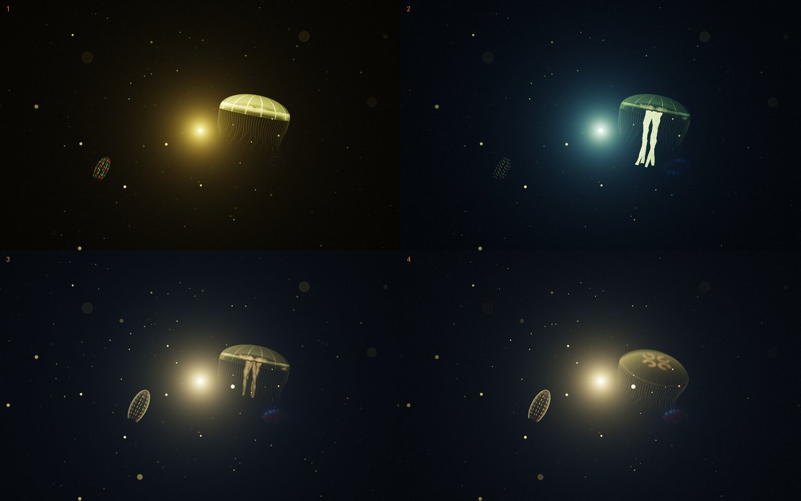

1. **第一版：一缸发黄的脏水。**
   - 水对红光吸收太少，光晕是橄榄黄的。
   - 水母像一把带伞骨的灯罩，栉水母像圣诞彩球，Atolla 看不见。
2. **第二版：成了橄榄绿。**
   - 暖光本身几乎没有蓝，水吃掉红以后只剩绿。
   - 改成细颗粒偏蓝的散射，再加一层冷色的多次散射。这一版第一次像深海了。
3. **口腕像两条棕色的根，伞像一只实心的卡其色圆顶。**
   - 水母到眼睛这 1.3 m 又把红光吃掉，暖色的水母变成黄绿；改成光去、光回两段分开吸收。
   - 口腕试了三种画法都像实心的绳子，宁缺毋滥，去掉了。
4. **伞像一个侧壁竖直的药盒；生殖腺像贴纸。**
   - 把切口移到赤道以上，伞变成碟子。
   - 让水母朝镜头倾一点，露出伞顶那四瓣生殖腺，生殖腺也改成柔和的乳白色。
5. **海雪像太空里的星星。** 只让光照到的海雪可见，并开大光圈，让更多颗粒成为焦外的光斑。

运动（连续 6 帧，每帧隔 0.35 s）：伞的收缩与舒张，触手的摆动。

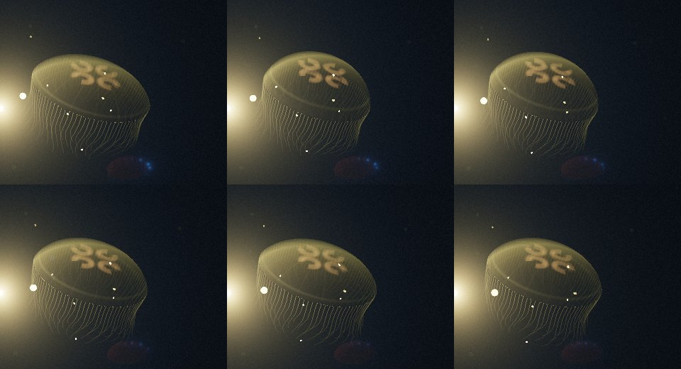

**鲸：还没达标，先不放进去。**

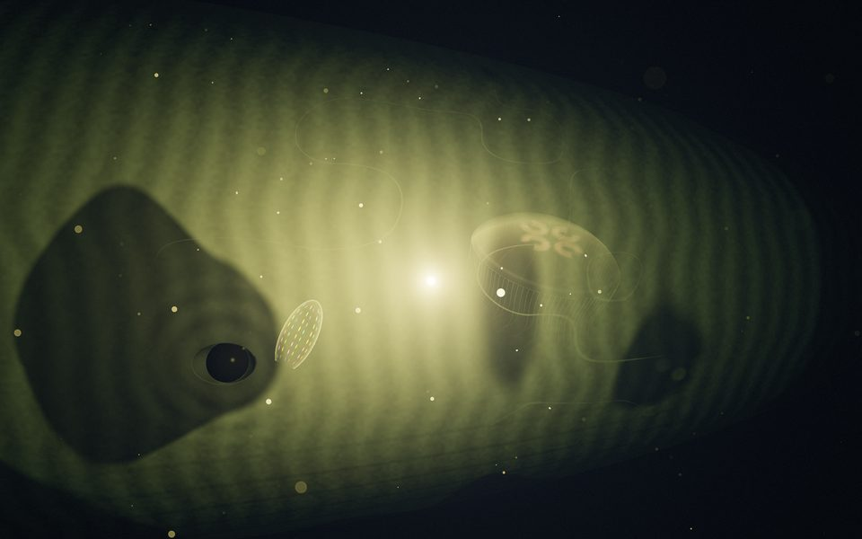

- 鲸的代码已经写了：SDF 的身体、眼窝和眼睛、带扇贝边的白色胸鳍、斑块、划痕、藤壶、喉部褶沟，海雪会被它挡住。
- 但现在的样子是一根带条纹的大香肠，眼睛像卡通，胸鳍从正面看只是一团黑影。
- 根本原因在取景：要做到「只看见一小片皮肤和一只眼睛」，鲸要贴着光、占满画面地滑过去，轮廓永远不出现。这要围绕主角的位置来设计镜头。
- 所以挪到 M4b，和主角一起做。在那之前，它只在调试参数 `&whale=x`（x 是它沿路线走到哪儿）下出现。

调试：`?world=deepsea`；`&whale=x`。

## M4b：光在深海；转场「冰窟窿」；好奇的小生命；另一粒光

**转场 3→4：冰窟窿撕开纸面。**

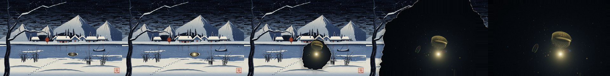

- 光在版画里沉进冰窟窿后，那片黑水先变成真的水：洞里透出深海，那粒光就在洞里。屏幕上的位置和它沉下去的地方相同。
- 然后纸从洞口撕开：边缘在每个尺度上都是毛糙的，有一圈白色的纸纤维；纸被掀起的地方暗一点；洞内靠边的水压着纸的影子。
- 洞越撕越大，越过四角；洞里的深海从远处推近，直到占满画面。
- 声音：干的撕纸声，接着一记沉重的下坠闷响；木刻世界的声音淡出，深海的嗡鸣淡入。

**光在深海：** 在这里它就是唯一的光，它照得到的地方就是你看得见的全部。

- 你的手牵着它，它在一米外跟着；放手，它就自己在中间缓缓漂。
- 它一直在下沉：海雪相对镜头慢慢往上飘。
- 它的明暗呼吸和其他世界一样。

**好奇，然后受惊。**

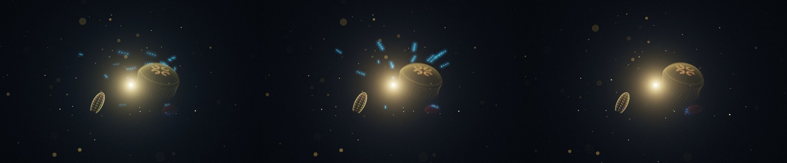

- 黑暗里游着十几条发光的小鱼，每条身侧一排四个蓝绿色的发光器。
- 你的手静下来几秒，它们就一条条游过来，在一段距离外绕着光转。越胆小的来得越晚。
- 你一动，它们猛地一闪，熄灭，四散；远处的 Atolla 拉响它的「防盗铃」，一段蓝光飞快地绕着伞缘转，几秒后才平息。

**另一粒光。**

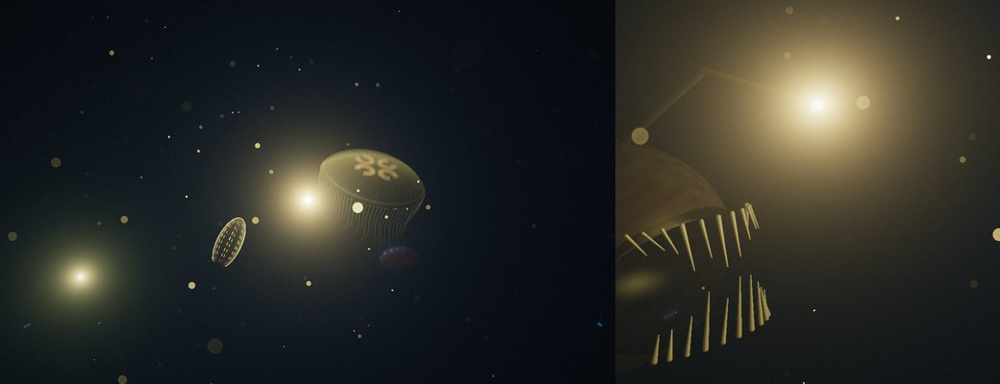

- 进入深海 24 秒后，黑暗的左边亮起另一粒光。它和我们的一模一样：一样的暖，一样的呼吸（只是错开一点），也照亮它身边的海雪和水。
- 它不慌不忙地靠近。等我们的光能照到它身后时，才看见那是一张嘴：
  - 深色的头；
  - 上颌一排向下、下颌一排向上的细长獠牙，长短不一，下颌往前突；
  - 一只会映光的眼；
  - 挑着饵的细柄。
- 我们的光吓得暗下去、往后退。那张嘴猛地合上，饵熄灭，鱼退回黑暗。
- 声音：现形时一声低沉的起伏，合嘴时一记闷响。

**自评与修改：**

- **灯笼鱼正对着我们张嘴时，只看得见一圈放射状的牙，像一朵花。**
  - 改成从侧面横着游过来，我们看到的是它的侧脸。
  - 牙从「一圈环」改成上下颌两排交错的獠牙，长短、粗细、角度都不规则，下颌往前突。
  - 皮肤略微提亮，加了湿润的高光，头的形状才显出来。
- **深海整体偏橄榄黄。** 把光去和光回两段对红光的吸收都减少了，暖光照到的东西现在是琥珀色的。

**鲸：第二次尝试，仍未达标，仍不放进片子。**

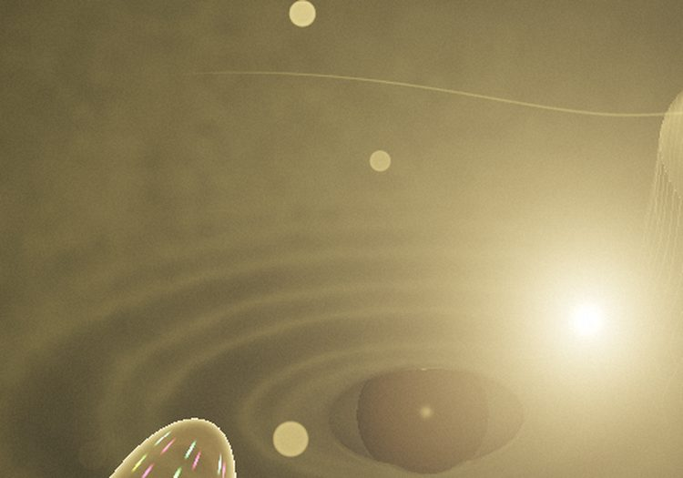

- 这次取景对了：身体加大到真实的粗细，从光后面约 35 cm 处贴着滑过，画面里只有一片皮肤，轮廓不再出现。
- 但皮肤和眼睛还不够真：
  - 眼周的皱褶成了一圈圈同心椭圆，像靶子；
  - 眼球是扁平的褐色；
  - 皮肤只是模糊的斑驳。
- 它仍然只在 `&whale=x` 下出现。要真的做好，需要专门的一轮：用参考照片定眼睑、皮肤纹理和藤壶的样子。我把它列为 M6 的待办；如果那时还达不到，就从计划里拿掉。

调试：

- `?phase=tear|deepsea&pt=秒`；
- `?world=deepsea` 下另有：
  - `&calm=秒`：手静了多久，小鱼靠过来没有；
  - `&scare=秒`：手动了之后多久；
  - `&lure=米`：饵离光多远，小于 0.65 时鱼现形。

## M5：杯底，回到房间

**转场 4→5：往上浮。**（深海里约 46 秒后，等饵的那一幕演完）

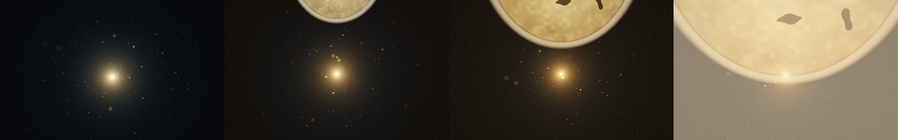

- 光不再跟着手走，它往上浮，镜头跟着它升起、仰起来。
- 头顶有一圈暖光，杯口那么大：
  - 水面透下来的光，中间最亮，随水波晃动；
  - 边上一圈白搪瓷，是杯子的口沿；
  - 几片卷曲的茶叶漂在上面，是暗的剪影。
- 越往上，水越像茶：黑里透出琥珀和棕。雨声隐约从水面上传下来。
- 最后一片暖光。

**第五幕：回到房间。**

1. **穿出水面。** 暖光从画面上散开，是书桌上那只印着小红花的搪瓷杯。镜头从茶面上方慢慢往后拉开，露出雨夜的房间。
2. **回家。** 光从杯口的热气里升起，停一停，四下看看，然后飞向台灯，照亮它经过的书桌、收音机和墙。
3. **灯重新亮起。** 它钻进灯丝，灯「咔」地一声亮了，响起房间里那个钢片琴音色的三音动机。光渐暗，消失在灯丝里，镜头回到片头的位置。
4. **雨还在下。** 结束后再点一下台灯，光又会跳出来，整部片子从头再来一遍。各个世界的状态都会重置。

调试：`?phase=rise|surface&pt=秒`。

## M6：通篇、健壮性、文档

**不碰任何东西，从头到尾播一遍。**

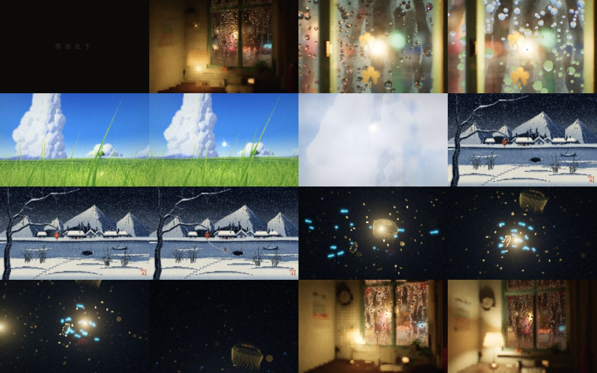

- 用加速参数 `&fast=6` 在软件渲染下自动播放，每次换阶段截一张（缩略图分辨率很低，只用来看流程）：
  房间 → 漫游 → 窗前 → 扎进雨滴 → 夏天 → 上升气流 → 云里 → 印出来 → 木刻 → 离开 → 撕纸 → 深海（饵出现、靠近、现形、退走）→ 上浮 → 回家 → 结束。
- 整部片子约 3 分 30 秒，没有卡住，没有报错。

**这一轮看出来、改掉的：**

1. **木刻那一幕，不碰的话太静了，观众也不知道这里能「下刀」。**
   - 现在如果 20 秒内没人下刀，光会自己飞出灯笼，在夜空里慢慢刻出一弯新月：外弧，内弧，再加两道顺着月形的刻线。然后回到灯笼。
   - 这一下既演示了玩法，又是一个小小的意外。月亮会一直留在版画上。
   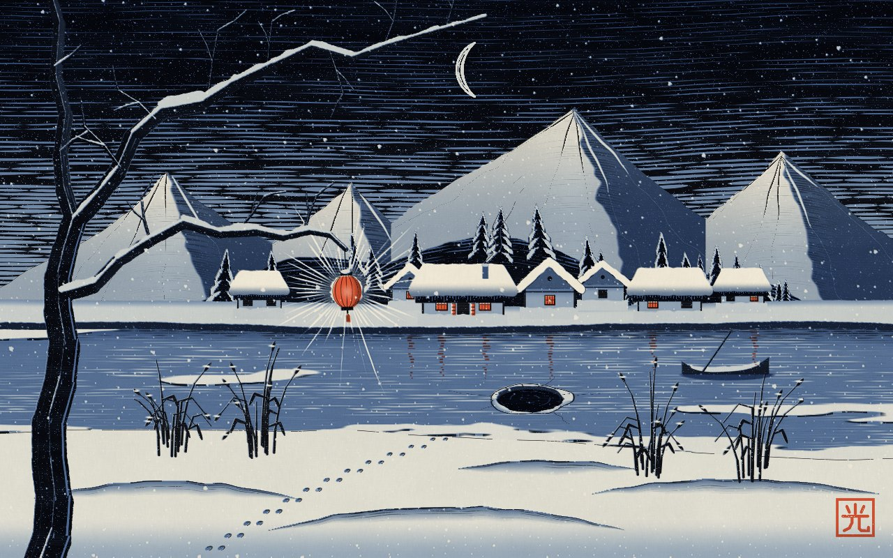
2. **深海里，光被灯笼鱼吓退时退到了画面边缘，镜头没有跟。** 加了一个死区跟随：光在画面中间时镜头不动，靠近边缘时镜头慢慢转过去。
3. **刚开始上浮时，镜头仰得比光升得快，光掉出画面，有一两秒只剩黑水。** 上浮时光跟得更紧。

**健壮性：**

- **WebGL 上下文丢失后恢复。**
  - 宿主本来就会重建自己的资源。现在导演会清掉转场合成用的缓存，各个世界会重建自己的着色器、缓冲和渲染目标，但保留时间和主角的状态，不会跳回开头。
  - 「丢失」事件晚一帧才派发，这一帧里画布尺寸读成 0。原来木刻世界会据此去重建渲染目标而报错；现在这一帧直接跳过。
  - 三个世界都实测过：丢失、恢复、继续画，没有报错。
  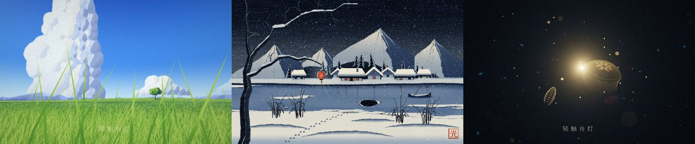
- **减少动态效果：** 系统设了这一项时，木刻的线条和套色不再在每一印之间抖动。
- **慢的设备：** 主循环把每帧时间限制在 0.05 秒以内，帧率低时整部片子只是放慢，物理不会失控。
- **单文件：** `node yiliguang/tools/inline.mjs` 把所有脚本合进 `yiliguang-single.html`（约 480 KB），可以单独发给别人。

**README：** [`README.md`](README.md) 写了怎么打开、五幕各自可以做什么、文件结构和调试参数。

**仍然没做到的：**

- 鲸（见 M4a、M4b）。
- 没在真机、真显卡上测过，所有截图都来自软件渲染。
- 声音只验证了技术层面。
