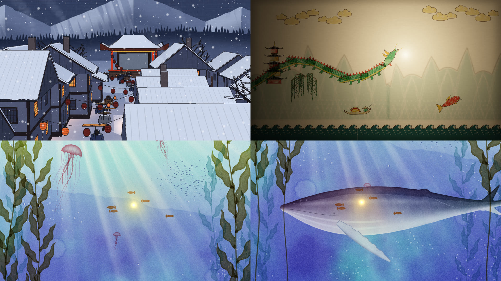

# 一粒光

一部动画短片。雨夜的房间里，你去点台灯，灯没有关上，而是从灯丝里蹦出一粒光。它在屋里飘了一圈，钻进窗上的一颗雨滴，然后穿过七种画法完全不同的世界，最后从一杯茶里浮上来，回到台灯里，灯重新亮起。

它有两种看法：

- **成片**：约 2 分钟的视频，带配乐。由 `?film` 模式逐帧录制（见下面「录成片」）。
- **互动版**：直接在浏览器里打开，可以用手牵着那粒光；不碰也能自己播完，每个世界停留得更久一些。

| 雨夜·房间 | 盛夏·午后 | 雪夜·戏台 / 戏台·皮影 / 海（样张） | |
|---|---|---|---|
|  |  |  |  |
| **水墨·烟雨山水** | **印象派·清晨睡莲池** | | |
|  |  | | |

## 怎么打开（互动版）

- 直接双击 `index.html`，用桌面版的 Chrome、Edge、Firefox 或 Safari 打开。不需要服务器，也不需要联网。
- 想发给别人，用 `yiliguang-single.html`：它是同一部片子合成的单个文件。在仓库根目录运行 `node yiliguang/tools/inline.mjs` 可以重新生成。
- 声音要在你第一次点或按屏幕之后才会开始，这是浏览器的规定。建议戴耳机。
- `index.html?film`：在浏览器里看成片的剪辑（节奏和成片一样，但声音是实时的，没有配乐）。

## 七种画法，一条光的旅程

每一种画法里，那粒光都是「光被画出来的方式」本身。

| | 世界 | 画法 | 光在这里是什么 | 通往下一个世界 |
|---|---|---|---|---|
| 1 | **雨夜·房间** | 写实的光线追踪：雨滴、玻璃、雾气、台灯 | 从灯丝里逃出来的一点暖，一个真的会移动的光源 | 窗上每颗雨滴里倒映出晴天；扎进它所在的那一颗 |
| 2 | **盛夏·午后** | 手绘动画背景：厚涂的积云、赛璐璐的草原；燕子、蝴蝶、蜻蜓、种子、云影 | 风里的一点阳光 | 风卷来一张纸，落在草尖上；纸上只印着墨版——一个雪夜村子的黑线，还没上色。光飞到它上面停一停（暖光落在纸上），然后直落下去、穿进纸面：纸面把它切开，穿过去的那一半已经是版画里的火苗。颜色从那一点一圈圈印开；镜头降下来、转正，直到纸就是整个画面——纸上的本来就是那个村子 |
| 3 | **雪夜·戏台** | 新版画（套色木刻）：一个真的三维村子，用光线求交画出来，再「印」——面一变就是墨版的线，色版错位，天上有木纹，和纸纤维，胡粉落雪 | 落进纸里的那粒光，成了版画里一朵刻出来的火苗 | 它顺着巷子飞，一路点亮横过巷子的灯笼串，越过等着看戏的全村人，钻进村口戏台的那块幕；幕从那一点亮起来。镜头跟着推进幕里，直到幕就是整个画面——幕上的本来就是皮影那个世界 |
| 4 | **戏台·皮影** | 幕后点着灯，每一片皮影从灯的位置逐像素投到幕上：贴着幕的清楚，离幕远的大而虚；灯一动，远处的影子跟着挪 | 幕后那盏灯；它在幕上的那团亮，就是龙要追的珠 | 珠往下一沉，落进皮影的浪里——浪线以下就是海：两个世界每一帧都在画，镜头跟着珠往下走，上面的幕慢慢退出画面 |
| 5 | **海·透明水彩** | 颜料是乘上去的（一层层罩染）：湿画法的大片水色、干后的硬边和深线、水渍、撒盐、颗粒；纸白就是光 | 珠：画面里唯一的暖色，四周的颜料被提掉、留出纸白 | 一头座头鲸游过来，停在珠旁边看它、眨眼；一只鱿鱼受惊喷出几团墨，墨在水里翻卷成烟，越来越浓，颜色被它吃掉——只剩墨 |
| 6 | **水墨·烟雨长卷** | 湿笔：墨往纸里洇开，干笔飞白，大片留白；一幅三屏长的手卷：瀑布、深潭、石桥、行人、草房、芦苇、白鹭、渔舟 | 一点朱砂，也是画笔：这幅长卷是它一路画出来的 | 天亮时它留在渔舟上当船灯，分出一粒火星升上天，成了太阳 |
| 7 | **印象派·清晨睡莲池** | 一万多笔有方向、有厚度的笔触，色彩碎片，补色并置；涟漪、阵风、蜻蜓、青蛙、晨雾 | 初升的太阳，和水面上的第一点光：它经过的睡莲一朵朵张开 | 它停进一颗露珠；露珠滚落，落进书桌上那杯茶 |
| ↩ | **回到房间** | 同一个雨夜 | 回家的光 | 它飞回台灯，灯重新亮起 |

光是一条线，镜头从头到尾不切：下一个世界一直就在这个世界里面——草上那张纸印着村子，村口戏台的幕上演着皮影，皮影的浪下面是海——光钻进去，那个世界就从它进去的地方醒过来。转场时两个世界每一帧都在画，交界是画面里一个真的东西（纸面、幕、浪线、墨团的边）。

画风彼此不撞：木刻是冷蓝雪夜里刀刻的硬线和平涂；水墨是暖灰烟雨里湿的、洇开的笔，没有一根硬线，两者在片中隔着两个世界。皮影是「光穿过来」，木刻是「印在纸上」。印象派是全片颜色最饱和、最碎的一个，紧接在全片颜色最少的水墨之后。

## 做法要点

- **以房间为宿主。** `src/room.js` 是原来的雨窗，它拥有 WebGL 上下文、渲染循环、动态分辨率、上下文丢失后的恢复和声音。其他世界注册到 `YL.worlds`，共用它的 GL 上下文。所以不需要打包工具，双击就能打开。
- **导演**（`src/director.js`）是一个状态机：决定这一帧画哪个世界；转场时同时画两个世界，在合成着色器里交接；让光在两边的屏幕位置保持一致。`?film` 时换成成片的节奏，并且替观众「动手」：夏天里一阵风扫过草地、按住不动让风停下；深海里小鱼一齐受惊——因为鲸来了。
- **每个世界都用自己的画法画这粒光，也用这粒光照亮自己。** 它的明暗呼吸节奏在所有世界里都一样；它还有一个三音动机，每个世界换一种音色。
- 每个世界的做法、试过又放弃的东西、每一轮自评和修改，都记在 [`DEVLOG.md`](DEVLOG.md)，配有截图。

## 录成片

```
Q=0.5 node yiliguang/tools/rec.mjs out/film.mp4 "film&seaq=0.75" 140 1280 720   # 逐帧渲染画面和环境声
node yiliguang/tools/master.mjs out/film out/一粒光.mp4 1280 720                    # 配乐、混音、响度、片名
```

- `rec.mjs` 打开 `index.html?rec&film`：片子不跟真实时间走，每帧固定 1/24 秒。声音在一个**离线音频上下文**里渲染，它在每一帧的边界停下：先推进整部片子一帧、画出来、存下，声音才往前渲染这一帧。所以雨声、蝉声、木轮声、深海的嗡鸣、古琴、鸟叫和画面严格对齐，与机器快慢无关。画面直接以 PNG 流进 ffmpeg 编码。
- `master.mjs` 把配乐垫在环境声上（配乐从光跳出台灯那一刻进来），整体响度归一到约 −16 LUFS，片尾加片名和署名。配乐和字体第一次使用时自动下载。
- `Q` 是房间光线追踪的内部分辨率（1 = 满分辨率），`seaq` 是深海的内部分辨率；画面最后都按输出分辨率合成。
- **没有显卡时很慢。** 软件渲染（SwiftShader）下，720p 一帧：房间约 5.5 秒（`Q=0.5`），深海加鲸约 9 秒，其他世界一到几秒；整部片子约三小时。1080p 要两倍多。有显卡的机器上会快得多。
- 画面是在页面里直接从画布读出来的（画布保留了绘制缓冲），而不是截整个页面：1080p 的软件渲染画布，截图常常超过浏览器肯等的时间。

## 配乐与字体

- 配乐：**"Dreamy Flashback"**，Kevin MacLeod（[incompetech.com](https://incompetech.com)），[Creative Commons: By Attribution 4.0](https://creativecommons.org/licenses/by/4.0/)。片尾有署名。
- 片名字体：Noto Serif SC（思源宋体），SIL Open Font License 1.1。
- 片中其余所有声音（雨、蝉、风、木琴、深海、鲸、古琴、二胡、锣、鸟、水滴）都是程序实时合成的。

## 文件

```
index.html              页面
yiliguang-single.html   合成的单文件（由 tools/inline.mjs 生成）
src/room.js             宿主：雨夜房间；录制模式
src/hero.js             房间里光的路线与表演
src/director.js         时间线、转场、成片的节奏
src/worlds/summer.js    盛夏·午后
src/worlds/village.js   雪夜·戏台（三维村子印成新版画）
src/worlds/stage.js     戏台·皮影（龙戏珠）
src/worlds/sea.js       海·透明水彩（座头鲸、鱿鱼的墨）
src/worlds/shadow.js    皮影的图集（stage.js 用它画好的皮影）
src/worlds/woodcut.js、deepsea.js  旧版的木刻和深海（成片里已不用）
src/worlds/ink.js       水墨·烟雨山水
src/worlds/pond.js      印象派·清晨睡莲池
tools/inline.mjs        生成单文件
tools/rec.mjs           逐帧录制画面和环境声
tools/master.mjs        配乐、混音、片名
tools/cuts.py           找片子里计划外的跳切（逐帧画面差）
shots/                  审查用截图
```

## 调试参数（加在地址后面）

| 参数 | 作用 |
|---|---|
| `?phase=village` `stage` `fall` `water` `&pt=秒` | 跳进村子—戏台—海那一镜的某处（从村子开头快进过去） |
| `?phase=名字&pt=秒` | 直接跳到某一段：`wander` `window` `daydrops` `dive` `summer` `paper` `print` `woodcut` `inlantern` `shadow` `snuff` `deepsea` `inkbloom` `ink` `dawn` `burst` `pond` `dew` `surface` |
| `?world=summer` `woodcut` `shadow` `deepsea` `ink` `pond` | 只看一个世界，不放主角 |
| `&film` | 成片的节奏 |
| `&wt=秒` | 世界的起始时间 |
| `&still` | 关掉镜头漂移（截图用） |
| `&fast=k` | 整部片子快 k 倍（测试用） |
| `&shot&frames=N` | 截图模式：画 N 帧后停下 |
| `&rec&fps=24&dur=秒` | 录制模式（由 `tools/rec.mjs` 使用） |
| 木刻：`&wh=x,y`、`&shiver=秒` | 把火苗放在版画某点；看灯笼抖雪 |
| 深海：`&calm=秒`、`&scare=秒`、`&lure=米` | 小鱼靠近与受惊；灯笼鱼 |
| 鲸：`&whaletest=x&look=0…1&blink=0…1&wz=k&wa=x,y` | 固定机位看鲸的眼睛：滑过多远、看不看光、眨眼、推近 k 倍看某处 |
| 鲸：`&gs=米` | 那头从头顶游过的鲸，已经游到哪里 |
| 皮影：`&sdbg`、`&sonly=名字` | 只看透光率；只画某一种皮影 |
| 水墨：`&ipan=x` | 看长卷的某一段 |

## 已知的不足

- **截图和成片都来自软件渲染（SwiftShader）。** 在真显卡上互动版会流畅得多；手机上没有在真机上测过。
- **声音只验证了技术层面**：音频图能跑、电平合理、不削波、和画面逐帧对齐。音色和混音的好坏需要用耳朵听。
- 系统设置了「减少动态效果」时，木刻的线条、印象派的笔触不再在每一印之间抖动。
